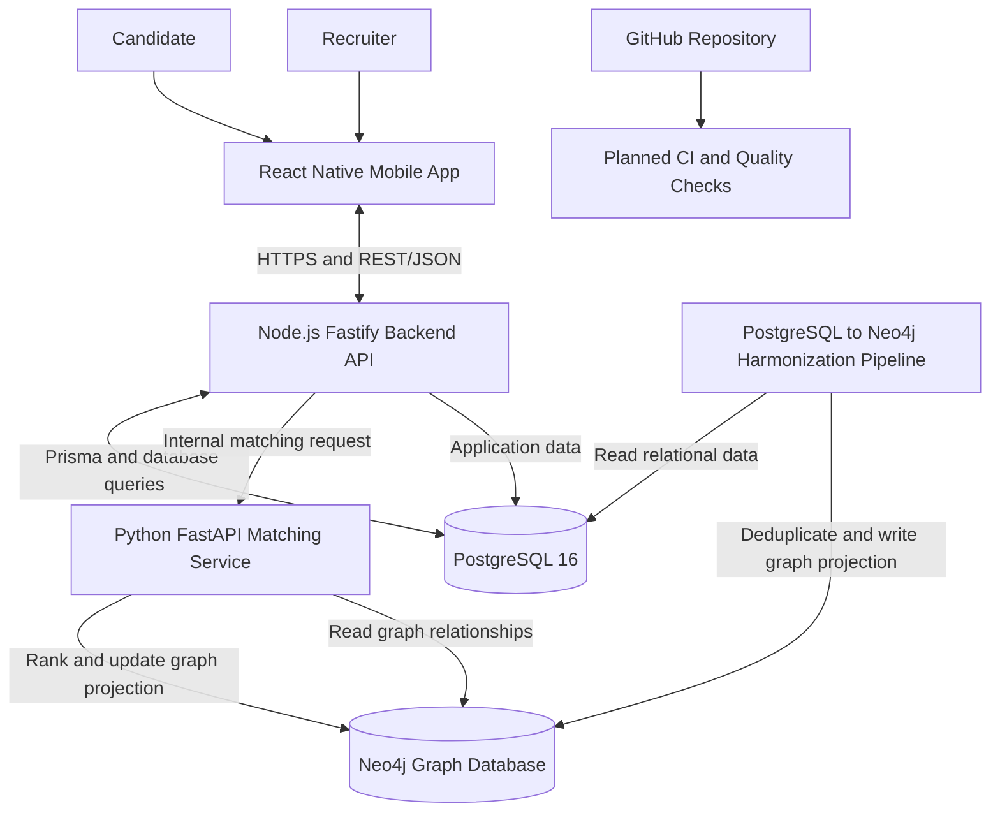
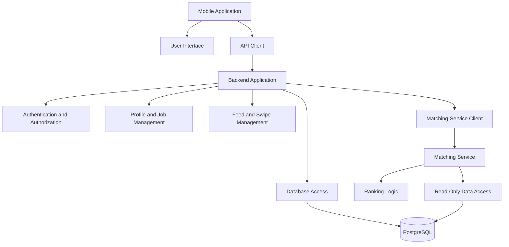
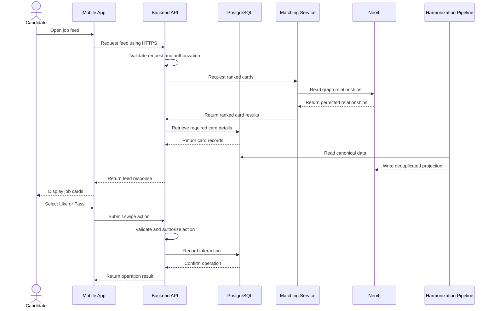
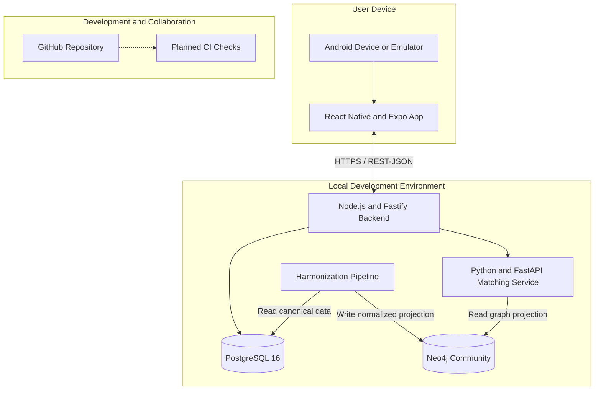

# AdoptAJob — Software Architecture Document

**Project:** AdoptAJob  
**Repository:** [bhsei/26A](https://github.com/bhsei/26A)  
**Course:** Software Engineering  
**Team:** 26A  
**Institution:** Beihang University  
**Documentation Method:** SEI Views and Beyond (V&B)  
**Document Version:** 1.0 
**Authors/Responsible Contributors:** Peter (Shek, Peter Richard Shekidele);
Jean-Baptiste Simon
**Status:** Draft — For Team Review  
**Architecture Documentation:** `docs/design/Architecture_Design.md`

---

## Table of Contents

1. [Documentation Roadmap](#1-documentation-roadmap)
2. [System Overview](#2-system-overview)
3. [Architectural Drivers and Constraints](#3-architectural-drivers-and-constraints)
4. [Architectural Views](#4-architectural-views)
   - [4.1 Module View](#41-module-view-development-structure)
   - [4.2 Component-and-Connector View](#42-component-and-connector-view-runtime-structure)
   - [4.3 Allocation View](#43-allocation-view-deployment-structure)
5. [Key Design Decisions and Rationale](#5-key-design-decisions-and-rationale)
6. [Interfaces](#6-interfaces)
7. [Mapping Between Views](#7-mapping-between-views)
8. [Quality Attribute Scenarios](#8-quality-attribute-scenarios)
9. [Risks and Open Issues](#9-risks-and-open-issues)
10. [Glossary and Acronyms](#10-glossary-and-acronyms)
11. [References](#11-references)
12. [Appendix A — Team Responsibilities](#appendix-a--team-responsibilities)

---

## 1. Documentation Roadmap

### 1.1 Purpose

This document describes the proposed software architecture of AdoptAJob, a mobile-first job-matching platform developed by Team 26A for the Software Engineering course at Beihang University.

The purpose of this document is to explain the system's major components, their responsibilities, their communication mechanisms, deployment structure, architectural decisions, and quality requirements.

It provides a shared technical reference for developers, testers, project coordinators, and course instructors.

### 1.2 Documentation Approach

This document follows the **Software Engineering Institute (SEI) Views and Beyond (V&B) approach**.

The central principle of this approach is to document software architecture using relevant architectural views and supporting information that applies across those views.

Three architectural views are selected for AdoptAJob:

1. **Module View:** describes the static organization of the software into modules and their dependencies.
2. **Component-and-Connector View:** describes the runtime components and how they communicate.
3. **Allocation View:** describes how software components are assigned to devices, execution environments, and deployment infrastructure.

The document also describes architectural drivers, design decisions, interfaces, quality attributes, risks, and open issues.

### 1.3 Intended Audience

- Mobile application developers.
- Backend API and database developers.
- Matching-service developers.
- Requirements and testing team members.
- Project coordinators.
- Course instructors and evaluators.

### 1.4 Document Status and Scope

The repository currently represents an initialization-stage proof of concept. Therefore, this document describes the **proposed architecture and intended implementation**, not a claim that all components are already operational.

Implementation status should be updated as the corresponding components are developed, tested, reviewed, and integrated.

---

## 2. System Overview

### 2.1 System Description

AdoptAJob is a mobile-first professional job-matching platform designed to connect job seekers with suitable employment opportunities through an intuitive, swipe-based interaction model.

The project is inspired by the familiar swipe interaction used in applications such as Tinder, but its purpose is professional recruitment rather than social dating.

Recruiters publish company and job cards. Candidates create profiles, discover opportunities, and express interest by selecting Like or Pass. Recruiters can review interested candidates and accept or decline them.

The system aims to provide a straightforward job-discovery experience while maintaining clear responsibilities between the mobile application, backend services, database, and matching service.

### 2.2 Primary Goals

The main goals of AdoptAJob are:

1. Provide a simple and accessible mobile interface for job discovery.
2. Allow recruiters to publish and manage company and job information.
3. Allow candidates to create and progressively update their professional profiles.
4. Support Like and Pass actions on job cards.
5. Support recruiter review and acceptance or rejection of interested candidates.
6. Provide a matching service that ranks relevant cards using available candidate and job information.
7. Protect accounts and personal information through appropriate authentication, authorization, and data-handling practices.
8. Enable parallel development through clearly defined component responsibilities and interfaces.

### 2.3 Primary Actors

| Actor | Responsibilities | Main Interests |
|---|---|---|
| Candidate | Creates a profile, discovers job cards, and expresses interest. | Usability, relevant opportunities, privacy. |
| Recruiter | Manages company and job cards and reviews interested candidates. | Candidate suitability, efficient recruitment. |
| Development Team | Builds, integrates, tests, and maintains the system. | Clear interfaces, maintainability, manageable scope. |
| Course Instructor | Reviews the design and project deliverables. | Architectural clarity, sound engineering practices, evidence of implementation. |

### 2.4 System Boundaries

The planned system includes:

- A React Native mobile application using Expo and TypeScript.
- A backend API built with Node.js, Fastify, TypeScript, and Prisma.
- A PostgreSQL 16 database.
- A Python-based matching service using FastAPI, Pydantic, and psycopg.
- Local development orchestration using Docker Compose.
- GitHub-based source control and planned automation.

External job-board integrations, payments, a separate web client, video interviews, recruiter analytics dashboards, and external push-notification services are outside the current proof-of-concept scope.

### 2.5 High-Level System Architecture

The following diagram shows the proposed major components and their relationships.

**Figure 1. Proposed high-level system architecture.**

The diagram represents the intended design. The exact interfaces, service startup sequence, security configuration, graph
synchronization cadence and automation remain subject to implementation and
team review.

---

## 3. Architectural Drivers and Constraints

Architectural drivers are the requirements and limitations that have the greatest influence on the system design.

### 3.1 Functional Drivers

The architecture must support the following principal functions:

- Candidate and recruiter accounts.
- Candidate onboarding and profile management.
- Company and job-card management.
- Candidate feed and card-ranking requests.
- Like and Pass actions.
- Recruiter review of interested candidates.
- Acceptance or rejection of interested candidates.

A match is created under the current project assumption when a candidate likes a card and the recruiter subsequently accepts the candidate.

Only candidates use the swipe-style discovery flow. Recruiter-side candidate swiping is outside the current scope.

### 3.2 Quality Attribute Priorities

| Priority | Quality Attribute | Architectural Implication |
|---|---|---|
| High | Security and privacy | Authentication, authorization, protected credentials, careful logging, and controlled database access. |
| High | Usability | A clear mobile interface and accessible alternatives to swipe gestures. |
| High | Maintainability | Separate mobile, backend, and matching-service responsibilities. |
| High | Reliability | Validate inputs, handle failures clearly, and test important workflows. |
| Medium | Performance | Avoid unnecessary requests and use efficient database access and ranking operations. |
| Medium | Testability | Define clear interfaces and keep important components independently testable. |
| Medium | Extensibility | Allow matching behavior to improve without redesigning the entire application. |

These priorities reflect the intended project design and should be validated against the final requirements.

### 3.3 Technical Constraints

The architecture follows the technology plan currently recorded in the repository:

- **Mobile:** React Native, Expo, and TypeScript.
- **Backend:** Node.js, Fastify, TypeScript, and Prisma.
- **Database:** PostgreSQL 16.
- **Matching service:** Python, FastAPI, Pydantic, and psycopg.
- **Local orchestration:** Docker Compose.
- **Source control:** Git and GitHub.

The backend is the designated owner of PostgreSQL schema changes and database
migrations. PostgreSQL remains the relational source of truth. The matching
service consumes the harmonized Neo4j projection, while the Alba/Levis
pipeline is responsible for transforming approved relational data into that
projection without changing the PostgreSQL schema.

The proof of concept must remain manageable within the academic schedule and available team resources.

### 3.4 Project Constraints

- The initial application is Android-first.
- The current target is a local proof of concept rather than a production service.
- Development should use synthetic test data.
- The team must follow the repository's contribution and review workflow.
- Credentials and secrets must not be committed to source control.
- The architecture must remain consistent with the approved requirements and implementation plan.

---

## 4. Architectural Views

This section describes AdoptAJob through the three views selected using the SEI Views and Beyond approach.

## 4.1 Module View — Development Structure

### 4.1.1 Purpose

The Module View describes how the software is divided into implementation units and how responsibilities are assigned.

It helps developers understand which modules they are responsible for and how changes in one module may affect another.

### 4.1.2 Proposed Module Organization

**Figure 2. Proposed module organization.**

### 4.1.3 Module Responsibilities

| Module | Main Responsibility |
|---|---|
| Mobile User Interface | Displays candidate and recruiter screens, forms, job cards, and interaction controls. |
| Mobile API Client | Sends requests to the backend and processes responses. |
| Authentication and Authorization | Handles identity verification and permission checks through the backend. |
| Profile and Job Management | Handles candidate profiles, recruiter information, companies, and job cards. |
| Feed and Swipe Management | Handles candidate feeds, Like and Pass actions, and related state changes. |
| Matching-Service Client | Requests ranking results from the matching service through an internal interface. |
| Backend Database Access | Uses Prisma to manage application data in PostgreSQL. |
| Matching Logic | Calculates and orders candidate-job relevance using the selected and evaluated ranking strategy. |
| Graph Projection Pipeline | Harmonizes, deduplicates and projects approved PostgreSQL data into Neo4j. |
| Graph Data Access | Reads the approved Neo4j projection without making Neo4j the account-data source of truth. |

These are logical responsibilities. They do not require every responsibility to become a separate deployed service.

### 4.1.4 Dependency Rules

The proposed module structure follows these rules:

1. The mobile application communicates with the backend through the defined API rather than accessing PostgreSQL directly.
2. The backend validates incoming requests and checks authorization before performing protected operations.
3. The backend owns database schema migrations.
4. The matching service does not independently modify the PostgreSQL schema.
5. PostgreSQL is the source of truth for relational application data.
6. The harmonization pipeline is the only path that writes the approved graph projection to Neo4j.
7. Matching logic should remain sufficiently separate from the mobile interface so that ranking behavior can be changed without redesigning the user interface.
8. Modules should expose clear interfaces and avoid unnecessary dependencies on internal implementation details.

These rules reduce accidental coupling and make parallel development easier.

## 4.2 Component-and-Connector View — Runtime Structure

### 4.2.1 Purpose

The Component-and-Connector (C&C) View describes the major components that operate while the system is running and the communication paths between them.

Unlike the Module View, which explains how code is organized, this view focuses on runtime interactions.

### 4.2.2 Runtime Components

**1. React Native Mobile Application**

The mobile application provides the interface used by candidates and recruiters. It collects user input, displays cards and profiles, and communicates with the backend.

**2. Backend API**

The backend receives mobile requests, validates data, checks permissions, performs application operations, accesses PostgreSQL, and coordinates matching requests.

**3. PostgreSQL Database**

PostgreSQL stores persistent application data, including account records, candidate profiles, company information, job cards, and interaction records as defined by the approved data model.

**4. Python Matching Service**

The matching service receives ranking requests and returns ordered results
according to the selected matching strategy. It researches and evaluates
candidate algorithms, executes the harmonization boundary that updates the
Neo4j projection from approved data, reads that graph projection, and remains
an internal service rather than a public mobile-facing API.

**5. Neo4j Graph Database**

Neo4j stores the approved graph projection of jobs, companies, candidates and
their permitted relationships. It is not the source of truth for accounts or
other relational application data.

**6. Data Harmonization Pipeline**

The pipeline, designed by Alba and Levis and executed by the matching service,
reads the canonical PostgreSQL representation, deduplicates and normalizes
records, then writes the approved projection to Neo4j. Its cadence, freshness
target and retry behavior must be defined before graph ranking is integrated.

**7. Local Development Environment**

Docker Compose is intended to coordinate the local development services and database. The exact service configuration will be documented when the implementation is available.

### 4.2.3 Runtime Interaction Diagram

**Figure 3. Proposed runtime sequence for feed retrieval and swipe actions.**

The diagram illustrates the intended interaction flow. Exact API routes, request formats, error responses, and transaction behavior must be finalized during implementation.

### 4.2.4 Connectors

| Connector | Purpose | Planned Mechanism |
|---|---|---|
| Mobile App ↔ Backend | Authentication, profiles, feed requests, and swipe actions. | HTTPS with REST/JSON. |
| Backend ↔ PostgreSQL | Persistent application data and transactional operations. | Prisma and PostgreSQL access. |
| Backend ↔ Matching Service | Internal ranking requests and results. | Internal HTTP interface, to be finalized. |
| Harmonization Pipeline ↔ PostgreSQL | Read canonical application data for normalization and graph projection. | Approved PostgreSQL access boundary; no schema changes. |
| Matching Service ↔ Neo4j | Read graph relationships needed for ranking. | Official Neo4j driver with minimized graph data. |
| Developers ↔ Repository | Source control, reviews, and collaboration. | Git and GitHub. |

### 4.2.5 Runtime Security Boundaries

The architecture should enforce the following security boundaries:

- The mobile application must not contain database credentials.
- Protected backend operations must verify authentication and authorization.
- The matching service should not be exposed as a public endpoint unless the team explicitly approves and secures that design.
- Database permissions should follow least privilege.
- Secrets should be supplied through local environment configuration or an appropriate secret-management mechanism.
- Logs should not contain passwords, authentication tokens, or unnecessary personal information.
- Errors returned to clients should avoid exposing internal implementation details.

The exact authentication method, session or token lifecycle, and secret-management configuration remain design decisions to finalize.

## 4.3 Allocation View — Deployment Structure

### 4.3.1 Purpose

The Allocation View describes where the software components are expected to execute.

It connects the logical architecture to the devices, runtime environments, and development infrastructure that support it.

### 4.3.2 Proposed Allocation

| Software Element | Intended Environment | Status |
|---|---|---|
| React Native Mobile Application | Android device or emulator, using Expo during development. | Planned |
| Backend API | Node.js runtime in the local development environment. | Planned |
| PostgreSQL Database | PostgreSQL 16 service managed through the local development setup. | Foundation present; application integration planned |
| Neo4j Graph Database | Neo4j Community graph projection for matching relationships. | Planned |
| Python Matching Service | Python runtime using FastAPI. | Planned |
| PostgreSQL-to-Neo4j Harmonization Pipeline | Local pipeline for normalization, deduplication and graph projection. | Planned |
| Docker Compose | Local orchestration of configured services. | Planned |
| Git Repository | GitHub repository `bhsei/26A`. | Available |
| Automated Build and Test Checks | GitHub Actions or the team-approved CI configuration. | Planned; verify repository configuration |

### 4.3.3 Proposed Deployment Diagram

**Figure 4. Proposed allocation for local development.**

This diagram describes the intended local proof-of-concept setup. It does not imply that public cloud hosting or remote deployment has already been configured.

### 4.3.4 Deployment Considerations

- The first objective is to make the proof of concept run locally with documented setup instructions.
- Docker Compose should be used to coordinate the services included in the approved local configuration.
- The mobile application must be configured to reach the correct backend address for the selected emulator or physical device.
- The team should document required environment variables without committing real secrets.
- Deployment to an external server should be considered only after the local workflow, security configuration, and tests are sufficiently stable.

---

## 5. Key Design Decisions and Rationale

The following table records the proposed architectural decisions and the reasons for them.

| Decision | Rationale | Alternative Considered |
|---|---|---|
| React Native, Expo, and TypeScript for mobile | Supports the Android-first mobile experience and a shared TypeScript development workflow. | Native Android-only implementation or another cross-platform framework. |
| Node.js and Fastify for the backend | Provides a structured HTTP API and uses TypeScript consistently with the mobile development ecosystem. | Other backend frameworks. |
| REST/JSON for mobile communication | Provides a familiar and straightforward request-response interface. | GraphQL or gRPC. |
| PostgreSQL 16 for persistent storage | Provides relational data storage and transactional operations for accounts, profiles, jobs, and interactions. | Other database technologies. |
| A separate Python matching service | Separates ranking logic from general application operations and allows the matching component to evolve independently. | Implementing all matching logic directly in the backend. |
| Backend-owned database migrations | Maintains a single owner for schema changes and reduces migration conflicts. | Allowing multiple services to independently manage the schema. |
| PostgreSQL as relational source of truth | Keeps account and application writes transactional and auditable. | Treating the graph as a second system of record. |
| Neo4j graph projection | Represents candidate, company and job relationships for the selected matching algorithm. | Keeping all relationship queries in relational joins. |
| Alba/Levis harmonization pipeline | Deduplicates and normalizes data before it enters the graph. | Independently transforming data in multiple services. |
| Docker Compose for local orchestration | Helps developers run the configured services in a consistent local environment. | Manual startup and configuration of each service. |
| GitHub for collaboration | Provides version control, review workflows, and a shared project history. | Uncoordinated local development without a shared repository. |

These decisions describe the repository's current planned direction. They should be updated when the team formally approves a different design.

### 5.1 Decision Management

For every significant architectural change, the team should record:

- The problem or requirement being addressed.
- The alternatives considered.
- The selected option.
- The reasons for selecting it.
- The effects on security, performance, maintainability, and implementation effort.
- The date and review status of the decision.

The team should update this document whenever an approved decision changes the architecture.

---

## 6. Interfaces

### 6.1 Mobile-to-Backend Interface

The mobile application communicates with the backend through REST/JSON over HTTPS.

The planned interface covers:

- Account registration and login.
- Authentication and session management.
- Candidate profile management.
- Recruiter and company information.
- Job-card management.
- Candidate feed retrieval.
- Like and Pass actions.
- Recruiter review and acceptance or rejection of interested candidates.

Exact routes, HTTP methods, request schemas, response schemas, and status codes should be documented in the project's OpenAPI contract once agreed.

### 6.2 Backend-to-Database Interface

The backend uses Prisma to access PostgreSQL.

The backend is responsible for:

- Managing the application data model.
- Validating operations before persistent changes.
- Enforcing appropriate authorization rules.
- Managing database schema migrations.
- Maintaining transactional consistency for relevant operations.

Database tables, indexes, constraints, and relationships should be documented alongside the approved schema and migration files.

### 6.3 Backend-to-Matching-Service Interface

The backend is expected to call the Python matching service through an internal HTTP interface.

**Proposed input:**

- The identifier or context of the requesting candidate.
- The information needed to select relevant job cards.
- Any agreed pagination or ranking parameters.

**Proposed output:**

- An ordered list of relevant card identifiers.
- Ranking scores or related metadata where required by the approved contract.

The exact payload, endpoint, error format, timeout behavior, and authentication between services remain to be defined.

### 6.4 Matching-Service-to-Graph Interface

The matching service reads the approved Neo4j graph projection using the official
Neo4j driver. It must not treat Neo4j as the source of truth for account data.
The graph contains only the fields and relationships approved by the data
minimisation rules.

### 6.5 PostgreSQL-to-Neo4j Harmonization Interface

The harmonization pipeline reads canonical PostgreSQL data, applies the agreed
normalization and deduplication rules, and writes the graph projection to
Neo4j. Alba owns the relational source and Levis owns the graph model; they
jointly define the canonical mapping and consistency checks.

The pipeline must define:

- its trigger or schedule;
- freshness and retry guarantees;
- idempotency and deletion behavior;
- the graph fields and relationships it may write;
- a reconciliation check against PostgreSQL.

### 6.6 Interface Documentation Requirements

Before final integration, each interface should define:

1. Purpose and ownership.
2. Input and output formats.
3. Validation rules.
4. Authentication and authorization requirements.
5. Expected success and error responses.
6. Timeout and failure-handling behavior.
7. Tests that demonstrate correct operation.

The OpenAPI contract should serve as the agreed reference for the backend's public REST API.

---

## 7. Mapping Between Views

The three architectural views describe the same system from different perspectives and must remain consistent.

### 7.1 View Relationships

| Module View Element | Runtime Component | Allocation Target |
|---|---|---|
| Mobile UI and API client | React Native mobile application | Android device or emulator |
| Authentication and application modules | Backend API components | Node.js runtime |
| Backend data-access module | Database access through Prisma | Backend runtime and PostgreSQL service |
| Matching logic module | Python matching service | Python/FastAPI runtime |
| Matching data-access module | Matching-service database access | Matching-service runtime and PostgreSQL service |
| Repository and automation configuration | GitHub collaboration and planned CI checks | GitHub-hosted repository and automation environment |

### 7.2 Consistency Rules

The following rules apply when architecture changes are made:

- Adding a major module should trigger a review of the Module View and its runtime responsibilities.
- Adding or removing a runtime component should trigger a review of the C&C View and its interfaces.
- Moving a component to another execution environment should trigger an update to the Allocation View.
- Changing an interface must be reflected in the relevant module responsibilities, runtime connectors, and API documentation.
- Security-sensitive changes must be reviewed across all affected views.
- The diagrams, source code, configuration files, and documentation should describe the same agreed design.

Maintaining these relationships reduces confusion during integration and review.

---

## 8. Quality Attribute Scenarios

Quality attribute scenarios describe how the system should behave under specified conditions. The targets below are proposed acceptance goals and must be validated through implementation and testing.

### 8.1 Security

**Scenario:** An unauthenticated user attempts to access a protected profile or swipe operation.

**Expected response:** The backend rejects the request without exposing protected information or modifying application data.

**Verification:** Automated tests should verify rejection of missing or invalid authentication and confirm that unauthorized operations do not change persistent data.

### 8.2 Usability and Accessibility

**Scenario:** A candidate wants to express interest in a job but cannot or does not want to use a swipe gesture.

**Expected response:** The application provides accessible Like and Pass buttons as alternatives.

**Verification:** Manual and automated UI checks should confirm that both actions are available, clearly labelled, and usable on supported Android devices.

### 8.3 Performance

**Scenario:** A candidate requests the job feed under the expected local proof-of-concept workload.

**Expected response:** The system returns relevant results within a response-time target agreed by the team.

**Verification:** Measure request latency and error rates using a documented synthetic dataset and repeatable test conditions.

**Note:** A numerical latency target should be agreed and tested before being treated as a requirement. No performance result is claimed in this draft.

### 8.4 Reliability

**Scenario:** The matching service is temporarily unavailable when the backend requests ranked cards.

**Expected response:** The backend handles the failure predictably, returns an appropriate error or agreed fallback response, and does not expose internal service details.

**Verification:** Integration tests should simulate a matching-service failure and confirm the backend's behavior.

### 8.5 Maintainability

**Scenario:** The team changes the ranking logic without changing the mobile interface.

**Expected response:** The matching implementation can be updated behind its agreed interface without requiring unrelated changes to the mobile application.

**Verification:** Component-level tests and integration tests should confirm that the interface contract remains stable.

### 8.6 Privacy

**Scenario:** A developer inspects application logs during troubleshooting.

**Expected response:** Logs contain useful diagnostic information without exposing passwords, access tokens, CV contents, or unnecessary personal data.

**Verification:** Review log output using synthetic test accounts and representative requests.

---

## 9. Risks and Open Issues

| Risk or Open Issue | Potential Impact | Proposed Mitigation |
|---|---|---|
| Architecture and implementation become inconsistent | Integration errors and inaccurate documentation. | Review the architecture after major design or implementation changes. |
| Matching-service interface is not finalized | Backend and matching-service integration delays. | Agree on the interface contract before completing integration. |
| Database migration ownership becomes unclear | Conflicting schema changes and failed development environments. | Keep PostgreSQL schema migrations under backend ownership. |
| Harmonization pipeline receives excessive database permissions | Accidental relational data modification or increased security risk. | Grant only the approved PostgreSQL read boundary and verify it. |
| Authentication and token behavior remain undecided | Inconsistent security behavior across clients and services. | Agree on the authentication and session design and document it. |
| Local configuration differs between developers | Services fail to start or communicate correctly. | Document prerequisites, environment variables, and local setup steps. |
| Scope expands beyond the proof of concept | Incomplete core features and missed academic deadlines. | Prioritize the agreed MVP and defer out-of-scope features. |
| Testing and automation are incomplete | Regressions may remain undetected. | Add component, integration, and security tests as services become available. |
| Sensitive information is committed to GitHub | Unauthorized disclosure of credentials or personal information. | Use `.env.example`, ignore local secret files, and use synthetic test data. |

### 9.1 Open Decisions

The following items require confirmation by the team:

1. Exact authentication and token/session lifecycle.
2. Final OpenAPI routes and request/response schemas.
3. Internal matching-service endpoint and error-handling contract.
4. Database schema, constraints, and indexing strategy.
5. Matching algorithm and ranking inputs.
6. Required automated test coverage and CI quality gates.
7. The final data-retention and privacy requirements applicable to the project.
8. Deployment arrangements beyond the local proof of concept.

These decisions should be recorded and updated as they are resolved.

---

## 10. Glossary and Acronyms

| Term | Definition |
|---|---|
| AdoptAJob | The professional job-matching application developed by Team 26A. |
| API | Application Programming Interface; a defined way for software components to communicate. |
| C&C View | Component-and-Connector View; describes runtime components and their interactions. |
| CI | Continuous Integration; automated checks performed when code changes are submitted. |
| Expo | A development platform and toolchain for React Native applications. |
| FastAPI | A Python framework for building HTTP APIs. |
| Fastify | A Node.js framework for building HTTP APIs. |
| HTTPS | HTTP protected by TLS encryption for communication in transit. |
| Like | A candidate action expressing interest in a job card. |
| Matching Service | The component that ranks or selects relevant cards using the agreed matching logic. |
| Module View | A view describing the static organization of software modules and their dependencies. |
| OpenAPI | A specification for describing HTTP APIs. |
| PostgreSQL | A relational database management system. |
| Prisma | A database toolkit and ORM used by the backend. |
| REST | An architectural style commonly used for HTTP APIs. |
| V&B | Views and Beyond; the SEI approach to documenting software architecture. |
| Allocation View | A view describing how software elements are assigned to execution environments. |

---

## 11. References

1. Clements, P., Bachmann, F., Bass, L., Garlan, D., Ivers, J., Little, R., Merson, P., Nord, R., and Stafford, J. *Documenting Software Architectures: Views and Beyond*, 2nd edition. Addison-Wesley, 2010.

2. Carnegie Mellon University Software Engineering Institute. *Views and Beyond Software Architecture Documentation Resources*. Refer to the official SEI materials and the course-provided documentation template.

3. Team 26A. *AdoptAJob Repository and Project Materials*. [GitHub repository](https://github.com/bhsei/26A).

4. Team 26A. *Software Requirements Specification (SRS)*. Refer to the requirements document maintained in the repository.

5. Fastify Documentation. [https://fastify.dev/](https://fastify.dev/).

6. React Native Documentation. [https://reactnative.dev/](https://reactnative.dev/).

7. PostgreSQL Documentation. [https://www.postgresql.org/docs/](https://www.postgresql.org/docs/).

8. FastAPI Documentation. [https://fastapi.tiangolo.com/](https://fastapi.tiangolo.com/).

The technical documentation above identifies the technologies planned for the project; it does not claim that every feature or configuration has already been implemented.

---

## Appendix A — Team Responsibilities

The repository currently records the following initial responsibilities.

| Team Member | Initial Responsibility |
|---|---|
| Alba (Qiu Runxiao) | PostgreSQL schema, Prisma migrations and relational data quality. |
| Nils Förg | Matching research, algorithm evaluation, Python matching service and traceability. |
| Peter (Shek, Peter Richard Shekidele) | Mobile design, React Native/Expo implementation and Android validation. |
| Jean-Baptiste Simon | Backend API, PostgreSQL integration, matching integration and architecture. |
| Levis Bangoh | Neo4j graph database and the PostgreSQL-to-Neo4j harmonization pipeline with Alba. |

Responsibilities may be refined by team agreement. Architecture decisions and implementation ownership should be coordinated to ensure that the document accurately reflects the work being delivered.

---

## Document Maintenance

This document is maintained as part of the AdoptAJob source repository.

**Review triggers:**

- A significant architectural decision is approved.
- A major component or interface is added, removed, or changed.
- A deployment assumption changes.
- A security or privacy requirement changes.
- Testing identifies a mismatch between the documented design and actual behavior.

Before the final course submission, the team should verify that the architecture, diagrams, OpenAPI contract, requirements, source code, and test results are consistent.

**End of document.**
