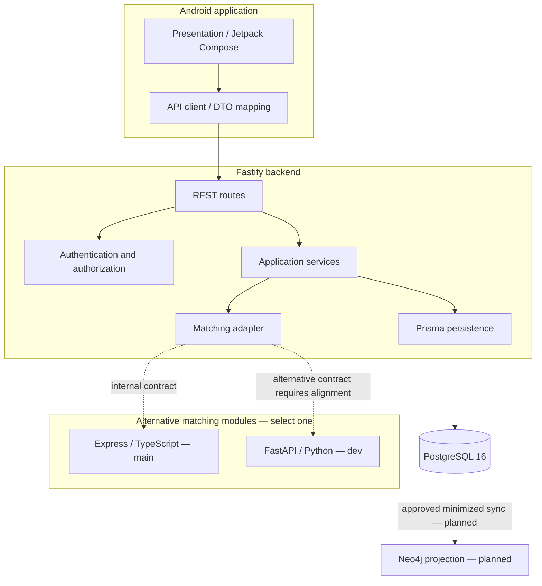
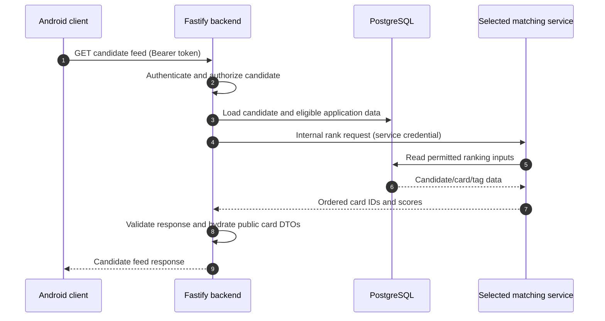
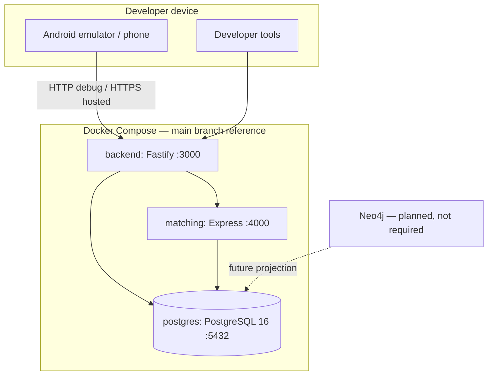
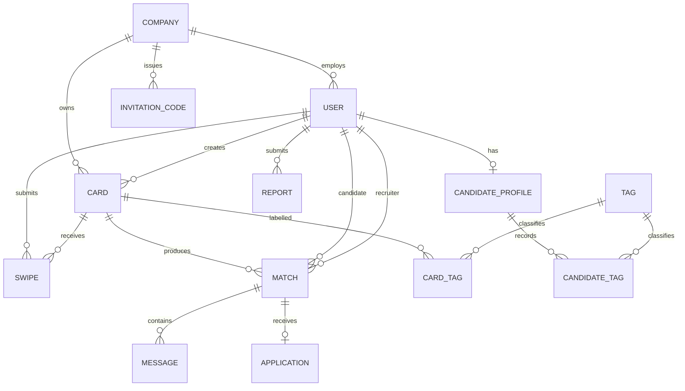
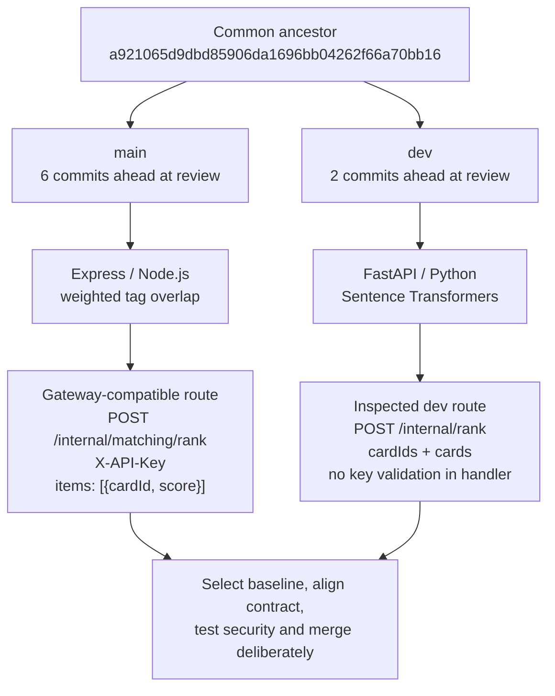

# AdoptAJob
## Software Architecture Document (SAD)

**Document ID:** 26A-SAD-001  
**Revision:** 1.6 — Repository-reconciled technical review draft  
**Date:** 26 November 2026  
**Project:** AdoptAJob, Team 26A, Beihang University  
**Repository:** https://github.com/bhsei/26A  
**Document owner:** Peter Richard Shekidele  
**Status:** Draft for team review — not approved for final submission  
**Architecture reference branch:** `main`  
**Alternative branch reviewed:** `dev`

> **Important status statement:** This document describes the repository state observed on 26 November 2026. It does not claim that the application has passed a complete build, deployment, migration, integration-test or end-to-end demonstration. Source presence is not proof of successful execution. Where the repository contains contradictory implementations or documentation, the contradiction is recorded rather than silently resolved.

---

## Document control

| Item | Value |
|---|---|
| Document ID | 26A-SAD-001 |
| Revision | 1.6 |
| Supersedes | Revision 1.5 draft |
| Review status | Draft for technical review |
| Primary implementation reference | `main` |
| Alternative implementation reference | `dev` |
| Common branch ancestor | `a921065d9dbd85906da1696bb04262f66a70bb16` |
| Main branch comparison state | Six commits ahead of common ancestor at review time |
| Dev branch comparison state | Two commits ahead of common ancestor at review time |
| OpenAPI version observed | `1.0.0` |
| PostgreSQL schema authority | Fastify backend Prisma schema and migrations |
| Graph database | Neo4j is planned; not a required operational dependency |
| Final immutable release SHA | **To be recorded after team selects and verifies the release commit** |

Branch names are mutable. The comparison state above is a point-in-time observation, not a permanent property. Before formal submission, replace the branch references with the full SHA of the exact reviewed commit and re-check all referenced files.

- [Repository](https://github.com/bhsei/26A)
- [Main vs. dev comparison](https://github.com/bhsei/26A/compare/main...dev)
- [Current SAD file in repository](https://github.com/bhsei/26A/blob/main/docs/design/New%20SAD%20v1.0.md)

## Revision history

| Revision | Summary |
|---|---|
| 1.0–1.3 | Earlier architecture drafts |
| 1.4 | Initial branch reconciliation and architecture-view corrections |
| 1.5 | Added evidence vocabulary, interface crosswalk, integration register and acceptance gates |
| 1.6 | Corrected SEI viewtype classification; corrected branch comparison; added recruiter-decision defect; clarified provisional ranker recommendation; added API boundary catalogue; expanded data dictionary; recorded root README drift and unresolved execution evidence |

## Table of contents

- [1. Documentation roadmap](#1-documentation-roadmap)
  - [1.1 Purpose and scope](#11-purpose-and-scope)
  - [1.2 Stakeholders and responsibilities](#12-stakeholders-and-responsibilities)
  - [1.3 Architecture description approach](#13-architecture-description-approach)
  - [1.4 Evidence and diagram conventions](#14-evidence-and-diagram-conventions)
  - [1.5 Related artifacts and authority](#15-related-artifacts-and-authority)
  - [1.6 Change and review process](#16-change-and-review-process)
- [2. Architecture background](#2-architecture-background)
  - [2.1 Product context](#21-product-context)
  - [2.2 Architectural drivers and constraints](#22-architectural-drivers-and-constraints)
  - [2.3 Architecture decisions and alternatives](#23-architecture-decisions-and-alternatives)
  - [2.4 Quality attribute scenarios](#24-quality-attribute-scenarios)
  - [2.5 Reuse and product-line considerations](#25-reuse-and-product-line-considerations)
- [3. Architecture views](#3-architecture-views)
  - [3.1 Module view](#31-module-view)
  - [3.2 Component-and-connector view](#32-component-and-connector-view)
  - [3.3 Allocation view](#33-allocation-view)
  - [3.4 Data model style](#34-data-model-style)
- [4. Relations among views and repository reconciliation](#4-relations-among-views-and-repository-reconciliation)
  - [4.1 Branch reconciliation](#41-branch-reconciliation)
  - [4.2 Cross-view consistency rules](#42-cross-view-consistency-rules)
  - [4.3 Integration and defect register](#43-integration-and-defect-register)
  - [4.4 API boundary catalogue](#44-api-boundary-catalogue)
  - [4.5 Root README and documentation drift](#45-root-readme-and-documentation-drift)
- [5. Referenced materials](#5-referenced-materials)
- [6. Repository directory](#6-repository-directory)
- [7. Sample figures and tables](#7-sample-figures-and-tables)
- [Appendix A. Review findings and acceptance gates](#appendix-a-review-findings-and-acceptance-gates)
- [Appendix B. Data dictionary](#appendix-b-data-dictionary)
- [Appendix C. Review and release checklist](#appendix-c-review-and-release-checklist)

# 1. Documentation roadmap

This Software Architecture Document describes AdoptAJob using the Software Engineering Institute (SEI) *Views and Beyond* approach. It documents the system's significant structures, interfaces, constraints, design decisions, implementation alternatives and known risks. It distinguishes the architecture intended by the team from what is actually present in a named repository branch and from what has been executed and verified.

The SAD is a technical communication and governance artifact. It is not a substitute for the Software Requirements Specification (SRS), API contract, OpenAPI definition, database migrations, source code or test evidence.

## 1.1 Purpose and scope

AdoptAJob is an Android-first recruitment proof of concept. Candidates create or progressively complete a profile, browse company and job cards, and express interest or pass. Recruiters manage cards and review candidates who have expressed interest in eligible job cards. A recruiter acceptance creates a match according to the product rules.

The architecture boundary includes:

1. Native Android application using Kotlin and Jetpack Compose.
2. Node.js/TypeScript Fastify backend, which is the public API boundary.
3. PostgreSQL 16 relational database, with Prisma schema and migrations owned by the backend.
4. A separate matching service. The `main` branch contains a Node.js/TypeScript Express implementation; `dev` contains a Python/FastAPI implementation. These are competing branch implementations, not two simultaneously deployed rankers.
5. Docker Compose for local development orchestration.
6. Neo4j as a proposed derived graph projection. It is not required for the baseline feed and is not treated as a second canonical data store.

The following are outside the current documented scope unless explicitly added to the approved SRS: production hosting, a browser-based client, payment processing, external job-board integrations, and third-party recruitment integrations.

### Evidence vocabulary

| Label | Meaning |
|---|---|
| Required | Stated in an approved requirement or agreed product rule |
| Designed | Described in a design artifact or this SAD |
| Present | Source, schema, configuration or documentation exists on the named branch |
| Tested | A test exists or has been executed; passing status must be separately reported |
| Build-verified | A recorded build passed for the stated full commit SHA |
| Demonstrated | A recorded end-to-end workflow was successfully demonstrated |
| Planned | Intended future capability without sufficient implementation evidence |
| Divergent | Different branches contain incompatible implementations or contracts |
| Unverified | Not executed or independently validated in this review |
| Defect | Observed implementation or documentation behavior conflicts with an agreed requirement or architecture rule |

A feature must not be described as tested, build-verified or demonstrated without a test result, build log or reproducible demonstration record tied to a commit SHA.

## 1.2 Stakeholders and responsibilities

| Stakeholder | Primary concerns | Relevant architecture views |
|---|---|---|
| Candidate | Onboarding, relevant feed, accessible interactions, privacy and account control | Component-and-Connector; Data |
| Recruiter | Company-scoped access, card management, candidate review and match handling | Component-and-Connector; Data |
| Acquirer / course sponsor | Scope, schedule, deliverable quality and acceptance evidence | All |
| Course evaluator | SRS traceability, architecture consistency, reproducibility and technical rationale | All |
| Project team / maintainers | Component ownership, interfaces, change impact, tests and integration | Module; Allocation |
| Security/privacy reviewer | Authentication, authorization, minimization, retention, deletion and ranking fairness | Component-and-Connector; Data |
| QA / peer reviewer | Contract compatibility, error handling, test coverage and regression risk | Component-and-Connector; Allocation |

### Team responsibility mapping

| Member | Recorded responsibility |
|---|---|
| Peter Richard Shekidele | Android client and SAD coordination |
| Jean-Baptiste Simon | Fastify backend, API gateway and integration |
| Nils Förg | Matching algorithm and matching service |
| Alba (Qiu Runxiao) | PostgreSQL schema, Prisma and relational data quality |
| Levis Bangoh | Neo4j design and data harmonization jointly with Alba |

This table records the team's stated ownership. It does not certify that a component is complete or approved. Each owner must verify their section against the selected release commit.

## 1.3 Architecture description approach

This SAD uses the three SEI *Views and Beyond* viewtypes:

1. **Module viewtype** — describes the static organization of the software into modules, responsibilities, interfaces and dependencies. A data model can be documented as a style within this viewtype.
2. **Component-and-Connector viewtype** — describes runtime components, connectors, communication paths, protocols, interactions and trust boundaries.
3. **Allocation viewtype** — describes how software elements are mapped to hardware, execution environments, processes, containers and development/deployment environments.

The relational entity model is documented in §3.4 as a **data model style**, not as a fourth SEI viewtype. This distinction corrects the previous revision's classification error.

## 1.4 Evidence and diagram conventions

Each view identifies its purpose, elements, relationships, interfaces, constraints, rationale, variability and limitations.

Diagram conventions:

- Solid edges represent relationships present in the named source or configuration.
- Dashed edges represent planned, optional, alternative or not-yet-integrated relationships.
- Branch-specific subgraphs represent alternatives, not simultaneous runtime processes.
- A diagram describes architecture; it does not prove that a build or runtime test passed.
- Captions identify the branch or status represented.
- A component is not considered integrated merely because its source directory exists.

## 1.5 Related artifacts and authority

| Artifact | Authority / purpose | Reconciliation rule |
|---|---|---|
| `docs/requirements/SRS.md` | Normative product requirements | Defines required behavior, subject to approved changes |
| `docs/design/API_CONTRACT.md` | Intended public API v1 contract | Must agree with implemented handlers and Android DTOs |
| `docs/design/openapi.yaml` | Machine-readable API description; `info.version` observed as `1.0.0` | Must match the implemented public API |
| `docs/design/database.md` | Relational model and proposed Neo4j projection | Must agree with Prisma schema and migration chain |
| `src/backend/prisma/schema.prisma` | Physical relational schema declaration | Backend is the sole schema/migration owner |
| `src/backend/prisma/migrations/` | Database change history | Migration chain, not schema text alone, establishes deployable database state |
| `src/backend/` | Fastify API and Prisma implementation | Runtime claims require tests/build evidence |
| `src/matching-service/` | Branch-specific ranking implementation | Ranker contract must match the gateway |
| `src/mobile/` | Native Android client and API configuration | Must agree with API contract and server DTOs |
| `docker-compose.yml` and Dockerfiles | Local runtime allocation | Image contents and healthchecks must be compatible |
| Root `README.md` | Repository onboarding and project summary | Must be updated to match the current architecture; it currently contains stale technology claims |

When artifacts disagree, the disagreement is recorded in §4.3 or §4.5. A design document does not override contradictory source evidence, and source presence does not prove runtime correctness.

## 1.6 Change and review process

1. Open a GitHub issue titled `SAD review: <section or artifact>`.
2. Include the affected section, figure or table; branch and full SHA; observed behavior; expected behavior; and supporting source path, line range or test output.
3. Classify the issue as editorial, architecture decision, interface/schema, implementation status, security/privacy, deployment or documentation drift.
4. Assign the relevant component owner and an independent reviewer.
5. For implementation changes, update source, schema, contract or tests first; then update the SAD and record the commit.
6. Reviewers record `Approved`, `Changes requested` or `Rejected`. Deferred issues remain visible in the defect register.
7. Close a defect only when it is corrected and verified, or when the team explicitly accepts it as a documented limitation with an owner and target date.

Never include passwords, tokens, real CVs or candidate personal data in issues. Suspected credential exposure must be reported privately, credentials rotated, and a sanitized issue created after containment.

# 2. Architecture background

## 2.1 Product context

The product uses a swipe-oriented interaction to make job discovery approachable. It supports candidate and recruiter roles, company-level authorization, card publication, candidate interest, recruiter decisions and match creation while protecting personal information.

The principal architecture risk is repository divergence. `main` and `dev` contain different matching implementations and different integration contracts. The current SAD therefore treats `main` as the primary reference for the present document and `dev` as an alternative implementation requiring a deliberate selection and integration decision.

## 2.2 Architectural drivers and constraints

| Driver or constraint | Architectural implication |
|---|---|
| Android-first product | Native Kotlin/Jetpack Compose client; not React Native/Expo |
| Candidate and recruiter roles | Server-side role checks and company-scoped authorization |
| Relevant candidate feed | Hard eligibility filters before ranking; fallback behavior when ranking is unavailable |
| Data integrity | PostgreSQL transactions, constraints and backend-owned migrations |
| Privacy and fairness | Minimize personal data; do not use protected attributes or photos as ranking inputs |
| Modifiability | Keep the matching engine behind an internal service boundary |
| Local proof of concept | Reproducible Docker Compose setup and configurable Android API base URL |
| Branch divergence | Pin evidence to branch and commit; do not merge architectural alternatives in diagrams |
| Future graph analysis | Neo4j remains optional and derived; PostgreSQL remains canonical |
| Recruiter workflow correctness | Decision ownership must be consistent with the number of recruiters allowed to decide |

## 2.3 Architecture decisions and alternatives

| ID | Decision / status | Rationale and alternatives |
|---|---|---|
| AD-01 | Native Android/Kotlin/Jetpack Compose is the mobile architecture baseline | Matches the checked-in Android project direction and mobile README. The root README's React Native/Expo statements are stale and must be corrected. |
| AD-02 | Fastify is the public API boundary | Centralizes authentication, authorization, validation and persistence. Direct mobile-to-database or mobile-to-ranker access is rejected. |
| AD-03 | PostgreSQL 16 is the canonical application store | Relational constraints and transactions protect accounts, cards, swipes and matches. Dual authoritative writes to PostgreSQL and Neo4j are rejected. |
| AD-04 | Fastify backend owns Prisma schema and migrations | One schema authority avoids independent services changing the same relational model. |
| AD-05 | Matching is isolated behind an internal service contract | Allows ranking technology to evolve without changing the Android public API. |
| AD-06 | Ranker selection is unresolved; Express on `main` is the provisional integration baseline | Express currently aligns with the `main` Dockerfile and gateway route/DTO expectations. This is a provisional compatibility choice, not a claim that its ranking quality is superior. FastAPI remains an alternative until benchmarked and contract-aligned. |
| AD-07 | Neo4j is a planned derived projection | PostgreSQL remains canonical; graph availability must not be required for basic feed operation. |
| AD-08 | Protected attributes and photos are excluded from ranking | Privacy and fairness guardrail; the schema comments explicitly prohibit these inputs. |
| AD-09 | Ranker calls must be bounded and have a safe fallback | The Compose environment configures a 1,000 ms matching timeout. The actual gateway fallback path must be verified by tests before being described as operational. |
| AD-10 | Public API v1 is independent of ranker technology | Internal ranking changes should not force Android API changes. |
| AD-11 | Recruiter decisions must be scoped consistently | Current schema and route implementation use one shared swipe decision while allowing one match per accepting recruiter; this is an unresolved workflow defect, not an accepted design. |

### Matching alternatives

**Express/TypeScript on `main`:** The checked-in implementation uses Express and a weighted tag-overlap ranking function. Its internal route is `POST /internal/matching/rank`. The handler checks `X-API-Key` and returns `items`, each containing `cardId` and `score`.

**FastAPI/Python on `dev`:** The checked-in implementation uses Python 3.12, FastAPI and Sentence Transformers (`all-MiniLM-L6-v2`) with cosine similarity. Its inspected route is `POST /internal/rank`; it returns `cardIds` and `cards`, and the inspected handler does not validate `X-API-Key`.

These implementations are not interchangeable without an adapter or coordinated contract change. Embeddings may capture semantic similarity but add model download, warm-up, memory, dependency and supply-chain costs. Tag overlap is simpler and more deterministic but may miss semantic similarity.

### Provisional recommendation

For the immediate integration baseline, retain the Express implementation on `main` because it currently aligns with the gateway's expected route and response structure and with the Node-based matching Docker image on `main`. This recommendation is about integration readiness, not a claim that Express produces better recommendations.

Before permanently selecting a ranker, evaluate both implementations using the same synthetic dataset and fixtures. Record:

- Precision@k and/or recall@k using an agreed relevance label.
- p50 and p95 ranking latency, including cold-start behavior.
- Memory use and container startup time.
- Determinism and behavior for candidates with incomplete profiles.
- Behavior when PostgreSQL or the ranker is unavailable.
- Security tests for missing, invalid and valid internal API keys.

The team must record the selected algorithm, benchmark results, owner approval and merge commit in an architecture decision record or this SAD's revision history.

## 2.4 Quality attribute scenarios

These are required verification scenarios, not claims that all have passed.

| Attribute | Stimulus and environment | Required response | Verification evidence |
|---|---|---|---|
| Security | Unauthenticated or wrong-role user calls a protected route | Reject with appropriate 401/403 response; do not expose protected data | Automated authorization tests |
| Company isolation | Recruiter requests or modifies another company's card or candidate record | Deny access without leaking existence-sensitive details | Cross-company negative tests |
| Feed reliability | Ranker is unavailable or exceeds configured 1,000 ms timeout | Backend uses documented safe fallback or returns a controlled error; no indefinite wait | Fault-injection integration test |
| Feed eligibility | Candidate requests feed after swiping cards | Previously swiped cards are excluded; only eligible published cards appear | Feed tests against synthetic database |
| Recruiter workflow | Multiple recruiters in one company review the same candidate/job card | Each decision is scoped to the correct recruiter or explicitly defined company-wide policy; no decision silently hides another recruiter's work | Multi-recruiter concurrency test |
| Data integrity | Two identical swipe requests arrive concurrently | At most one logical swipe is stored; retry behavior is deterministic | Database constraint and idempotency tests |
| Privacy | Ranking request is built from candidate data | Protected attributes and photos are not included | Schema inspection and ranking-input tests |
| Modifiability | Matching algorithm is replaced | Public API and Android DTOs remain stable; internal contract tests pass | Consumer/provider contract tests |
| Deployability | Services start using selected Compose branch | Healthchecks use commands present in each image; dependencies become ready in order | `docker compose config` and startup logs |
| Android compatibility | Android emulator calls local backend | Client uses configured API base URL and compatible DTOs | Gradle build and emulator workflow |
| Maintainability | Schema change is introduced | Migration is reviewed, repeatable and consistent with Prisma schema | Migration deployment test on clean database |

No numeric performance target is invented here. The team must derive a concrete latency and throughput budget from the approved SRS or agree one explicitly before performance acceptance.

## 2.5 Reuse and product-line considerations

The project is a single proof of concept, not a software product line. Reuse is limited to shared contracts, validation rules, data-access conventions, UI components and test fixtures. The matching engine is intentionally replaceable behind an internal interface. No claim is made that the current repository provides a configurable multi-customer product platform.

# 3. Architecture views

## 3.1 Module view

### Purpose

The module view describes the major implementation responsibilities and their dependency direction. It is a logical decomposition; it does not imply that every module has been built, tested or deployed.

### Module decomposition

| Module | Responsibility | Main technology / location | Dependency rule |
|---|---|---|---|
| Android presentation | Screens, navigation, candidate/recruiter interaction | Kotlin, Jetpack Compose; `src/mobile/` | Calls public backend API only |
| Android data/client | HTTP requests, DTO mapping, session/API configuration | Android project; `src/mobile/` | Must not access PostgreSQL or internal ranker |
| API routes | Public REST endpoints, request validation and response mapping | Fastify; `src/backend/` | Uses backend services and Prisma |
| Authentication/authorization | Token validation, role and company-scope enforcement | Fastify backend | Every protected route enforces server-side authorization |
| Application services | Candidate feed, card, swipe, recruiter decision and match use cases | Fastify backend | Coordinates transactions and external ranker call |
| Persistence | Prisma client, schema and migrations | `src/backend/prisma/` | Sole owner of relational schema changes |
| Matching adapter | Internal request, timeout, response validation and fallback | Fastify backend | Isolates backend from ranker implementation |
| Matching engine — main | Eligibility and weighted tag-overlap ranking | Express/TypeScript; `src/matching-service/` on `main` | Internal API only; read-only database access where required |
| Matching engine — dev | Eligibility and embedding/cosine ranking | FastAPI/Python; `src/matching-service/main.py` on `dev` | Alternative, not co-deployed with main ranker |
| Graph projection pipeline | Transform approved relational data to minimized graph | Planned; Neo4j work | Derived projection only; PostgreSQL remains canonical |

### Module dependency rules

1. Android depends on the public API, never on database tables or internal matching routes.
2. Fastify owns authentication, authorization, validation and business transactions.
3. The matching engine cannot create or mutate canonical application records.
4. The matching adapter validates ranker responses and applies timeout/error policy.
5. Prisma schema and migrations are changed through the backend repository workflow.
6. Neo4j is optional and cannot be required for core account, card, swipe or match operations.

### Module relationship diagram

**Figure 1.** Logical module decomposition. The two ranker boxes are branch alternatives; the figure does not claim that both are deployed together.

## 3.2 Component-and-connector view

### Purpose

The component-and-connector view describes runtime responsibilities, communication paths, protocols and trust boundaries.

### Runtime components

| Component | Runtime role | Interface / protocol | Status |
|---|---|---|---|
| Android application | Candidate and recruiter user interface | HTTPS in hosted environment; configurable HTTP for local debug | Native project and mobile README present; build status unverified here |
| Fastify backend | Public API, authentication, authorization and persistence coordination | REST/JSON over HTTP | Source and Compose service present on `main`; runtime unverified here |
| PostgreSQL | Canonical relational store | PostgreSQL protocol | Compose service and Prisma schema present |
| Express matching service | Main-branch ranking process | Internal HTTP; `POST /internal/matching/rank`; `X-API-Key` | Present on `main`; not execution-verified here |
| FastAPI matching service | Alternative ranking process | `POST /internal/rank` in inspected `dev` source | Present on `dev`; incompatible with gateway contract as inspected |
| Neo4j | Derived graph projection | Bolt / Cypher when implemented | Planned; not part of required baseline runtime |

### Runtime interaction

**Figure 2.** Intended candidate-feed interaction. The sequence represents the target integration contract; the `dev` FastAPI route currently requires contract and authentication changes before it can participate in this sequence.

### Trust boundaries

- The Android client is an untrusted environment. It must not be trusted to enforce role permissions, company ownership or data access.
- The public API is the enforcement boundary for user authentication and authorization.
- The matching service is an internal service and must authenticate backend requests.
- PostgreSQL credentials must be restricted. The ranker should receive only the minimum read access required for ranking.
- Neo4j, if implemented, receives minimized derived data and must not become a second canonical write store.
- Secrets are injected through local environment configuration and must not be committed.

### Failure behavior

The backend must treat the ranker as an independently failing dependency. It must enforce the configured timeout, validate response shape and handle connection errors, invalid responses and non-success status codes. The exact fallback behavior must be documented in code and tested. The existence of `MATCHING_TIMEOUT_MS=1000` in Compose is configuration evidence; it is not proof that the fallback is implemented correctly.

## 3.3 Allocation view

### Purpose

The allocation view maps software components to local development processes, containers and devices.

### Local allocation

| Element | Allocation | Port / configuration | Notes |
|---|---|---|---|
| Android client | Android emulator or physical Android device | Debug API URL defaults to `http://10.0.2.2:3000/` | `10.0.2.2` is the Android emulator host alias; physical devices need a reachable LAN/host address |
| Fastify backend | Docker Compose service `backend` | Container port 3000; `HOST=0.0.0.0` | Uses PostgreSQL and matching service |
| PostgreSQL | Docker Compose service `postgres` | Container port 5432 | Persistent named volume `postgres-data` |
| Matching service on `main` | Node-based container built from `src/matching-service/Dockerfile` | Port 4000 | Express/TypeScript |
| Matching service on `dev` | Python 3.12 slim container | Port 4000 | Alternative FastAPI runtime; current Compose healthcheck is incompatible with this image |
| Neo4j | Not allocated in the current required baseline | Not specified as an active required Compose service | Planned only |

### Deployment/allocation diagram

**Figure 3.** Local allocation on the `main` branch. The Python/FastAPI service on `dev` is an alternative image/runtime and must not be shown as a component in this same deployment.

### Environment and configuration

- The root `.env` file supplies local database credentials, JWT secret and matching-service key. It must not be committed.
- `.env.example` should document variable names without usable secrets.
- Android uses `BuildConfig.API_BASE_URL`; the mobile README documents emulator and physical-device configuration.
- Debug builds permit cleartext HTTP for local development; release builds must use HTTPS.
- The matching service receives `MATCHING_SERVICE_API_KEY` in Compose. The service must validate it on every protected internal ranking request.
- Healthchecks must use commands available inside the relevant image. A Node-based healthcheck is valid for the Node image on `main`, but not for the Python slim image on `dev`.

## 3.4 Data model style

### Purpose and ownership

This section documents the relational data model as a data-model style within the Module viewtype. PostgreSQL is the canonical store. The Fastify backend owns the Prisma schema and migration history. The matching service may read approved data but must not independently change the schema.

The schema contains the following principal entities. The exact physical column definitions are summarized in Appendix B; the checked-in Prisma schema and migrations remain authoritative.

### Entity relationship overview

**Figure 4.** Logical relational entity overview based on the Prisma model. The diagram is a high-level relationship view, not a substitute for column-level constraints or migration SQL.

### Data ownership and integrity principles

1. PostgreSQL is the single source of truth for accounts, companies, cards, candidate profiles, swipes, matches, messages, applications and reports.
2. Prisma schema and migrations are maintained by the backend team.
3. A candidate can have at most one swipe per card, enforced by a unique constraint on `(candidate_id, card_id)`.
4. The current schema allows one match per `(candidate_id, recruiter_id, card_id)`, so different recruiters in the same company can each have a match for the same candidate/card.
5. The current `swipes` table stores only one `decision` per candidate/card. This is inconsistent with recruiter-specific match creation and is recorded as a defect in INT-11. It must not be represented as a resolved design.
6. Reports use a polymorphic target identifier and intentionally do not have a foreign key to every possible target table.
7. CV files are stored outside PostgreSQL; the database stores a storage key and size.
8. Protected attributes and candidate photos must not be used as ranking inputs.
9. `messages`, `applications` and `reports` are present in the Prisma schema, but their complete end-user workflows must be separately verified. Schema presence does not establish a complete workflow.
10. `revoked_tokens` is present in the Prisma schema and supports token revocation; implementation and expiry cleanup behavior require tests.

### Recruiter-decision defect and required correction

The current Prisma schema permits multiple matches for the same candidate and job card when the accepting recruiter differs. However, the `Swipe` record contains one shared `decision` field. The current recruiter interested-candidates query filters for `decision = PENDING`, and the decision route updates that shared swipe row to `ACCEPTED` or `DECLINED`.

Consequently, when Recruiter A accepts or declines a candidate's interest, the shared swipe decision can remove that candidate from the pending list seen by Recruiter B, even though the match model permits Recruiter B to make a separate decision and create a separate match.

This is a data-model and workflow inconsistency. The team must choose one of the following policies before closing INT-11:

- **Recruiter-specific decisions (recommended if multiple recruiters independently review):** introduce a separate decision entity keyed by swipe and recruiter (or equivalent company/recruiter scope), with a uniqueness rule preventing duplicate decisions by the same recruiter. The pending-interest query must be scoped to the current recruiter. Match creation must be idempotent for the relevant recruiter.
- **Company-wide shared decision:** explicitly define one decision for the company, enforce one accepting recruiter or a canonical decision owner, and change the match model and requirements so they do not imply independent decisions by multiple recruiters.

Do not implement a partial fix in the SAD alone. The selected policy must be reflected in the SRS, Prisma schema, migration, backend route logic, API contract and automated multi-recruiter tests.

# 4. Relations among views and repository reconciliation

## 4.1 Branch reconciliation

At the time of review, the GitHub comparison reports that `main` and `dev` have diverged from common ancestor `a921065d9dbd85906da1696bb04262f66a70bb16`. The current comparison reports `main` six commits ahead and `dev` two commits ahead of that common ancestor. This supersedes the previous revision's four-commits-ahead statement.

The `dev` branch replaces the TypeScript/Express matching implementation with Python/FastAPI and Sentence Transformers. The branches are alternatives until the team selects and integrates one implementation.

**Figure 5.** Branch reconciliation. The branch counts are a snapshot and must be refreshed before submission. The two rankers are not one integrated runtime.

## 4.2 Cross-view consistency rules

1. Every module dependency must map to an allowed runtime connector.
2. Every runtime process must have a corresponding allocation and configuration entry.
3. Every physical data entity must be represented in the data model or explicitly excluded.
4. Planned components and connectors must be visually distinguished from implemented ones.
5. Replacing the ranker must preserve the internal contract or introduce a versioned migration.
6. Healthchecks must use tools available in their container images.
7. Requirements define desired behavior; source and migrations show implementation presence; tests and execution records establish verification.
8. Express on `main` and FastAPI on `dev` must never be presented as one integrated service.
9. OpenAPI, API contract, route handlers, Android DTOs and tests must agree.
10. Neo4j must not become a second canonical write store.
11. Recruiter decision scope, swipe uniqueness and match uniqueness must express the same business rule.
12. Root README, component READMEs, SAD and actual implementation must describe one consistent technology baseline.

## 4.3 Integration and defect register

| ID | Finding | Impact | Required disposition | Owner(s) |
|---|---|---|---|---|
| INT-01 | `main` and `dev` diverged | No single shared release baseline | Select merge/rebase strategy; record immutable SHA; review changed files | Team / maintainer |
| INT-02 | Express and FastAPI differ in algorithm, runtime and operational costs | Ranking behavior and deployment are not equivalent | Benchmark on common synthetic fixtures; record selected baseline | Nils / team |
| INT-03 | Gateway expects `/internal/matching/rank`; FastAPI exposes `/internal/rank` | Route mismatch | Align route or provide a tested adapter | Jean-Baptiste / Nils |
| INT-04 | Gateway expects `items[{cardId, score}]`; FastAPI returns `cardIds` and `cards` | DTO mismatch and unnecessary data coupling | Agree response schema; add consumer/provider contract tests | Jean-Baptiste / Nils |
| INT-05 | Inspected FastAPI handler does not validate `X-API-Key` | Internal service authentication gap | Add constant-time key validation or approved service authentication; add negative tests | Nils |
| INT-06 | `dev` matching image is Python 3.12 slim while Compose healthcheck invokes Node | Healthcheck cannot run in the Python image | Use Python/HTTP readiness probe or image-available command | Jean-Baptiste / Nils |
| INT-07 | OpenAPI, API contract, route handlers and Android DTOs require parity review | Stale or misleading public interface documentation | Generate/validate route inventory and contract tests from selected baseline | Jean-Baptiste / Peter |
| INT-08 | Database design revisions differ between branches and may not match selected migration chain | Schema claims may be stale | Audit Prisma schema and every migration on selected release SHA | Alba / Jean-Baptiste |
| INT-09 | Neo4j projection is planned, not an established required runtime | Risk of overstating implementation | Keep planned in all views until pipeline, deletion and failure tests pass | Alba / Levis |
| INT-10 | No complete build, migration, Compose or end-to-end execution evidence was recorded in this document review | Operational readiness unverified | Execute and record gates G-04 to G-11 against pinned SHA | Component owners |
| INT-11 | One shared swipe decision coexists with recruiter-specific matches | One recruiter's decision can hide a pending candidate from other recruiters | Select recruiter-specific or company-wide decision policy; update schema, routes, contract and tests | Jean-Baptiste / Alba / Peter |
| INT-12 | Root README describes React Native/Expo, Python/FastAPI and Neo4j as core architecture, conflicting with current Android and branch-baseline evidence | First-time evaluators receive contradictory system description | Update README technology map, scope, quick start, project structure and team ownership | Peter / team |
| INT-13 | `messages`, `applications` and `reports` exist in schema but full workflows are not established by schema presence alone | Readers may mistake tables for complete product features | Label workflow status and verify routes, authorization, storage and tests | Backend owner / QA |
| INT-14 | Revision number, repository filename and repository-directory reference have been inconsistent | Document control and navigation confusion | Keep revision 1.6 in document; choose canonical filename and update directory references/links | Peter |

### Integration acceptance rule

An issue is not closed because a paragraph or diagram has been edited. It is closed only when the implementation or documentation change is present on the selected branch, reviewed, and supported by appropriate test or inspection evidence. If a defect is intentionally deferred, the SAD must label it as open and identify the owner.

## 4.4 API boundary catalogue

The public API is the Android-to-Fastify boundary. The internal matching API is a separate backend-to-ranker boundary. The API contract and OpenAPI file are intended contract artifacts; the actual route inventory must be regenerated or checked against the selected branch before release.

| Boundary / route | Consumer → provider | Purpose | Authentication / contract | Status |
|---|---|---|---|---|
| `GET /health` | Local orchestration → Fastify | Process health | No user token expected | Present in Compose healthcheck target; verify handler and startup |
| `POST /internal/matching/rank` | Fastify → Express ranker (`main`) | Obtain ordered card IDs and scores | `X-API-Key`; request includes candidate ID and limit; response `items` | Present on `main`; contract alignment indicated by source |
| `POST /internal/rank` | Caller → FastAPI ranker (`dev`) | Alternative ranking operation | Inspected handler accepts payload and request ID; no API-key check observed | Present on `dev`; incompatible and not approved for gateway integration |
| Public authentication routes | Android → Fastify | Registration, login, current session and logout | Bearer token for protected operations; see API contract | Contract artifact exists; confirm exact route parity before submission |
| Candidate profile routes | Android → Fastify | Read and update candidate background | Candidate role; see API contract | Contract artifact exists; confirm exact route parity before submission |
| Candidate feed and swipe routes | Android → Fastify | Retrieve eligible cards and record actions | Candidate role; see API contract | Contract artifact exists; verify route/DTO/test parity |
| Recruiter card and interested-candidate routes | Android → Fastify | Manage company cards and review candidate interest | Recruiter role and company scope | Recruiter route source is present; decision defect INT-11 remains open |
| Match, messaging, application and report routes | Android → Fastify | Post-match communication and moderation | Match participant / role-specific access | Schema entities exist; complete workflow status requires verification |

**Important:** This table is a boundary catalogue, not a claim that every route has been build-verified. Exact public route paths, request schemas, response schemas and error codes must be copied from the final selected OpenAPI and route implementation. Do not invent endpoints to fill gaps. The team should add a generated endpoint-by-endpoint appendix after the API parity review.

## 4.5 Root README and documentation drift

The root `README.md` on `main` is inconsistent with the implementation evidence reviewed for this SAD. It describes:

- React Native, Expo and TypeScript as the mobile technology, while the current mobile project and mobile README describe a native Android/Kotlin/Jetpack Compose application.
- Python/FastAPI as the matching service technology without explaining the branch split; `main` currently contains Express/TypeScript, while `dev` contains FastAPI/Python.
- Neo4j as part of the core matching pipeline, while the database design and this SAD classify it as planned/derived rather than a required current runtime.
- A repository initialization state in which backend, matching and mobile services are not yet available, while service source, Compose configuration and the Android project are now present.

This is a repository documentation defect. It does not mean the SAD should be changed to match stale README text. The root README must be updated to describe the selected implementation baseline and explicitly disclose any still-open alternative or planned component.

Minimum README corrections:

1. Replace React Native/Expo claims with native Kotlin/Jetpack Compose.
2. Describe Fastify + PostgreSQL/Prisma as the public backend and canonical data boundary.
3. Explain that Express on `main` and FastAPI on `dev` are branch alternatives until selection and merge.
4. Mark Neo4j as planned and non-essential to the baseline feed.
5. Replace obsolete “no runnable service yet” and “planned” statements with verified status labels.
6. Update prerequisites, quick-start commands, project tree, mobile instructions and team ownership.
7. Do not claim that the full stack works until the build and integration gates pass.

# 5. Referenced materials

| Ref | Material | Purpose |
|---|---|---|
| R1 | [Repository](https://github.com/bhsei/26A) | Source and project artifacts |
| R2 | [Main/dev comparison](https://github.com/bhsei/26A/compare/main...dev) | Branch divergence and changed files |
| R3 | [SRS](https://github.com/bhsei/26A/blob/main/docs/requirements/SRS.md) | Normative requirements |
| R4 | [API contract](https://github.com/bhsei/26A/blob/main/docs/design/API_CONTRACT.md) | Intended public API v1 |
| R5 | [OpenAPI definition](https://github.com/bhsei/26A/blob/main/docs/design/openapi.yaml) | Machine-readable API definition |
| R6 | [Database design](https://github.com/bhsei/26A/blob/main/docs/design/database.md) | Relational design and planned graph projection |
| R7 | [Prisma schema](https://github.com/bhsei/26A/blob/main/src/backend/prisma/schema.prisma) | Relational model source |
| R8 | [Backend README](https://github.com/bhsei/26A/blob/main/src/backend/README.md) | Backend setup and implementation notes |
| R9 | [Main matching service](https://github.com/bhsei/26A/tree/main/src/matching-service) | Express/TypeScript implementation |
| R10 | [Dev matching service entry point](https://github.com/bhsei/26A/blob/dev/src/matching-service/main.py) | FastAPI/Python alternative |
| R11 | [Docker Compose](https://github.com/bhsei/26A/blob/main/docker-compose.yml) | Local service orchestration |
| R12 | [Android README](https://github.com/bhsei/26A/blob/main/src/mobile/README.md) | Android API URL and build configuration |
| R13 | [Root README](https://github.com/bhsei/26A/blob/main/README.md) | Repository overview; currently contains stale technology statements |
| R14 | [SEI Views and Beyond](https://resources.sei.cmu.edu/library/asset-view.cfm?assetid=513807) | Architecture description method |
| R15 | [OpenAPI Specification](https://spec.openapis.org/oas/latest.html) | API description standard |
| R16 | [Prisma documentation](https://www.prisma.io/docs) | ORM and migration reference |

# 6. Repository directory

The following is the intended high-level repository map. Confirm exact paths against the selected release commit before submission.

| Path | Purpose |
|---|---|
| `README.md` | Project overview and local workflow; requires alignment with this SAD |
| `docs/requirements/SRS.md` | Requirements |
| `docs/design/New SAD v1.0.md` | Current repository SAD path; filename should be normalized when team approves |
| `docs/design/API_CONTRACT.md` | Public API v1 contract |
| `docs/design/openapi.yaml` | OpenAPI definition |
| `docs/design/database.md` | Relational database and graph projection design |
| `src/mobile/` | Native Android application |
| `src/backend/` | Fastify API, Prisma schema and migrations |
| `src/matching-service/` | Branch-specific matching implementation |
| `docker-compose.yml` | Local service orchestration |
| `tests/` | Cross-component and test assets, where present |
| `plans/` | Planning and backlog artifacts |
| `worklogs/` | Team activity and work records |
| `.github/` | Issue templates and repository workflows |

# 7. Sample figures and tables

This section is retained because it is part of the document structure supplied for the SAD. It is not a second repository for project evidence. AdoptAJob's actual figures and tables are placed beside the architecture views and discussions they explain. Template examples must not be mistaken for implemented project content.

# Appendix A. Review findings and acceptance gates

## A.1 Review-finding disposition

| Review finding | Disposition in revision 1.6 |
|---|---|
| Incorrect SEI viewtype classification | Corrected: three viewtypes; data model is a style within Module viewtype |
| Branch comparison count stale | Updated to six commits ahead on `main` and two on `dev` from the common ancestor at review time; refresh before submission |
| GitHub Markdown tables render poorly | Rewritten using pipe tables |
| TOC missing subsections | Added entries for all §1, §2, §3 and §4 subsections |
| Recruiter decision scope inconsistent with match uniqueness | Added INT-11 and required policy/schema/API/test correction |
| No provisional ranker recommendation | Added provisional Express-on-main recommendation based on current contract compatibility, not ranking quality |
| Root README conflicts with current architecture | Added INT-12 and concrete README correction list |
| No endpoint-level API information | Added boundary catalogue; exact public route inventory remains a release gate |
| Data model lacks column-level summary | Added Appendix B; Prisma schema and migrations remain authoritative |
| Messages/applications/reports status overstated | Explicitly marked workflow completion as requiring verification |
| `revoked_tokens` omitted from entity discussion | Added to data dictionary and verification requirements |
| §7 presented as sample evidence | Clarified that actual evidence appears in relevant views |
| No execution evidence | Explicitly retained as a limitation; added build, migration, Compose and end-to-end gates |
| Filename/revision mismatch | Document revision is 1.6; canonical filename and links must be normalized by team before release |

## A.2 Acceptance gates

| Gate | Required evidence | Owner(s) |
|---|---|---|
| G-01 Branch baseline | Selected merge/rebase strategy; final full commit SHA; branch comparison reviewed | Team / maintainer |
| G-02 Ranker decision | Common synthetic dataset, agreed relevance labels, ranking metrics, latency and resource results | Nils / team |
| G-03 Internal contract | Agreed route, request/response DTO, request ID, authentication and error contract; consumer/provider tests | Jean-Baptiste / Nils |
| G-04 Container readiness | `docker compose config` succeeds; images build; healthchecks pass using image-available tools | Jean-Baptiste / Nils |
| G-05 Database parity | Prisma schema and complete migration chain agree; clean database migration succeeds | Alba / Jean-Baptiste |
| G-06 Public API parity | OpenAPI, API contract, route handlers and Android DTOs agree | Jean-Baptiste / Peter |
| G-07 Security | Authentication, role authorization, company isolation, token revocation, internal service authentication and redaction tests | Jean-Baptiste |
| G-08 Feed behavior | Eligibility, exclusion of swiped cards, ranking, cold-start/fallback and pagination tests | Nils / Jean-Baptiste |
| G-09 Recruiter workflow | Multi-recruiter decision policy implemented; acceptance/decline, match uniqueness, company scope and concurrency tests | Jean-Baptiste / Alba / Peter |
| G-10 Graph projection | If implemented: minimization, deletion propagation, retries, reconciliation and failure tests; otherwise clearly remains planned | Alba / Levis |
| G-11 Android | Gradle build and recorded login/profile/feed/swipe/recruiter workflow on emulator or device | Peter / team |
| G-12 Documentation consistency | Root README, SRS, SAD, API, database design and diagrams agree on selected SHA | Peter / team |
| G-13 Final review | Independent reviewer records approval or requested changes; final revision and SHA recorded | Team / acquirer |

A gate may be marked `Passed` only when its evidence is linked or attached and identifies the commit SHA. A gate that has not been executed must remain `Open` or `Not run`.

### Verification limitation

This revision was prepared from repository file inspection and branch comparison. It did not execute Docker Compose, build container images, apply Prisma migrations, run live HTTP integration, build the Android Gradle project, run emulator workflows or execute the automated test suite. No passing result is claimed. The document is therefore a repository-reconciled review draft, not proof of operational readiness.

# Appendix B. Data dictionary

The following summary is based on the checked-in Prisma schema on `main`. It is intentionally concise; the schema and migration SQL are authoritative for exact SQL types, defaults, nullability, indexes and constraints. Verify the full migration chain on the final selected SHA.

| Table | Key columns / purpose | Status qualification |
|---|---|---|
| `users` | `id`, `email`, `password_hash`, `role`, `display_name`, `company_id`, `privacy_consent_at`, `privacy_notice_version`, `age_confirmed`, `privacy_accepted`, timestamps | Present in Prisma schema; authentication and consent workflows require tests |
| `companies` | `id`, `name`, `sector`, timestamps | Present |
| `invitation_codes` | `id`, `company_id`, `code`, `created_by_id`, `used_by_id`, `used_at`, `created_at` | Present; single-use behavior requires concurrency test |
| `candidate_profiles` | `user_id`, `education_level`, `years_experience`, `updated_at` | Present; optional profile design |
| `tags` | `id`, `type`, `slug`, `label` | Present; `(type, slug)` unique |
| `card_tags` | `card_id`, `tag_id` | Present; composite primary key |
| `candidate_tags` | `candidate_id`, `tag_id` | Present; composite primary key |
| `cards` | `id`, `company_id`, `created_by_id`, `kind`, `status`, `title`, `description`, `location`, `contract_type`, salary fields, `perks`, `image_url`, `published_at`, timestamps | Present; job-card constraints include migration-level rules |
| `swipes` | `id`, `candidate_id`, `card_id`, `action`, `decision`, `decided_at`, `idempotency_key`, `created_at` | Present; one swipe per candidate/card; shared-decision defect INT-11 |
| `matches` | `id`, `candidate_id`, `recruiter_id`, `card_id`, `created_at`, `ended_at` | Present; unique per candidate/recruiter/card |
| `messages` | `id`, `match_id`, `sender_id`, `body`, `created_at` | Table present; complete chat workflow not certified |
| `applications` | `id`, `match_id`, `message`, `cv_storage_key`, `cv_size_bytes`, `created_at` | Table present; complete upload/storage workflow not certified |
| `reports` | `id`, `reporter_id`, `target_type`, `target_id`, `reason`, `created_at` | Table present; complete moderation workflow not certified |
| `revoked_tokens` | `jti`, `expires_at`, `revoked_at` | Present; revocation and cleanup behavior require tests |

### Important constraints and relationships

| Rule | Current schema evidence | Verification needed |
|---|---|---|
| Unique email | Unique `users.email` | Case-normalization and duplicate-registration tests |
| Recruiter/company relationship | `users.company_id` references `companies.id`; role/company constraint is documented in schema/migrations | Candidate cannot belong to a company; recruiter scope tests |
| Candidate profile | One optional profile per user | Onboarding and profile update tests |
| Tag vocabulary | Unique `(type, slug)` | Seed and normalization tests |
| One card swipe per candidate | Unique `(candidate_id, card_id)` | Concurrent retry/idempotency tests |
| Idempotency key | Unique `(candidate_id, idempotency_key)` | Retry behavior and null semantics tests |
| One match per recruiter/candidate/card | Unique `(candidate_id, recruiter_id, card_id)` | Duplicate acceptance and concurrency tests |
| One application per match | Unique `applications.match_id` | Duplicate application test |
| Message length | `VARCHAR(1000)` | API validation and database constraint tests |
| Report target | Polymorphic `target_type` + `target_id`; no target FK | Retention and moderation workflow tests |
| Revoked token | `jti` primary key and expiry index | Logout, token rejection and expired-token cleanup tests |

### Privacy and deletion

- Passwords must be stored as adaptive hashes, never plaintext.
- Consent timestamp and privacy notice version are represented in the user schema.
- Development and test data must be synthetic.
- Ranking must not use gender, age, ethnicity, nationality, religion, disability, marital status or candidate photos.
- CV content is stored outside PostgreSQL; only a storage key and size are recorded in the schema.
- Neo4j, if implemented, must contain only approved minimized data and must support deletion propagation.
- Account and card deletion semantics must be verified against migration constraints and end-user requirements; schema comments alone are not execution evidence.

# Appendix C. Review and release checklist

Before the SAD is approved, reviewers must confirm:

- [ ] Final branch and full commit SHA are recorded.
- [ ] The document uses the three SEI viewtypes correctly.
- [ ] Every table renders as a GitHub Markdown table.
- [ ] TOC links resolve to the correct headings.
- [ ] Main/dev ranker alternatives are not represented as one runtime.
- [ ] Ranker baseline is selected and benchmark evidence is recorded, or decision remains explicitly open.
- [ ] Internal ranker route, DTO, authentication, timeout and fallback are covered by tests.
- [ ] Recruiter decision scope defect INT-11 is resolved in requirements, schema, migrations, routes and tests.
- [ ] Prisma schema and complete migration chain match the documented data model.
- [ ] Messages, applications and reports are labelled according to actual workflow completion.
- [ ] Revoked-token behavior is tested.
- [ ] Docker healthchecks match the tools available in each selected image.
- [ ] Android builds and connects to the selected backend.
- [ ] Candidate and recruiter workflows pass integration tests.
- [ ] Privacy, deletion, authorization and company-isolation tests pass.
- [ ] Neo4j remains marked planned until its implementation and failure tests pass.
- [ ] Root README and component READMEs match the selected architecture.
- [ ] API contract, OpenAPI, route handlers and Android DTOs are consistent.
- [ ] Figures render and captions match actual implementation status.
- [ ] References, revision history, filenames and metadata are consistent.
- [ ] Independent reviewer records approval or requested changes.

---

**End of Software Architecture Document**

