# AdoptAJob  
## Software Architecture Document (SAD)

**Beihang University · Software Engineering · Team 26A**

**CONTENT OWNER:** Peter Richard Shekidele (Team 26A)

| DOCUMENT NUMBER | RELEASE/REVISION | RELEASE/REVISION DATE |
|---|---|---|
| 26A-SAD-001 | 1.2 · Unified submission | 22 November 2026 |
| 26A-SRS | 1.0 · Requirements | 18 November 2026 |
| 26A-OPENAPI | 0.1.0 · Contract baseline | 05 November 2026 |
| 26A-DATA | 0.4 · Database design | 18 November 2026 |
| 26A-ANDROID | 1.0.0 · Native app source | 20 November 2026 |
| 26A-MATCH | 0.1.0 · Ranker source | 17 November 2026 |

## Background

AdoptAJob is Team 26A’s Android-first job discovery and recruitment proof of concept. This document applies the SEI *Views and Beyond* template to the checked-in architecture and clearly separates what runs from what has only been specified. [R1] [R2] [R20]

### Document baseline

Issue date: 22 November 2026. Scope: the local academic proof of concept at `main` commit `8c9e2e7`. The cover register lists the SAD release and the versions of its principal inputs, not six releases of this SAD. [R1]

### How to read implementation status

- **Implemented:** The code, migration, or test exists at the reference revision; it does not imply end-to-end verification.
- **Stub:** A handler exists without the product behavior.
- **Proposed:** A contract is not reconciled or approved.
- **Target:** A requirement or design is not implemented in the reviewed revision.

# Table of Contents

1. [Documentation Roadmap](#1-documentation-roadmap)  
2. [Architecture Background](#2-architecture-background)  
3. [Views](#3-views)  
4. [Relations Among Views](#4-relations-among-views)  
5. [Referenced Materials](#5-referenced-materials)  
6. [Directory](#6-directory)  
7. [Sample Figures & Tables](#7-sample-figures--tables)  
- [Appendix A: Appendices](#appendix-a-appendices)

# List of Figures

- Figure 1: System context and trust boundaries
- Figure 2: AdoptAJob implementation modules
- Figure 3: Module boundaries and contract artifacts
- Figure 4: Runtime containers and connectors
- Figure 5: Registration, consent and login: Android calls versus Fastify results
- Figure 6: Candidate feed: Android, Fastify and standalone ranking
- Figure 7: Candidate swipe, recruiter accept or decline, and match: target sequence
- Figure 8: Runtime ingress and internal-only target boundaries
- Figure 9: Local deployment allocation on the reviewed revision
- Figure 10: Source control and build environment
- Figure 11: Canonical relational model and derived graph projection
- Figure 12: Deletion-first graph projection and rebuild failure: target sequence
- Figure 13: Data authority and access boundaries
- Figure 14: Integration gates for the local proof of concept

# List of Tables

- Table 1: Stakeholders and Relevant Viewpoints
- Table 2: Integration issues, owners and closure evidence
- Table 3: Implementation status and integration evidence
- Table 4: Android proposal, OpenAPI and observed Fastify routes

# 1 Documentation Roadmap

Begin here to find the architecture relevant to your work. The SAD captures the architecture at `main` commit `8c9e2e7` and the gaps to the SRS v1.0 target; it does not certify that the product is operational end to end. [R1] [R2]

For the fastest route through the document:

- **Configuration and scope:** §§1.1–1.2 identify the exact baseline and explain the boundary of this document.
- **Architecture drivers:** §2 relates the requirements to concrete decisions, quality scenarios and verification gaps.
- **Android and gateway implementation:** §§3.1–3.2 show code boundaries, connectors and product sequences.
- **Local setup and data governance:** §§3.3–3.4 distinguish the current development host and schema from planned orchestration and projection.
- **Contract alignment:** §4 and Appendix A.1 compare the mobile proposal, OpenAPI, Fastify and Express against each other.
- **Review and handoff:** §§5–7 and Appendix A.2 provide evidence, terminology, and the integration acceptance gates.

## 1.1 Document Management and Configuration Control Information

The SAD is controlled against one Git revision. Cover rows identify the versions of its major inputs.

- **Revision Number:** 1.2, document 26A-SAD-001.
- **Revision Release Date:** 22 November 2026.
- **Purpose of Revision:** Consolidate the SAD at the reviewed commit and reconcile the architecture narrative with the source tree. [R1] [R5]
- **Scope of Revision:** All template views, an integration issue register, graph and recruiter decision sequences, a side-by-side API crosswalk, downstream requirements traceability and acceptance gates. Team approval is separate from document completion.

## 1.2 Purpose and Scope of the SAD

This SAD specifies AdoptAJob’s local proof-of-concept architecture: native Android, the public Fastify API boundary, the Express ranker, the PostgreSQL schema and the planned Neo4j projection. It records both checked-in behavior and intended interactions explicitly. [R1] [R2]

Architectural scope includes deployable units, cross-module contracts, data authority, privacy and authorization boundaries, behavior visible across interfaces, and quality targets with architectural consequences.

Detailed UI styling, individual SQL statements, dependency internals and test implementation are maintained in source. The normative product behavior remains in SRS v1.0; the older OpenAPI and the mobile proposal are evidence of a split contract, not interchangeable specifications. [R2] [R3] [R8]

The document excludes production hosting, payments, a web client, external job boards, video interviews and external push notifications. The baseline is synthetic-data-only, and no real-person processing or GDPR compliance is certified here. [R2] [R13]

## 1.3 How the SAD Is Organized

The architecture is organized by reader concern rather than by development chronology.

- Section 1 records scope, document control, stakeholders and the conventions shared by all views.
- Section 2 explains product context, architectural drivers, design choices and verification findings.
- Sections 3–4 describe the four views and reconcile module, runtime, deployment and data concerns.
- Sections 5–7 and Appendix A provide evidence URLs, a directory, project figures and tables, the detailed API crosswalk, and release gates.

## 1.4 Stakeholder Representation

Candidates need relevant results and control over their data; recruiters need company-scoped card and candidate access. Their most important boundaries are rendered in the runtime and data views. [R2]

Developers and reviewers need component ownership, exact interfaces, reproducible verification and a clear separation of completed work from target behavior. The stakeholder matrix retains the template’s concern-to-view mapping. [R14] [R15]

The content owner coordinates revisions. Component owners review claims in their areas; a named technical owner is not a designation of GDPR controller. [R13] [R14]

| Stakeholder | Component assignment | Review concerns |
|---|---|---|
| Candidate | — | Feed relevance, usability, consent and deletion |
| Recruiter | — | Company-scoped access, card management and candidate decisions |
| Course evaluator | — | Traceability to SRS v1.0 and reproducible local builds |
| Team 26A maintainer | Peter Richard Shekidele: Android; Jean-Baptiste Simon: backend and architecture; Nils Förg: matching service; Alba (Runxiao Qiu): PostgreSQL; Levis Bangoh: Neo4j | Contract compatibility, reproducible builds and traceability |
| QA or peer reviewer | — | Verification evidence, test coverage and integration gaps |
| Privacy reviewer | — | Consent, minimization, retention, deletion and graph privacy |

### Table 1: Stakeholders and Relevant Viewpoints

| Stakeholder | Viewpoint(s) that apply to that class of stakeholder’s concerns |
|---|---|
| Candidates and recruiters | Component-and-Connector and Data: role access, consent, card visibility and match behavior |
| Peter and Jean-Baptiste | Module, Component-and-Connector and Allocation: Compose/Fastify contract, integration and build ownership |
| Alba, Nils and Levis | Data, Module and Component-and-Connector: schema, ranking, projection, deletion and drift |
| Course evaluators, QA and privacy reviewers | All four viewpoints: trace requirements, named ownership, reproducibility and verification gaps |

## 1.5 Viewpoint Definitions

The four viewpoints separate source dependencies, runtime interaction, environment allocation and data authority. Each has a conforming view in §3. [R20]

The same subsystem can appear in several views. For example, the Express code is a module in §3.1, a running process in §3.2, a host allocation in §3.3 and a SQL reader in §3.4.

A solid connector represents a checked-in dependency or explicitly labeled current interaction; a dashed connector in structural diagrams denotes a proposed, target or not-integrated link. Sequence diagrams explicitly label current and target behavior in their captions and notes.

### 1.5.1 Module Viewpoint Definition

#### 1.5.1.1 Abstract

Defines the static implementation units behind the native app, gateway, database tooling and ranking process. It excludes runtime call success.

#### 1.5.1.2 Stakeholders and Their Concerns Addressed

Peter, Jean-Baptiste, Nils, Alba and Levis use it to assess ownership, change impact and forbidden dependencies; reviewers use it to find code evidence. [R14]

#### 1.5.1.3 Elements, Relations, Properties, and Constraints

Elements are source modules, configuration, contracts and migration sets. Relations are uses, registers, implements and reads-schema. The Android modules use only HTTP DTOs at the external boundary; only backend-owned migrations evolve PostgreSQL. [R6] [R7] [R9] [R10] [R11]

#### 1.5.1.4 Language(s) to Model/Represent Conforming Views

Mermaid flowcharts show source dependencies; the text identifies concrete packages and filenames. Arrows are evidence of dependency, not of product success.

#### 1.5.1.5 Applicable Evaluation/Analysis Techniques and Consistency/Completeness Criteria

Compare directory, imports, registrations, schema ownership and lockfiles to the pinned tree. Check that the module-to-process mapping in §4 includes each runtime role. [R1]

#### 1.5.1.6 Viewpoint Source

SEI *Views and Beyond* module viewpoint, specialized for AdoptAJob’s source layout and team boundaries. [R20]

### 1.5.2 Component-and-Connector Viewpoint Definition

#### 1.5.2.1 Abstract

Defines executing processes, stores, public versus internal HTTP, and sequences observed or specified across those connections.

#### 1.5.2.2 Stakeholders and Their Concerns Addressed

Android and service owners check paths and payloads; QA evaluates failure modes; candidates and recruiters are represented by their distinct interaction and privacy needs. [R2] [R8]

#### 1.5.2.3 Elements, Relations, Properties, and Constraints

Elements are Android, Fastify, Express, PostgreSQL and target Neo4j. Connectors are HTTP/JSON, SQL and target graph operations. Properties include path, payload, timeout, request ID and implementation status. [R2] [R3] [R9] [R11]

#### 1.5.2.4 Language(s) to Model/Represent Conforming Views

Mermaid flowcharts and sequence diagrams with labeled boundaries; dashed structural links are target or not integrated. Actual and assumed sequence branches are named.

#### 1.5.2.5 Applicable Evaluation/Analysis Techniques and Consistency/Completeness Criteria

Compare app calls, API definitions and route registrations; exercise status and response shapes independently. Do not infer a call path from coincidentally similar names. [R3] [R6] [R9] [R11]

#### 1.5.2.6 Viewpoint Source

SEI *Views and Beyond* component-and-connector viewpoint, extended with route crosswalk and failure scenarios. [R20]

### 1.5.3 Allocation Viewpoint Definition

#### 1.5.3.1 Abstract

Allocates the Android binary, service processes, container and data volume to local execution nodes and identifies target GitHub checks.

#### 1.5.3.2 Stakeholders and Their Concerns Addressed

The demo operator, developers and QA need the device host alias, process ports, build prerequisites, service startup order and CI status. [R12] [R25] [R26]

#### 1.5.3.3 Elements, Relations, Properties, and Constraints

Elements are the device/emulator, workstation, processes, Compose container, volume and repository. Relations include deploys to, binds to, mounts and checks. Local HTTP and target HTTPS are different modes. [R2] [R12] [R16]

#### 1.5.3.4 Language(s) to Model/Represent Conforming Views

Mermaid nodes and nested host/container boundaries identify allocations. Connection labels show configuration or port.

#### 1.5.3.5 Applicable Evaluation/Analysis Techniques and Consistency/Completeness Criteria

Compare manifests, Gradle and service launch settings, Compose and GitHub Actions. Verify environment-dependent behavior independently; do not equate a checked-in manifest with a full-stack launch. [R12] [R16] [R19]

#### 1.5.3.6 Viewpoint Source

SEI *Views and Beyond* allocation viewpoint, applied to the local academic environment and review workflow. [R20]

### 1.5.4 Data Viewpoint Definition

#### 1.5.4.1 Abstract

Defines the canonical relational model, authority, integrity constraints and the planned derived graph.

#### 1.5.4.2 Stakeholders and Their Concerns Addressed

Alba and Levis evaluate schema and projection consistency, Nils checks permitted ranking signals, and Jean-Baptiste checks write and access semantics. Privacy reviewers trace minimization and erasure. [R4] [R14]

#### 1.5.4.3 Elements, Relations, Properties, and Constraints

Elements are tables, keys, state and graph nodes/edges. Relations are ownership, foreign keys, joins and projection. Constraints include cardinality, soft deletion, target erasure and no reverse graph writes. [R2] [R4] [R10]

#### 1.5.4.4 Language(s) to Model/Represent Conforming Views

A Mermaid entity overview is supplemented by the committed detailed UML and migration SQL; text disambiguates enforced and planned constraints. [R10] [R28]

#### 1.5.4.5 Applicable Evaluation/Analysis Techniques and Consistency/Completeness Criteria

Review migrations rather than draft prose for enforced keys; check SRS-versus-schema gaps and design tests for reconciliation, graph freshness and failure-independent deletion. [R2] [R4] [R10]

#### 1.5.4.6 Viewpoint Source

SEI *Views and Beyond* module/data-model style, specialized for authoritative PostgreSQL and a privacy-minimized Neo4j projection. [R20]

## 1.6 How a View is Documented

Each AdoptAJob view is presented as a view packet with a primary figure, catalog, boundary, variability, rationale and relations to the other packets. Figures are rendered Mermaid diagrams with adjacent text; the figures are informative and the cited implementation defines actual behavior.

The template numbering is repeated for each viewpoint and each view. Follow the view packet’s subsections in this order:

- **View:** identifies the concern addressed by the packet.
- **View Description:** states what is in and out of the view.
- **View Packet Overview:** identifies the packet and its ownership boundary.
- **Architecture Background:** explains the architecture choices that affect the full view.
- **Variability Mechanisms:** lists supported or target variation points and their limits.
- **View Packets:** introduces the detailed packet, using the following catalog structure.
- **Primary Presentation:** depicts the main elements and relations.
- **Element Catalog:** supplies the semantics behind the primary presentation.
- **Elements:** names components, code units, hosting nodes or data entities.
- **Relations:** states direction, dependencies and authority.
- **Interfaces:** records exact paths, protocols, configuration or storage contracts.
- **Behavior:** shows important sequences and failure branches.
- **Constraints:** sets permitted dependencies, data use and trust levels.
- **Context Diagram:** identifies the interfaces outside the scope of the packet.
- **Variability Mechanisms:** identifies choices local to that packet.
- **Architecture Background:** records packet-specific rationale and trade-offs.
- **Related View Packets:** gives the relevant cross-view links.

## 1.7 Relationship to Other SADs

No parent or suite SAD governs AdoptAJob. The older `Architecture_Design.md` remains historical design evidence; when it differs from the snapshot, code defines implemented behavior and SRS v1.0 defines required behavior. Database design and OpenAPI remain separately versioned companion artifacts. [R2] [R3] [R4] [R5]

## 1.8 Process for Updating this SAD

When a change affects routes, schema, graph projection, build or hosting, the responsible owner updates the source and the corresponding SAD views and tests. Peter coordinates the document and Android review; Jean-Baptiste reviews gateway and contract impact; Alba, Nils and Levis review their affected data or ranking boundaries. Record the new commit and date, recheck the view mappings and lists, and use the repository’s review workflow. Changes to requirements follow the separate SRS process in `CONTRIBUTING.md`. [R14] [R15]

# 2 Architecture Background

## 2.1 Problem Background

AdoptAJob is a two-sided system: a candidate discovers published opportunities and supplies interest signals; a recruiter for the relevant company decides whether to accept a candidate. A ranked recommendation is not a hiring decision. [R2]

### 2.1.1 System Overview

Candidates and recruiters share one native Android app with role-specific screens. The intended public endpoint is the Fastify gateway. The current backend foundation, isolated ranker and database artifacts exist separately; no external hiring service is in scope. [R2] [R6] [R9] [R11]

### Figure 1: System context and trust boundaries

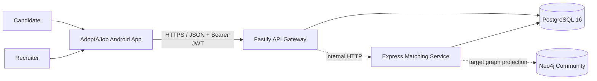

### 2.1.2 Goals and Context

The first product goal is a reproducible local demonstration with synthetic data. Candidates should be able to discover and act on eligible cards without disclosing their profile to unrelated companies; recruiters should manage their own company’s cards and decide on qualified interest. The academic POC target includes loading cards and persisting 20 swipes (`REQ-POC-001`), not operating a public recruiting service. [R2] [R13] [R14]

### 2.1.3 Significant Driving Requirements

**Discovery and state:** `REQ-FUNC-008/009` and `011–017` require company-scoped card management, published unswiped feed items, flags and recruiter decisions. Likes on Company Cards are ranking signals only; only Job Card likes can yield a match. `REQ-ML-006` reserves decisions to humans. [R2]

**Identity and privacy:** `REQ-FUNC-001/002/004`, `REQ-SEC-001–007` and `REQ-COMP-001–004` drive consent recording, server-side authorization, adaptive hashes, token invalidation, deployed HTTPS and minimized ranking inputs. Export and deletion are requirements, not implemented API routes. [R2] [R21]

**Reliability and quality:** `REQ-REL-001/002`, `REQ-OBS-001–003` and `REQ-ML-007/008` require retry-safe swipes, feed degradation, traceability and independent graph deletion. `REQ-INST-001`, `REQ-BUILD-002` and `REQ-MAINT-002` drive reproducible setup, push/PR checks and coverage. [R2]

## 2.2 Solution Background

Separate the client, system of record and ranker so that Android can evolve independently, writes remain consistent and ranking can degrade without breaking the public API. The boundaries exist in code or design; the public-to-ranker connection is not implemented at this baseline. [R4] [R6] [R9] [R11]

### 2.2.1 Architectural Approaches

| Decision | Approach | Rationale and trade-off |
|---|---|---|
| A1 | Native Android over the initial Expo plan | Kotlin/Compose is the checked-in implementation; it reuses an interface proposal derived from the earlier Expo client, not Expo runtime code. This supports Android 10+ with a small native stack but does not supply an iOS client. [R8] [R13] [R16] [R22] |
| A2 | A single transactional owner | Use Fastify and its Prisma-owned PostgreSQL schema for application writes. The ranker’s direct SQL read implementation avoids a second write authority but couples ranking to the schema, making migrations and read privileges integration concerns. [R4] [R9] [R10] [R11] |
| A3 | Deterministic ranker plus optional graph signal | Prefer explainable, synthetic-testable ranking to a trained model or a graph-only feed. PostgreSQL is authoritative; the Neo4j co-like projection is disposable and privacy-minimized. Use a PostgreSQL-only score when graph data is unavailable, or a gateway recent-feed fallback when the ranker is unavailable. These are two distinct target mechanisms. [R2] [R4] [R11] |
| A4 | A public contract with an internal matching boundary | The phone must not connect to either database or the ranker. Keep external DTOs separate from database rows and internal scores. The trade-off is a gateway adapter and explicit contract versioning; neither baseline contract can be assumed to match the current clients. [R3] [R7] [R8] [R11] |

### 2.2.2 Analysis Results

Static review covered committed route registrations, Android serializers, the ranker queries, migration constraints, tests and both remote branches. The local checks in Appendix A.2 exercise the backend foundation and compile the ranker; they do not validate live persistence, Android or Neo4j. [R1] [R6] [R9] [R10] [R11] [R17]

Performance targets are not measured results. Feed: p95 ≤ 1.5 s for 20 items over five minutes, 1,000 published cards and 50 concurrent candidates. Swipe acknowledgement: p95 ≤ 500 ms under the same load. The UI target is < 200 ms to advance with 1 s simulated delay; the reviewed client instead awaits acknowledgement. [R2] [R6]

Degradation targets: at 1 s without a ranker response, serve eligible cards newest first; at 300 ms without Neo4j, rank without graph contribution. Both branches need timed integration tests. The current ranker loads the entire eligible set and has no page limit or tertiary tie-break, so measure and specify a stable cursor order before claiming the feed target. [R2] [R3] [R11]

Most important risks are contract drift, lack of server authorization, an incompatible match uniqueness key, and graph erasure depending on as-yet-unbuilt operations. No formal ATAM evaluation, load result, privacy approval or cross-service tracing result is asserted; Appendix A.2 defines observable acceptance evidence. [R2] [R3] [R4] [R8] [R9]

### 2.2.3 Requirements Coverage

**Account and profile:** `REQ-FUNC-001–006/025`, `REQ-COMP-001/002` and `REQ-SEC-001–007` map to the Android forms, gateway trust boundary and PostgreSQL account/consent models. UI and schema are partial evidence; security, notice completeness, account export/deletion and API integration remain unverified. See §§3.1, 3.2, 3.4. [R2] [R6] [R9] [R10]

**Cards, swipes and matches:** `REQ-FUNC-008/009/011–019` and `REQ-REL-001` map to role-based Android requests and SQL constraints. The server product routes, match transaction, flags UI, notifications and per-recruiter schema are not complete. See §§3.2, 3.4 and Appendix A.1. [R2] [R6] [R9] [R10]

**Post-match and moderation:** `REQ-FUNC-020` (chat) maps to `Message`, `REQ-FUNC-021` (application and optional PDF CV) to `Application`, `REQ-FUNC-022` (unmatch) to `Match.endedAt`, and `REQ-FUNC-023` (report) to `Report`. These are SRS Should requirements with relational foundations, not working Android or gateway features. The target must scope chats and applications to match participants, close messaging when a match ends, and apply CV and report retention. `REQ-FUNC-024` is a separate in-app like indicator, not push or a delivered feature. [R2] [R3] [R6] [R8] [R9] [R10]

**Feed, fairness and privacy:** `REQ-INT-005/006`, `REQ-ML-001–008` and `REQ-REL-002` map to OpenAPI, the standalone ranker and the graph design. Weighted stated-tag overlap and prior-swipe exclusion are implemented in the ranker; full signal scoring, cold-start diversity, graph and fallback remain target. See §§3.2, 3.4. [R2] [R3] [R4] [R11]

**Delivery and operations:** `REQ-OBS-001–003`, `REQ-INST-001/002`, `REQ-BUILD-001/002`, `REQ-MAINT-001–003`, `REQ-PORT-001` and `REQ-POC-001` map to the local allocation, seed and quality evidence. Full Compose, Actions, both-store checks, coverage and end-to-end demonstration are not established. See §3.3 and Appendix A.2. [R2] [R12] [R17] [R19]

### 2.2.4 Summary of Background Changes Reflected in Current Version

**October:** The initialization README and architecture draft set out Expo and Python/FastAPI; Jean-Baptiste then checked in OpenAPI and the Fastify foundation. The 5 November OpenAPI revision added lint and security metadata, not implementation parity. [R5] [R9] [R13] [R29]

**November:** Alba added the MVP PostgreSQL migration and synthetic seed, then SRS v1.0 and the graph deletion-first design. Nils added deterministic Express ranking on 10 November and revised it for PostgreSQL on 17 November. Peter added native Android on 20 November and documented its API address in the snapshot’s final commit. [R1] [R10] [R22] [R23] [R24]

## 2.3 Product Line Reuse Considerations

AdoptAJob has no committed software product line. The single Android application supports two roles, and the debug/release API transport modes support development versus deployment rather than separate products. [R6] [R16]

The REST boundary, synthetic seed generator and independent ranker are candidates for reuse in later course work, but no second application, production deployment or iOS equivalent is delivered by this document. The adapter must be stabilized before reusing it. [R2] [R3] [R8] [R11] [R26]

# 3 Views

Four views represent one system. Table headings and packet numbering follow the template; each view distinguishes checked-in implementation from proposed connectors or behavior. The canonical requirement IDs remain those in SRS v1.0. [R2] [R20]

The view packets answer four questions: how code is partitioned, what executes and communicates, where it runs, and who owns or derives each data record.

| Name of view | Viewtype that defines this view | Types of elements and relations shown | Is this a module view? | Is this a component-and-connector view? | Is this an allocation view? |
|---|---|---|---|---|---|
| Module | Module | Modules, uses and schema dependency | Yes | No | No |
| C&C | Runtime | Processes, stores and connectors | No | Yes | No |
| Deploy. | Deployment | Execution nodes, hosts and artifacts | No | No | Yes |
| Data | Module / information | Entities, keys and derived relations | Yes | No | No |

## 3.1 Module View

### 3.1.1 View Description

The Module View decomposes the reviewed source into native Android, Fastify, database tooling and Express. The view shows compile-time or source dependencies, not network success. [R1]

### 3.1.2 View Packet Overview

This view is presented as one focused packet.

Packet #1 maps source names and ownership. Use the Component-and-Connector View for response behavior and the Data View for table keys.

### 3.1.3 Architecture Background

The initial Expo and Python/FastAPI descriptions explain the project’s starting point, not the current implementation. Android retains the Expo-derived interface proposal and Express replaces the intended matching stack. [R5] [R8] [R13] [R22] [R23]

### 3.1.4 Variability Mechanisms

The app selects its API URL at build time; components build independently. The applied Prisma migration history is fixed rather than a configuration choice. [R10] [R16] [R27] [R32]

### 3.1.5 View Packets

#### 3.1.5.1 View packet #1: Source structure and ownership

##### 3.1.5.1.1 Primary Presentation

Figure 2 shows code dependencies inside the source units. See Appendix A.1 for the contract edges between units.

### Figure 2: AdoptAJob implementation modules

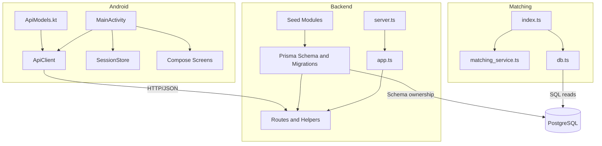

##### 3.1.5.1.2 Element Catalog

The catalog uses checked-in files and public behavior to identify responsibility. Names refer to code unless a target is explicitly marked.

###### 3.1.5.1.2.1 Elements

**Android — Peter:** `src/mobile/AdoptAJob/app`. `MainActivity` creates `ApiClient` and `SessionStore`, then mounts `AdoptAJobApp` under Material 3. Compose screens are `AuthScreen`, `CandidateFeed`, `CandidateProfileScreen`, `MatchesScreen` and `RecruiterScreen`. `ApiModels.kt` defines DTOs; `ContractTests.kt` tests local JSON serialization. [R6] [R7] [R18]

**Backend — Jean-Baptiste:** `src/backend/src`. `server.ts` loads host/port and starts `app.ts`. `app.ts` registers health, auth and feed routes and the request-ID and error hooks. Alba owns relational modeling and migrations in `src/backend/prisma`; seed modules generate and load synthetic records. [R9] [R10] [R14] [R26]

**Matching — Nils:** `src/matching-service/src`. `index.ts` exposes an Express endpoint and delegates to `matching_service.ts`; `db.ts` creates a `pg` Pool. Graph schema implementation is Levis’s assignment; Alba and Levis own harmonization/deduplication design with Nils responsible for matching integration and target pipeline execution. [R4] [R11] [R14]

###### 3.1.5.1.2.2 Relations

`MainActivity` composes screens and delegates networking to `ApiClient`, which uses `HttpURLConnection` on `Dispatchers.IO` and Gson for JSON, not Retrofit. `SessionStore` uses AndroidX EncryptedSharedPreferences and persists the bearer token only. Fastify registers handlers; Express delegates ranking to a SQL-backed module. Neither Android nor graph code is a schema owner. [R6] [R9] [R10] [R11] [R33] [R34]

###### 3.1.5.1.2.3 Interfaces

Android constructs `ApiClient` with `BuildConfig.API_BASE_URL`, sends JSON and uses a Bearer header when a token is set. Prisma maps camelCase model fields onto snake_case PostgreSQL tables and columns; the Express reader uses those mapped SQL names. The separate mobile and OpenAPI DTOs are compared in Appendix A.1. [R3] [R7] [R10] [R11] [R16]

###### 3.1.5.1.2.4 Behavior

With no token, the activity shows sign-in/registration. With a token it calls `/auth/me`; the candidate has Feed, Profile and Matches tabs, while the recruiter has a single workspace. A failed session check clears the token and returns to `AuthScreen`. Sign-out clears local state even if the logout call fails; this is not server revocation. [R6] [R7]

###### 3.1.5.1.2.5 Constraints

Only built-in role navigation is provided in this client, not access control. Client DTOs are not database schemas, Android never imports database code, and raw ranker response rows are not public DTOs. [R2] [R6] [R7] [R11]

##### 3.1.5.1.3 Context Diagram

The static boundary exposes two contract descriptions and one SQL schema dependency. No graph source or API adapter is present in the reviewed source tree. [R1] [R3] [R8] [R11]

### Figure 3: Module boundaries and contract artifacts

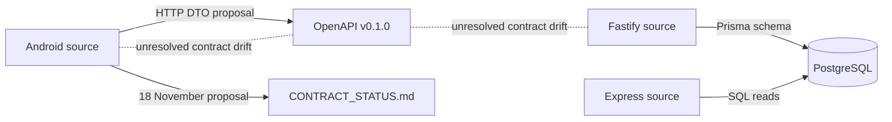

##### 3.1.5.1.4 Variability Mechanisms

Android uses Gradle property, then environment variable, then its emulator default for `API_BASE_URL`. Material 3 and role-specific screens ship in one app; no separate recruiter binary or iOS module exists at this revision. [R6] [R16] [R25]

##### 3.1.5.1.5 Architecture Background

Keep UI/network/session concerns distinct without claiming a multi-module Gradle architecture. Separate Fastify and ranking packages so the scoring implementation can evolve without changing Android once the gateway contract is unified. [R6] [R7] [R9] [R11]

##### 3.1.5.1.6 Related View Packets

§3.2 allocates behavior to these code units; §3.3 maps them to processes/builds; §3.4 defines the storage dependencies.

## 3.2 Component-and-Connector View

### 3.2.1 View Description

This view separates independently runnable components, observed gateway responses and intended product flows. An Android call in a sequence is evidence of client intent, not of a server handler. [R6] [R8] [R9] [R11]

### 3.2.2 View Packet Overview

This view is presented as one focused packet.

Packet #1 contains container connectors and three sequences. Appendix A.1 specifies methods, routes and payload drift; Appendix A.2 supplies runnable acceptance criteria.

### 3.2.3 Architecture Background

The gateway is the single client-facing trust boundary and owns authoritative writes. The ranker computes relevance independently and must never make hiring decisions. A second, derived store can add graph signals without becoming a source of truth. [R2] [R4]

### 3.2.4 Variability Mechanisms

Target fallbacks are recent published unswiped cards when the ranker exceeds 1 s; PostgreSQL-only scoring when the graph exceeds 300 ms. Neither fallback connector is implemented on `main`. [R2] [R9] [R11]

### 3.2.5 View Packets

#### 3.2.5.1 View packet #1: Public gateway, ranking and product sequences

##### 3.2.5.1.1 Primary Presentation

Figure 4 shows the current standalone SQL read and Prisma tooling connection. Dashed links show intended connectors or client calls without product behavior.

### Figure 4: Runtime containers and connectors

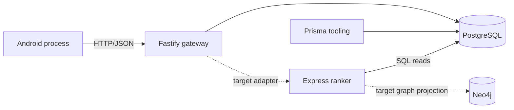

##### 3.2.5.1.2 Element Catalog

The runtime catalog identifies the owner, provides exact externally visible interfaces and then separates recorded observations from desired outcomes.

###### 3.2.5.1.2.1 Elements

**Android:** A device process using Compose, JSON over HTTP(S), a local encrypted bearer-token store and user-visible loading, empty and error states. [R6] [R7] [R16]

**Fastify:** Node.js/TypeScript public gateway foundation. Its configured logger redacts authorization and cookie header fields. Custom errors cover 501 and generic 500; unmatched URLs use Fastify’s default 404 body, not the intended `{code,message}` shape. [R9]

**Express ranker:** TypeScript HTTP process with `pg` access to canonical data. PostgreSQL is the transactional store; Neo4j Community 5 is a planned ranking projection with no runtime connector on `main`. [R4] [R10] [R11] [R12]

###### 3.2.5.1.2.2 Relations

Android supplies Bearer tokens on protected-intent requests. The Express ranker currently queries PostgreSQL directly using parameterized values. Backend-to-Express request forwarding, private service authentication, graph reads and projection writes are target links, not facts about `main`. [R2] [R3] [R7] [R9] [R11]

###### 3.2.5.1.2.3 Interfaces

Fastify exposes `GET /health` and `GET /ready` (both static 200 responses, not dependency probes); `POST /auth/register`, `POST /auth/login`, `GET /candidates/me/feed` and `POST /candidates/me/swipes` exist as 501 stubs. No other product endpoint is registered by the reviewed source. [R9]

Express implements `GET /feed/:candidateId` and returns `200 {success:true,count,data}` with ordered PostgreSQL card rows or `500 {success:false,message}` on failure. OpenAPI proposes `POST /internal/matching/rank` with `candidateId`/optional `limit`, service authentication, and ordered `{cardId,score}` items. There is no route alias or adapter between them. [R3] [R11]

The Fastify hook echoes a supplied `X-Request-ID` (truncated to 128 characters) or generates a UUID. Android’s swipe UUID is an `Idempotency-Key`, not a request ID. Cross-service ID propagation belongs to the future adapter. [R6] [R7] [R9] [R11]

###### 3.2.5.1.2.4 Behavior

**Registration and login.** The Android form blocks absent 18+ confirmation or notice acceptance, absent display name or incomplete recruiter company data. It submits lower-case role and consent fields for registration; login submits email/password. Current Fastify returns 501 for both. On a successful compatible server, Android saves token then calls `GET /auth/me`; a failed validation clears it. `POST /auth/logout` is best effort on Android and absent on `main`. [R6] [R7] [R8] [R9]

### Figure 5: Registration, consent and login: Android calls versus Fastify results

```mermaid
sequenceDiagram
    participant U as User
    participant A as Android App
    participant F as Fastify Gateway

    U->>A: Enter registration details
    A->>A: Validate age, privacy, name and recruiter company fields
    A->>F: POST /auth/register
    F-->>A: 501 Not Implemented (current)
    Note over A,F: Target: 201 with token and user; persist consent version and timestamp

    U->>A: Sign in
    A->>F: POST /auth/login
    F-->>A: 501 Not Implemented (current)
    Note over A,F: Target: 200 with token and user

    A->>F: GET /auth/me
    F-->>A: 404 (current)
    Note over A,F: Target: 200 user; invalid token clears local session
```

**Candidate feed.** Android calls `GET /candidate/feed` and expects `{cards}`; Fastify does not serve that path, and `GET /candidates/me/feed` is a separate 501 stub. Independently, Express filters to `PUBLISHED` cards with a publication date and excludes any previous swipe for the candidate. It adds 3 per matched `SKILL` tag, 2 per `ROLE` and 1 for `SECTOR`, `LOCATION` or `CONTRACT` (including default 1 for an unknown type), then sorts by descending score and publication time; exact ties have no explicit third key. Scores are not returned.

No tag means recency, not the SRS’s sector-diverse cold start. Liked/flagged cards are not used as scoring evidence beyond prior-swipe exclusion. [R2] [R3] [R6] [R9] [R11]

### Figure 6: Candidate feed: Android, Fastify and standalone ranking

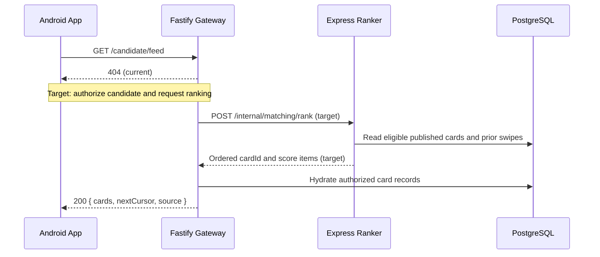

**Swipe to match.** The Android app sends `{cardId,action}` with `LIKE` or `PASS` and a new UUID `Idempotency-Key` for each invocation. It removes the card only on a successful response. The recruiter client fetches `/recruiter/interested` and posts `ACCEPT` or `DECLINE`; on success it removes that row locally. Candidate Matches requests `GET /matches`. Those proposal routes are absent from Fastify. The next sequence illustrates the target, not a replay of successful requests. [R6] [R7] [R8] [R9]

### Figure 7: Candidate swipe, recruiter accept or decline, and match: target sequence

```mermaid
sequenceDiagram
    participant C as Candidate
    participant A as Android App
    participant F as Fastify Gateway
    participant P as PostgreSQL
    participant R as Recruiter

    C->>A: Like a Job Card
    A->>F: POST /candidate/swipes
    A->>F: Idempotency-Key: UUID
    F->>P: Persist candidate swipe
    F-->>A: 201 { cardId, action, recorded }

    R->>F: GET /recruiter/interested
    F-->>R: 200 { swipes }

    R->>F: POST /recruiter/interested/{swipeId}/decision
    alt ACCEPT
        F->>P: Persist ACCEPT and create recruiter-scoped match atomically
        F-->>R: 200 with match
    else DECLINE
        F->>P: Persist DECLINE; no match
        F-->>R: 200 with match: null
    end

    C->>F: GET /matches
    F-->>A: 200 { matches }
```

Only candidates swipe. In the target, a Company Card like is ranking-only; `PASS` and flags never create a match; `DECLINE` removes the candidate from the applicable interested list without notifying them or creating a match. Validate candidate, card kind, company membership and recruiter identity server-side; accept a Job Card like and persist the decision and that recruiter’s match atomically. The SRS permits distinct matches for distinct accepting recruiters, which the committed schema artifacts do not yet support. [R2] [R4] [R10]

###### 3.2.5.1.2.5 Constraints

Validate inputs and enforce resource scope server-side: candidate ownership, recruiter company boundary, participant-only match visibility, deployed TLS 1.2+, approved privacy notice and no sensitive log content. Do not expose standalone ranker output to the phone. The final match is a human decision. [R2] [R3] [R4] [R11]

##### 3.2.5.1.3 Context Diagram

Only the Fastify boundary is intended for the phone. A local developer can invoke the standalone ranker for development; this is not an approved public second API. [R3] [R8] [R11]

### Figure 8: Runtime ingress and internal-only target boundaries

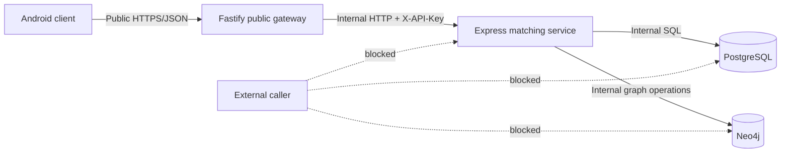

##### 3.2.5.1.4 Variability Mechanisms

Candidate versus recruiter behavior is selected in the client by returned role. Product authorization, paging, error normalization, timeout and retry semantics must be agreed at the gateway, not inferred from local selection. [R2] [R3] [R6] [R7] [R9]

##### 3.2.5.1.5 Architecture Background

Separate behavior by trust and authority: UI presents choices, gateway enforces policy and owns transactions, ranker orders candidates’ opportunities, graph supplies optional relationships only. This preserves a usable fallback without letting automated scores determine a match. [R2] [R4]

##### 3.2.5.1.6 Related View Packets

§3.1 names the handlers and DTOs; §3.3 identifies ports and launch boundaries; §3.4 defines swipe, decision and match integrity; Appendix A.1 is authoritative for observed path discrepancies.

## 3.3 Allocation View

### 3.3.1 View Description

Allocation covers the development workstation, Android build and test environment, persistent local database and GitHub collaboration. No production topology is asserted. [R2] [R12] [R25] [R26]

### 3.3.2 View Packet Overview

This view is presented as one focused packet.

Packet #1 shows current deployment locations and distinguishes startup, readiness, build checks and planned CI.

### 3.3.3 Architecture Background

The course targets a reproducible synthetic-data demo and no paid infrastructure. Local split-process operation is the current repository workflow, not the one-command full-stack target. [R2] [R12] [R26]

### 3.3.4 Variability Mechanisms

Supported configuration varies by emulator or LAN device and by debug or release transport. PostgreSQL host port, backend bind host/port and matching port are configurable. [R9] [R11] [R12] [R16] [R25]

### 3.3.5 View Packets

#### 3.3.5.1 View packet #1: Local development, delivery and observability

##### 3.3.5.1.1 Primary Presentation

The workstation runs the separate Fastify and Express processes and holds the one Compose service. The Android arrow is the address configured for the gateway, not evidence of integration.

### Figure 9: Local deployment allocation on the reviewed revision

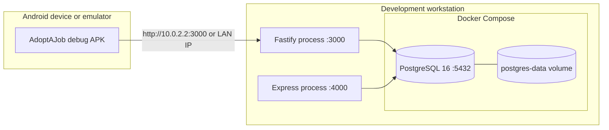

##### 3.3.5.1.2 Element Catalog

The local topology intentionally distinguishes an active process, an executable build artifact, a health endpoint and a readiness signal.

###### 3.3.5.1.2.1 Elements

**Android emulator/device:** Android 10 or higher (`minSdk 29`); compile and target SDK 35, Java 17, Gradle 8.9, AGP 8.7.3 and Kotlin 2.0.21. Consuming a debug APK and inspecting code is not the same as passing an emulator test. [R16] [R25]

**Workstation:** Fastify uses Node.js 22 LTS and defaults to `0.0.0.0:3000`. Express listens on `MATCHING_PORT`, default 4000, and loads a root `.env` `DATABASE_URL` through `db.ts`. PostgreSQL 16.13 runs under Docker Compose, default host port 5432, named `postgres-data` volume and `pg_isready` container health check. [R9] [R11] [R12] [R26] [R27]

**GitHub:** `main` and `dev` resolve to the same reviewed SHA. Review templates are committed; no Actions workflow or run was present at review. Backend npm scripts support build, typecheck, tests and Prisma checks; Express has build/dev/start; Android has the Gradle wrapper and JVM contract tests. [R1] [R15] [R18] [R19] [R25] [R27] [R32]

###### 3.3.5.1.2.2 Relations

Start Compose PostgreSQL first; apply backend migrations and optionally load the synthetic seed; start API and matching separately when testing those processes; configure/build Android last. Production credentials, device signing material, database files and process output are not source-controlled. [R12] [R15] [R25] [R26]

###### 3.3.5.1.2.3 Interfaces

Emulator default: `http://10.0.2.2:3000/`. A physical device builds with `-PAPI_BASE_URL` set to an appropriate development LAN address; debug permits cleartext. Release disables cleartext and requires an HTTPS base URL for deployed use. `DATABASE_URL` and `POSTGRES_*` are local configuration, not embedded app secrets. [R12] [R16] [R25] [R26]

###### 3.3.5.1.2.4 Behavior

From repository root, use `docker compose up -d postgres` and inspect container health. From `src/backend`, run `npm ci`, `npm run db:deploy`, `npm run db:generate`, then `npm run dev`; `npm run db:seed` is optional and destructive, so use only a throwaway synthetic local database. In `src/matching-service`, run `npm ci` and `npm run dev` to start a standalone process; use only an approved PostgreSQL read account. In the Android project, use `./gradlew test` and `./gradlew assembleDebug` with the Android SDK and a supported JDK. [R11] [R12] [R25] [R26] [R32]

`GET /health` and `GET /ready` can demonstrate Fastify reachability, not database readiness. Express has no health route. Container `pg_isready` provides an independent database-level signal. To meet `REQ-OBS-003`, probe actual dependencies, test 503 on database failure and record demo start/end checks. [R2] [R9] [R11] [R12]

Use the existing package checks and historical lint evidence as a starting point. Add a committed GitHub workflow for locked installs, lint, build and tests on `dev`/`main` pushes and pull requests, and collect separate backend and matching 60% line-coverage reports. Current package scripts do not establish that lint, formatting or coverage gates run. [R2] [R14] [R19] [R27] [R32]

###### 3.3.5.1.2.5 Constraints

Public repository and synthetic inputs only. Deployed traffic requires TLS 1.2+; run the development services in a restricted local environment and keep the ranker and stores private. This deployment view does not establish firewalling, TLS termination, backup or production health. [R2] [R12] [R15] [R16]

##### 3.3.5.1.3 Context Diagram

Source and review history live in GitHub; the workstation performs local builds. The target CI connection is not a running or configured workflow on the reviewed revision. [R15] [R19] [R25]

### Figure 10: Source control and build environment

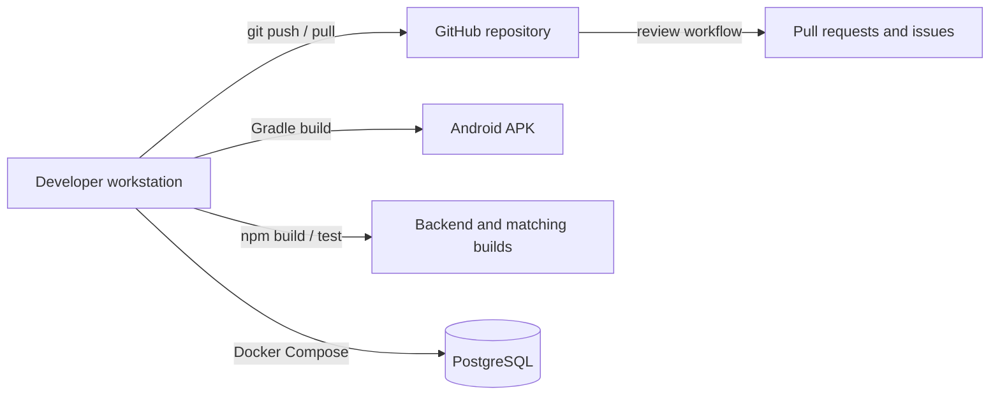

##### 3.3.5.1.4 Variability Mechanisms

Host Fastify, Express and Compose separately today. For the target demo, add service and Neo4j definitions, startup health checks and dependency readiness wiring, keeping the graph optional for ranking. No hosted environment is selected. [R2] [R4] [R12]

##### 3.3.5.1.5 Architecture Background

Keeping data in a named volume lets developers restart processes without recreating state. Separate process checks isolate source problems from Compose, database, network and Android configuration problems. [R9] [R12] [R25] [R26]

##### 3.3.5.1.6 Related View Packets

§3.1 maps code to binary/processes; §3.2 identifies the HTTP and SQL links; §3.4 identifies durable and derived data; Appendix A.2 lists the evidence gates.

## 3.4 Data View

### 3.4.1 View Description

The Data View captures relational ownership and identity, then traces the subset authorized for a derived graph. The committed Prisma schema and migration SQL are authoritative for enforced integrity. [R4] [R10]

### 3.4.2 View Packet Overview

This view is presented as one focused packet.

Packet #1 covers PostgreSQL records, target Neo4j projections, retention and reconciliation. The repository’s UML provides the full physical diagram. [R28]

### 3.4.3 Architecture Background

Keep PostgreSQL authoritative and Neo4j rebuildable. A separate projection trades duplicate storage and synchronization complexity for efficient collaborative path queries. Never authorize writes or infer user rights from the graph. [R2] [R4]

### 3.4.4 Variability Mechanisms

SRS graph augmentation is optional for serving a feed; minimum data and erasure obligations are not. Synthetic fixture size and seed can vary without changing data ownership. [R2] [R4] [R26]

### 3.4.5 View Packets

#### 3.4.5.1 View packet #1: PostgreSQL authority and Neo4j projection

##### 3.4.5.1.1 Primary Presentation

Figure 11 groups related physical entities; arrows summarize associations rather than replacing foreign-key cardinalities. The derived graph is dashed because it is design-only. See the committed UML for full columns and relationships. [R28]

### Figure 11: Canonical relational model and derived graph projection

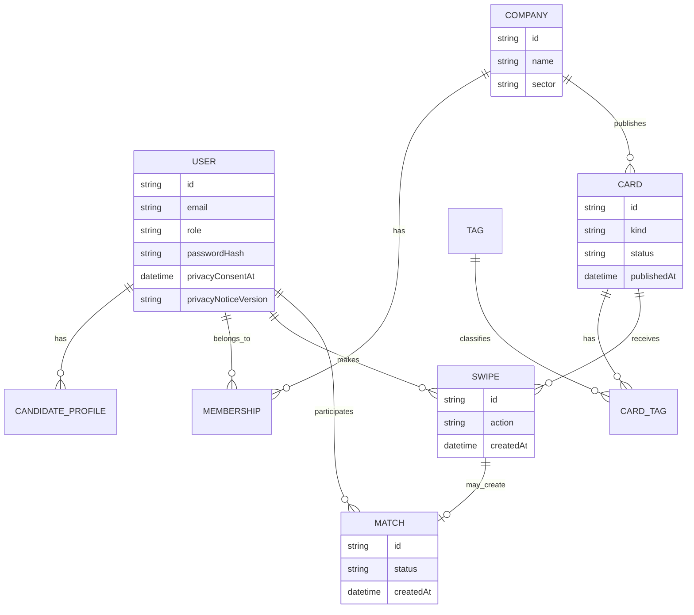

##### 3.4.5.1.2 Element Catalog

The catalog distinguishes current relational constraints, backend policy that needs implementation, and the target graph contract.

###### 3.4.5.1.2.1 Elements

**Canonical PostgreSQL entities:** users, companies, invitation_codes, candidate_profiles, tags, candidate_tags, cards, card_tags, swipes, matches, messages, applications and reports. User stores the role, adaptive-hash field, `privacy_consent_at` and `privacy_notice_version`. Membership is recruiter-only; multiple recruiters can belong to a company. [R4] [R10]

**Cards:** `COMPANY` or `JOB`; lifecycle is `DRAFT`, `PUBLISHED`, `UNPUBLISHED` or `DELETED`. A Job Card requires location and contract type in migration SQL; at least one tag and company ownership require application checks. `DELETED` is a soft-delete state; target UI retains existing matches as “Position closed.” [R2] [R4] [R10]

**Target Neo4j 5 Community nodes:** `Candidate{id}`, `Card{id,kind,status,publishedAt}`, `Company{id}`, `Tag{id,type,slug}`. Derived edges: `LIKED`, `PASSED`, `GREEN_FLAGGED` and `RED_FLAGGED` with `at`; `HAS_TAG` from Card/Candidate to Tag; `OF_COMPANY` from Card to Company. Node IDs are unique per label in the design. Reports are canonical only and have a polymorphic target, not a graph node. [R2] [R4] [R10]

###### 3.4.5.1.2.2 Relations

Prisma migrations are run under backend authority; ranker SQL selects but does not write. Existing swipes and matches each have a unique candidate/card key. Non-`LIKE` swipes cannot carry decisions or decision time. Match participant foreign keys currently cascade on user deletion. Graph ingestion maps canonical IDs and relationships; it must not write back to PostgreSQL. [R4] [R10] [R11]

###### 3.4.5.1.2.3 Interfaces

Use Prisma for schema evolution and application writes. Matching’s `pg` pool currently takes `DATABASE_URL`; the source does not provision or enforce a read-only role. The approved target uses least privilege for ranking and harmonization, schema-versioned mappings, no credentials in source and field-minimized output. [R2] [R4] [R10] [R11] [R15]

###### 3.4.5.1.2.4 Behavior

**Consent and membership target:** validate policy and age affirmation at registration; set server-side privacy timestamp and notice version; hash passwords; bind recruiters to an authorized company. The scrypt generator is used by the synthetic seed only. The `adult_confirmed_at` field, token invalidation strategy and inactivity timestamp are not in the committed schema. [R2] [R4] [R9] [R10] [R26]

**Swipes and decisions:** unique candidate/card prevents duplicate rows, but API replay semantics do not exist. Migration target for SRS per-recruiter acceptance is unique candidate/card/recruiter and a recruiter_decisions record unique per swipe/recruiter. The interested-list contract for a second recruiter after the first decision remains open. No such migration is committed. [R2] [R4] [R9] [R10]

**Graph sync target:** schedule runs no more than 15 minutes apart. Before every rebuild attempt, remove candidates absent from PostgreSQL and their relationships independently of rebuild success; log failed deletions and retry them at the next run. Merge deduplicated batches by canonical IDs and relationships, mark the run, remove stale elements only after a successful copy and reconcile counts against PostgreSQL. A count mismatch fails the attempt. Retry failed rebuilds up to three times; preserve the last usable graph except for required deletions. Neither the worker nor the mechanism that isolates failed rebuild writes is committed. [R2] [R4] [R24] [R30] [R31]

### Figure 12: Deletion-first graph projection and rebuild failure: target sequence

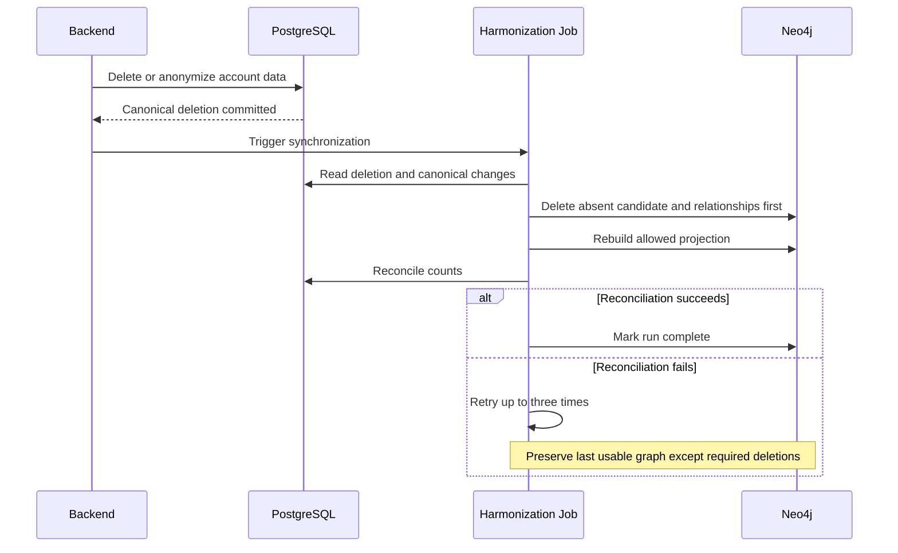

**Deletion and retention target:** cut API access immediately; remove identifiers and applicable data from authoritative, file and graph stores within 24 h even when rebuild attempts fail. Account data retains until deletion or 12 months inactive, CV until the match ends or account is deleted, report for 12 months. Retention operations, export, CV cleanup and anonymized survivor matches are not verified; the current cascade differs from required survivor semantics. [R2] [R4] [R10]

###### 3.4.5.1.2.5 Constraints

Network access to stores is internal. The graph excludes names, emails, passwords/hashes, messages, CVs, company sector, deleted cards and protected attributes; ranking uses no protected attribute or photo. The permitted-signal proxy review and deletion failure tests remain release gates. [R2] [R4] [R11]

##### 3.4.5.1.3 Context Diagram

The gateway’s schema/tools establish canonical records; the ranker reads canonical data; only the planned harmonization job would write the derived graph. [R4] [R10] [R11]

### Figure 13: Data authority and access boundaries

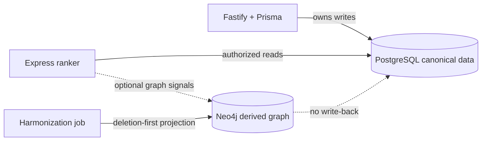

##### 3.4.5.1.4 Variability Mechanisms

Seed counts and synthetic fixture patterns may vary. Migration IDs, opt-in requirements and graph allowlist are controlled by versioned architecture rather than runtime toggles. [R2] [R4] [R10] [R26]

##### 3.4.5.1.5 Architecture Background

Database keys enforce local integrity, while the gateway must enforce cross-table conditions and authorization. A deletion-first projection avoids making privacy erasure wait on availability of graph scoring. [R2] [R4] [R10]

##### 3.4.5.1.6 Related View Packets

§3.1 identifies Prisma and ranker source; §3.2 shows transaction and ranking interactions; §3.3 shows the PostgreSQL volume and missing graph allocation; Appendix A.2 lists integrity and erasure checks.

# 4 Relations Among Views

The four views share architectural names but represent different concerns. An implemented module does not imply a deployed or connected service. Relations below also identify contradictions that would otherwise produce misleading diagrams or tests. [R1] [R20]

## 4.1 General Relations Among Views

**Contract gap:** Android implements singular candidate/recruiter paths, lowercase roles and `token`; OpenAPI uses plural self-scoped paths, uppercase roles and `accessToken`. DTO, status, pagination, consent and endpoint mismatches are listed in Appendix A.1. GitHub validation of a file is not compatibility evidence. [R3] [R7] [R8] [R29]

**Runtime gap:** Fastify has no matching adapter or protected product handlers; Express reads PostgreSQL directly. Fastify’s request-ID hook echoes the header, but the framework’s default logger binding can still show `req-1` in an injected request. Express logs to console and does not forward or correlate this ID. Treat end-to-end traceability as unverified. [R9] [R11] [R17]

**Data gap:** The current schema has one decision on the swipe and one match per candidate/card, but SRS requires one match per accepting recruiter. Schema and interested-list behavior must align before a two-recruiter acceptance test can pass. Account deletion cascades matches today; the target keeps an anonymized “Account deleted” entry for the other party. [R2] [R4] [R10]

**Deployment gap:** Compose defines PostgreSQL only, and the GitHub repository shows no configured Actions workflows at review. The intended Neo4j and sync process are absent. Documentation and local checks do not substitute for operational or end-to-end evidence. [R12] [R19]

## 4.2 View-to-View Relations

- **Android module → one device process → Android APK, local session storage and JSON DTOs; no direct relational or graph data path.** See §§3.1–3.3. [R6] [R7] [R16]
- **Fastify routes/helpers → public gateway host process → target Prisma transactional ownership. Prisma schema/migrate/seed → tooling process → implemented PostgreSQL schema and fixtures.** See §§3.1–3.4. [R9] [R10] [R12] [R26]
- **Express modules → independent ranker host process → parameterized PostgreSQL reads and ordered output. Target harmonization → scheduled internal runtime → minimized Neo4j projection and optional co-like score.** See §§3.1–3.4. [R4] [R11]
- **SRS and OpenAPI → review/build acceptance contracts, not running components. Changes in data cardinality or request/response shapes must be carried through all four views and the corresponding acceptance tests.** [R2] [R3] [R15]

### Table 2: Integration issues, owners and closure evidence

| Issue / evidence | Owner(s) | Evidence required to close |
|---|---|---|
| I1. Mobile paths, DTOs and identity differ; registration and login are stubs. [R3] [R8] [R9] | Jean-Baptiste, Peter | Approved contract and passing route tests; validate age and record consent version/time. See G1. |
| I2. `LIKE`/`PASS` only at both API baselines; schema also models flags. [R2] [R3] [R10] | Jean-Baptiste, Peter, Nils | Publish action semantics; prove persistence and feed effects. See G2–G3. |
| I3. Unique candidate/card plus one swipe decision cannot represent two accepting recruiters. [R2] [R10] | Alba, Jean-Baptiste | Migration and transaction tests for two same-company recruiters; deny cross-company decisions. See G2. |
| I4. The legacy Python plan differs from the checked-in Express service; no adapter connects it. [R11] [R13] | Nils, Jean-Baptiste | Update architecture/README and internal contract; test result mapping, timing and fallback. See G3. |
| I5. Graph projection, independent erasure and survivor-match migration are pending. [R2] [R4] [R10] | Alba, Levis; Jean-Baptiste for canonical deletion | Prove deletion during rebuild failure, reconciliation and anonymized survivor state. See G4. |
| I6. Database readiness and cross-service tracing are not implemented; no Actions workflow. [R9] [R11] [R19] | Jean-Baptiste, Peter, Nils | Reproduce bring-up, log a correlated request, demonstrate device flow and record CI results. See G5. |

# 5 Referenced Materials

| Reference | Material |
|---|---|
| R1 | Repository snapshot and branches: https://github.com/bhsei/26A/commit/8c9e2e73a624f6419d1aad1275f3effd81dfde0a |
| R2 | Software Requirements Specification v1.0, 18 November 2026: https://github.com/bhsei/26A/blob/8c9e2e73a624f6419d1aad1275f3effd81dfde0a/docs/requirements/SRS.md |
| R3 | OpenAPI 3.0.3 contract baseline, API v0.1.0: https://github.com/bhsei/26A/blob/8c9e2e73a624f6419d1aad1275f3effd81dfde0a/docs/design/openapi.yaml |
| R4 | Database Design v0.4, including planned Neo4j projection: https://github.com/bhsei/26A/blob/8c9e2e73a624f6419d1aad1275f3effd81dfde0a/docs/design/database.md |
| R5 | Existing architecture draft and initialization context: https://github.com/bhsei/26A/blob/8c9e2e73a624f6419d1aad1275f3effd81dfde0a/docs/design/Architecture_Design.md |
| R6 | Android `MainActivity` and Compose flows: https://github.com/bhsei/26A/blob/8c9e2e73a624f6419d1aad1275f3effd81dfde0a/src/mobile/AdoptAJob/app/src/main/java/com/adoptajob/android/MainActivity.kt |
| R7 | Android API client, DTOs and encrypted session handling: https://github.com/bhsei/26A/tree/8c9e2e73a624f6419d1aad1275f3effd81dfde0a/src/mobile/AdoptAJob/app/src/main/java/com/adoptajob/android/data |
| R8 | Android contract status and 18 November proposal alignment: https://github.com/bhsei/26A/blob/8c9e2e73a624f6419d1aad1275f3effd81dfde0a/src/mobile/AdoptAJob/CONTRACT_STATUS.md |
| R9 | Fastify application, configuration, routes and request handling: https://github.com/bhsei/26A/tree/8c9e2e73a624f6419d1aad1275f3effd81dfde0a/src/backend/src |
| R10 | Prisma schema and committed PostgreSQL migrations: https://github.com/bhsei/26A/tree/8c9e2e73a624f6419d1aad1275f3effd81dfde0a/src/backend/prisma |
| R11 | Express route, `pg` connection and ranking implementation: https://github.com/bhsei/26A/tree/8c9e2e73a624f6419d1aad1275f3effd81dfde0a/src/matching-service/src |
| R12 | Local Docker Compose service definition: https://github.com/bhsei/26A/blob/8c9e2e73a624f6419d1aad1275f3effd81dfde0a/docker-compose.yml |
| R13 | Root README, initialization baseline and ownership: https://github.com/bhsei/26A/blob/8c9e2e73a624f6419d1aad1275f3effd81dfde0a/README.md |
| R14 | Team backlog, assignments and historical quality evidence: https://github.com/bhsei/26A/blob/8c9e2e73a624f6419d1aad1275f3effd81dfde0a/plans/BACKLOG.md |
| R15 | GitHub review and configuration-control workflow: https://github.com/bhsei/26A/blob/8c9e2e73a624f6419d1aad1275f3effd81dfde0a/CONTRIBUTING.md |
| R16 | Native Android Gradle configuration: https://github.com/bhsei/26A/blob/8c9e2e73a624f6419d1aad1275f3effd81dfde0a/src/mobile/AdoptAJob/app/build.gradle.kts |
| R17 | Backend tests: Fastify injection and synthetic seed: https://github.com/bhsei/26A/tree/8c9e2e73a624f6419d1aad1275f3effd81dfde0a/src/backend/tests |
| R18 | Android JSON contract unit tests: https://github.com/bhsei/26A/blob/8c9e2e73a624f6419d1aad1275f3effd81dfde0a/src/mobile/AdoptAJob/app/src/test/java/com/adoptajob/android/ContractTests.kt |
| R19 | GitHub Actions history: https://github.com/bhsei/26A/actions |
| R20 | SEI *Views and Beyond* documentation template: https://sei.cmu.edu/library/views-and-beyond-documentation-template/ |
| R21 | Regulation (EU) 2016/679, GDPR: https://eur-lex.europa.eu/eli/reg/2016/679/oj |
| R22 | Android source addition, Peter, 20 November 2026: https://github.com/bhsei/26A/commit/15e674bbc3b34565358daf4d8fd5ace30bf9343c |
| R23 | Express ranker revision, Nils, 17 November 2026: https://github.com/bhsei/26A/commit/6b4785c6e8deb326ece69175b7dd15a9fe597fbd |
| R24 | SRS v1.0 and graph design revision, Alba, 18 November 2026: https://github.com/bhsei/26A/commit/cc888161e51fd8a7ac673869302983b8de0d051a |
| R25 | Android build and local connection instructions: https://github.com/bhsei/26A/blob/8c9e2e73a624f6419d1aad1275f3effd81dfde0a/src/mobile/AdoptAJob/README.md |
| R26 | Backend setup, seed behavior and schema ownership: https://github.com/bhsei/26A/blob/8c9e2e73a624f6419d1aad1275f3effd81dfde0a/src/backend/README.md |
| R27 | Backend dependency and check definitions: https://github.com/bhsei/26A/blob/8c9e2e73a624f6419d1aad1275f3effd81dfde0a/src/backend/package.json |
| R28 | Committed relational UML and Mermaid source: https://github.com/bhsei/26A/blob/8c9e2e73a624f6419d1aad1275f3effd81dfde0a/docs/design/database-uml.mmd |
| R29 | OpenAPI validation and security metadata revision: https://github.com/bhsei/26A/commit/71b4e0e |
| R30 | GitHub project review issue A-04 and related findings: https://github.com/bhsei/26A/issues/2 |
| R31 | GitHub project review issue F-01 and related findings: https://github.com/bhsei/26A/issues/1 |
| R32 | Express dependency and build definitions: https://github.com/bhsei/26A/blob/8c9e2e73a624f6419d1aad1275f3effd81dfde0a/src/matching-service/package.json |
| R33 | Android HTTP transport and Gson serialization: https://github.com/bhsei/26A/blob/8c9e2e73a624f6419d1aad1275f3effd81dfde0a/src/mobile/AdoptAJob/app/src/main/java/com/adoptajob/android/data/ApiClient.kt |
| R34 | Android encrypted bearer-token store: https://github.com/bhsei/26A/blob/8c9e2e73a624f6419d1aad1275f3effd81dfde0a/src/mobile/AdoptAJob/app/src/main/java/com/adoptajob/android/data/SessionStore.kt |

# 6 Directory

## 6.1 Index

- **Android / MainActivity / SessionStore:** defined in §3.1.5.1, Elements and Interfaces; used in §§3.2–3.3; Appendix A.1.
- **Consent, retention and erasure:** defined in §3.4.5.1, Behavior and Constraints; used in §§2.1.3, 3.2; Appendix A.2.
- **Fastify gateway / service probes / X-Request-ID:** defined in §3.2.5.1, Interfaces; used in §§3.3–4.2; Appendix A.
- **Express / SQL / weighted tag overlap / fallback:** defined in §3.2.5.1, Behavior; used in §§2.2, 3.3–3.4; Appendix A.
- **PostgreSQL / Prisma / canonical ownership:** defined in §3.4.5.1, Elements and Relations; used in §§3.1–3.3, 4.2.
- **Neo4j / deduplication / reconciliation:** defined in §3.4.5.1, Elements and Behavior; used in §§2.2, 3.2–3.3; Appendix A.2.
- **Swipe / decision / match cardinality:** defined in §3.4.5.1, Behavior; used in §§3.2, 4.1; Appendix A.
- **Deployment / GitHub Actions / synthetic data:** defined in §3.3.5.1, Elements and Behavior; used in §§2.2.3, 4.1; Appendix A.2.
- **Public API / contract drift / DTO:** defined in Appendix A.1; used in §§1.2, 2.2.1, 3.2, 4.1.

## 6.2 Glossary

| Term | Definition |
|---|---|
| Canonical record and projection | PostgreSQL owns authoritative product data. Neo4j is a planned, minimized derived copy and must never write back. |
| Job Card and Company Card | A Job Card describes a role and may lead to a match. A Company Card describes a company and provides ranking feedback only. |
| Swipe, interested candidate and match | A swipe is a candidate action on a card. Eligible Job Card likes appear to authorized recruiters; a match is a recruiter-accepted like, scoped to its participants. |
| View, viewpoint and packet | A view represents one concern; its viewpoint defines the modeling conventions. A view packet is the scoped presentation and catalog used in §3. |

## 6.3 Acronym List

| Acronym | Meaning |
|---|---|
| AGP | Android Gradle Plugin |
| API | Application Programming Interface |
| APK | Android application package |
| ATAM | Architecture Tradeoff Analysis Method |
| C&C | Component and Connector |
| CI | Continuous Integration |
| CV | Curriculum Vitae |
| DB | Database |
| DTO | Data Transfer Object |
| FK | Foreign Key |
| GDPR | General Data Protection Regulation |
| HTTP(S) | Hypertext Transfer Protocol (Secure) |
| JDK | Java Development Kit |
| JSON | JavaScript Object Notation |
| JWT | JSON Web Token |
| LAN | Local Area Network |
| MVP | Minimum Viable Product |
| POC | Proof of Concept |
| PR | Pull Request |
| SAD | Software Architecture Document |
| SDK | Software Development Kit |
| SRS | Software Requirements Specification |
| TLS / UML | Transport Layer Security / Unified Modeling Language |

# 7 Sample Figures & Tables

The flow and table summarize local integration readiness. In structural views, solid connectors show checked-in dependencies; dashed connectors mark an intended or unintegrated interface. Cylinders represent data stores. Sequence notes state limits and failures; a dashed reply is a response, not a status marker. The captions identify target-only sequences.

### Figure 14: Integration gates for the local proof of concept

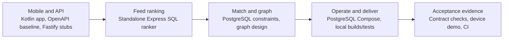

### Table 3: Implementation status and integration evidence

| Concern | Current evidence | Gap | Acceptance evidence |
|---|---|---|---|
| Mobile and API | Kotlin app; OpenAPI baseline; Fastify stubs | Routes, DTOs, consent and access differ | Contract checks and device demo |
| Feed ranking | Standalone Express SQL ranker | No gateway adapter, feedback scores or fallback | Ranker fixtures and timed gateway fallback |
| Match and graph | PostgreSQL constraints; graph design | Per-recruiter decisions, projection and erasure pipeline | Atomic match and deletion-under-failure tests |
| Operate and deliver | PostgreSQL Compose; local builds/tests | No full Compose runtime or configured Actions | Reproducible bring-up, health probes and CI evidence |

# Appendix A: Appendices

The appendices provide the actionable crosswalk and the check results behind the baseline.

## A.1 API Contract Crosswalk

Read the Android proposal, published OpenAPI and registered Fastify behavior as separate records. The inventory summarizes route status; the notes explain payload and authorization differences. [R2] [R3] [R6] [R8] [R9] [R11]

### Table 4: Android proposal, OpenAPI and observed Fastify routes

| Operation | Android proposal | OpenAPI v0.1.0 | Observed Fastify |
|---|---|---|---|
| Register / login | `POST /auth/register`; `POST /auth/login` | Same paths; registration fields, role casing and token key differ. | Both are 501 stubs. |
| Session | `GET /auth/me`; `POST /auth/logout` | Not specified. | Both absent (404). |
| Profile | `GET`/`PUT /candidate/profile` | `GET`/`PUT /candidates/me` | Both path families absent (404). |
| Feed / swipe | `GET /candidate/feed`; `POST /candidate/swipes` | `GET /candidates/me/feed`; `POST /candidates/me/swipes` | Android 404; OpenAPI paths 501. |
| Recruiter cards | `GET`/`POST /recruiter/cards` | `GET`/`POST /recruiters/me/cards` | Both path families absent (404). |
| Interest / decision / matches | `GET /recruiter/interested`; `POST /recruiter/interested/{swipeId}/decision`; `GET /matches` | Not specified. | All three paths absent (404). |
| Internal ranking | Not called directly. | `POST /internal/matching/rank` | 404. Express separately serves `GET /feed/:candidateId`. |
| Health / readiness | Not called directly. | `GET /health`; `GET /ready` | Static 200. No PostgreSQL readiness check. |

**Registration and login.** Android and OpenAPI both name `POST /auth/register` and `POST /auth/login`; checked-in handlers return 501. Android registers with email, password, role (`candidate`/`recruiter`), `displayName`, `ageConfirmed`, `privacyAccepted` and, for recruiters, `companyName` and `companySector`. The SRS places company creation on first sign-in for a recruiter without membership and allows joining by invitation. OpenAPI defines uppercase roles, email/password for login, and no consent/company/display fields in registration. It specifies a 12-character minimum password for registration; the SRS rejects under 8. Android expects `{user,token}`; OpenAPI specifies `{accessToken,user}`. Reconcile the registration fields, membership timing and password rule before implementing server acceptance. [R2] [R3] [R6] [R7] [R8] [R9]

**Session.** `GET /auth/me` returns an expected `{user}` wrapper in the client. `POST /auth/logout` is best effort and its response body is ignored. Neither route exists in OpenAPI or Fastify at this revision. JWT issuance, expiry of at most 24 hours and revocation on logout/deletion are server-side SRS obligations. [R2] [R3] [R6] [R7] [R9]

**Candidate profile.** Android `GET /candidate/profile` reads `{profile}`; `PUT` sends `CandidateProfileInput` and ignores the success body. The client uses strings for `desiredRoles`, `preferredLocations` and `experienceYears`, a skills list, plus `displayName`, `educationLevel` and `contractType`. OpenAPI `GET` and `PUT /candidates/me` return a direct `CandidateProfile` with `userId` and fields including `background`, `educationLevel` and integer `yearsExperience`. Neither path is registered in Fastify. [R3] [R6] [R7] [R9] [R10]

**Candidate feed.** Android `GET /candidate/feed` expects `{cards}` and has no cursor argument. OpenAPI `GET /candidates/me/feed` defines `limit`/`cursor` and `{items,nextCursor,source}`; limit is 1–50, default 20. Fastify returns 404 for the Android path and 501 for the OpenAPI path. Express `GET /feed/:candidateId` is independent. [R3] [R6] [R9] [R11]

**Candidate swipe.** Android `POST /candidate/swipes` uses `{cardId,action}`, uppercase `LIKE`/`PASS` and a fresh `Idempotency-Key` UUID per UI invocation. It does not process a success body. OpenAPI `POST /candidates/me/swipes` uses the same request keys and declares a 201 body `{cardId,action,recorded}` with a required key. Fastify returns 404 for the client path and 501 for the baseline path. Define key reuse across retries and clarify `GREEN_FLAG`/`RED_FLAG` before expanding the API. [R2] [R3] [R6] [R7] [R9] [R10]

**Recruiter cards.** Android `GET` and `POST /recruiter/cards` expect `{cards}` and `{card}`. The checked-in create screen submits `kind=JOB`, `companyName`, `sector`, `title`, `description`, `location`, `contractType` and `tags`; the DTO also allows `salaryRange`/`perks`, which the screen leaves unset. OpenAPI `GET /recruiters/me/cards` returns a bare JobCard array, and `POST` returns a direct JobCard from input centered on title, description and enum contractType. Neither path is registered. Server ownership must follow authenticated membership, not the submitted company name. [R2] [R3] [R6] [R7] [R9]

**Recruiter decisions and matches.** The app uses `GET /recruiter/interested` → `{swipes}`, `POST /recruiter/interested/{swipeId}/decision` with `{decision:"ACCEPT"}` or `{decision:"DECLINE"}`, and `GET /matches` → `{matches}` on the candidate Matches screen. None of these routes exists in OpenAPI or Fastify. The recruiter workspace does not display a separate list of matches. The current match DTO has optional counterparty email fields; that does not authorize disclosure. Confirm response fields against participant scope and SRS display requirements. [R2] [R3] [R6] [R7] [R9]

**Deferred workflows.** Chat, applications/CV transfer, unmatch, reports and the in-app like notification are not operations in the current Android app, OpenAPI v0.1.0 or Fastify. Relational models are not evidence of an API or file-storage implementation. Do not infer WebSockets or an external notification service from these SRS requirements. [R2] [R3] [R6] [R8] [R9] [R10]

**Internal ranking.** OpenAPI `POST /internal/matching/rank` is not registered in Fastify or Express. Express `GET /feed/:candidateId` returns raw sorted rows inside `{success,count,data}`, with no score, limit, service auth or `X-Request-ID` correlation in source. Fix the contract with a versioned adapter or implement the agreed endpoint; keep the raw rows behind the internal boundary. [R2] [R3] [R9] [R11]

**Operational endpoints.** Fastify `GET /health` returns `{status:"ok",service:"backend"}`, and `GET /ready` returns `{status:"ready",database:"up"}` without a database query. OpenAPI describes a readiness 503, not observed or implemented by these routes. Express has no corresponding `GET /health`. [R2] [R3] [R9] [R11]

## A.2 Verification and Acceptance Gates

**Checks run for this SAD.** At the pinned revision, Node.js 22.23.5 compiled both TypeScript services and all 26 backend Vitest checks passed (3 Fastify foundation and 23 synthetic seed tests). Prisma client generation, schema validation and backend type checking passed without a running database. The 23 in-process Fastify probes returned two static 200 responses, four 501 stubs and seventeen 404s for absent routes. Each response echoed the supplied `X-Request-ID`. These checks did not exercise a live database, Android or the Express HTTP endpoint. [R1] [R9] [R10] [R11] [R17] [R27] [R32]

**Not executed or not established:** Android SDK/emulator build and JVM contract tests, live PostgreSQL migration and seed, end-to-end product flow, Neo4j pipeline, load behavior, deployed TLS, full log review and automated GitHub checks. Existing Android fixture tests validate serialization only; the backlog’s OpenAPI lint evidence applies to the older file, not client parity. [R14] [R18] [R19] [R25] [R29]

### G1 — Contract and identity

**Owners:** Jean-Baptiste with Peter and Nils.  
Publish one authoritative OpenAPI document reconciled to all app calls and the internal contract. Test accepted and missing consent, versioned consent persistence, duplicate email, wrong credentials, expiry/revocation, company isolation and error envelopes. Confirm notice controller, contact, lawful basis, recipients, profiling and rights before enabling real data; the course baseline remains synthetic. [R2] [R3] [R8] [R14]

### G2 — Product transactions

**Owners:** Jean-Baptiste, Alba and Peter.  
Run from an actual device/emulator with seeded data; verify 20 device swipes become 20 rows, replay a swipe without an extra row, distinguish Company and Job Card likes, and verify separate same-card matches for two authorized recruiters. Verify decline/no-match and cross-company denial. Implement and test the required schema and interested-list semantics first. [R2] [R4] [R10] [R14]

### G3 — Feed resilience and fairness

**Owners:** Nils, Jean-Baptiste, Alba and Levis.  
Verify deterministic fixtures, three-sector cold start, green/red flag effects, safe publication filtering and pagination. Force ranker latency > 1 s and graph latency > 300 ms separately. Measure the SRS feed/swipe targets on the specified test host, exercise the 200 ms UI target and record allowed-signal proxy review. [R2] [R4] [R11] [R14]

### G4 — Privacy and graph

**Owners:** Alba, Levis, Jean-Baptiste and Nils.  
Write versioned mapping/deduplication, exercise deletion-first with every rebuild forced to fail, check previous non-deleted graph data, reconcile counts, inspect allowed properties and test 15-minute freshness and 24-hour erasure. Verify export scoping, cascade or anonymized survivor behavior, and synthetic retention cleanup independently. [R2] [R4] [R10] [R24]

### G5 — Delivery and observability

**Owners:** Jean-Baptiste with Peter and Nils.  
Prove fresh full-stack startup in under 15 minutes with synthetic fixtures, add real database health checks, test 503/negative readiness, and trace one feed request across both services without sensitive fields in logs. Run the Android/device checks, configure GitHub checks on `dev`/`main` and PRs, record both coverage reports and retain demo evidence. [R2] [R14] [R15] [R17] [R18] [R19]
