# AdoptAJob  
## Software Architecture Document (SAD)

**Beihang University · Software Engineering · Team 26A**

**CONTENT OWNER:** Peter Richard Shekidele (Team 26A)

| DOCUMENT / ARTIFACT | VERSION / ROLE | REVISION DATE |
|---|---|---|
| 26A-SAD-001 | 1.3 · Current architecture baseline | 24 November 2026 |
| Software Requirements Specification | 1.0 · Normative product requirements | 18 November 2026 |
| Frontend-to-Backend API Contract | API v1 · Intended integration contract | 22 November 2026 |
| OpenAPI | 0.1.0 · Historical API baseline | 05 November 2026 |
| Database Design | 0.4 · Design rationale; reconcile with schema | 18 November 2026 |

## Background

AdoptAJob is Team 26A’s Android-first job discovery and recruitment proof of concept. This SAD applies the SEI *Views and Beyond* structure to the current checked-in architecture, its interfaces, data ownership, deployment and architectural decisions, while explicitly distinguishing implementation from verification and future design. [R1] [R2] [R20]

### Document baseline

Issue date: 24 November 2026. Architecture evidence is pinned to `main` commit `a921065d9dbd85906da1696bb04262f66a70bb16` (short SHA `a921065`), committed 22 November 2026. This is an immutable snapshot, not a promise that a future `main` branch will remain unchanged. The previous SAD baseline `8c9e2e7` is historical; its commit still exists on GitHub. The newer baseline includes Jean-Baptiste's W9 backend, API-integration and runtime work. [R1] [R38]

### How to read implementation status

- **Implemented in source:** The relevant handler, model, migration or connector is present at the pinned commit. This does not prove that the flow works against a live database or Android device.
- **Configured:** A service, port, container or health check is declared in repository configuration.
- **Tested:** A committed automated test exercises the stated behavior. The test's scope is stated explicitly.
- **Demonstrated:** A recorded manual or end-to-end run provides evidence for the stated scenario.
- **Target / planned:** Required or designed behavior that is not implemented at the pinned commit.
- **Historical:** A previous contract, decision or repository state retained for traceability.

# Table of Contents

- [1 Documentation Roadmap](#1-documentation-roadmap)
  - [1.1 Document Management and Configuration Control Information](#11-document-management-and-configuration-control-information)
  - [1.2 Purpose and Scope of the SAD](#12-purpose-and-scope-of-the-sad)
  - [1.3 How the SAD Is Organized](#13-how-the-sad-is-organized)
  - [1.4 Stakeholder Representation](#14-stakeholder-representation)
  - [1.5 Viewpoint Definitions](#15-viewpoint-definitions)
  - [1.6 How a View is Documented](#16-how-a-view-is-documented)
  - [1.7 Relationship to Other SADs](#17-relationship-to-other-sads)
  - [1.8 Process for Updating this SAD](#18-process-for-updating-this-sad)
- [2 Architecture Background](#2-architecture-background)
  - [2.1 Problem Background](#21-problem-background)
  - [2.2 Solution Background](#22-solution-background)
  - [2.3 Product Line Reuse Considerations](#23-product-line-reuse-considerations)
- [3 Views](#3-views)
  - [3.1 Module View](#31-module-view)
  - [3.2 Component-and-Connector View](#32-component-and-connector-view)
  - [3.3 Allocation View](#33-allocation-view)
  - [3.4 Data View](#34-data-view)
- [4 Relations Among Views](#4-relations-among-views)
- [5 Referenced Materials](#5-referenced-materials)
- [6 Directory](#6-directory)
- [7 Sample Figures & Tables](#7-sample-figures--tables)
- [Appendix A: Appendices](#appendix-a-appendices)
  - [A.1 API Contract Crosswalk](#a1-api-contract-crosswalk)
  - [A.2 Verification and Acceptance Gates](#a2-verification-and-acceptance-gates)

# List of Figures

- Figure 1: System context and trust boundaries
- Figure 2: AdoptAJob implementation modules
- Figure 3: Module boundaries and contract artifacts
- Figure 4: Runtime containers and connectors
- Figure 5: Registration, consent and login
- Figure 6: Candidate feed and ranking fallback
- Figure 7: Candidate swipe and recruiter decision flow
- Figure 8: Runtime ingress and trust boundaries
- Figure 9: Local deployment allocation
- Figure 10: Source control and build environment
- Figure 11: Current relational model and planned graph projection
- Figure 12: Planned deletion-first graph projection and rebuild failure
- Figure 13: Data authority and access boundaries
- Figure 14: Integration gates for the local proof of concept

# List of Tables

- Table 1: Stakeholders and Relevant Viewpoints
- Table 2: Integration issues, owners and closure evidence
- Table 3: Implementation status and integration evidence
- Table 4: Android, API contract, OpenAPI and observed runtime

# 1 Documentation Roadmap

Begin here to find the architecture relevant to your work. The SAD describes the architecture at immutable `main` commit `a921065d9dbd85906da1696bb04262f66a70bb16`, including the later W9 backend and runtime changes. It distinguishes source implementation, configured deployment, automated test coverage and end-to-end evidence; it does not certify production readiness. [R1] [R2]

For the fastest route through the document:

- **Configuration and scope:** §§1.1–1.2 identify the exact baseline and explain the boundary of this document.
- **Architecture drivers:** §2 relates the requirements to concrete decisions, quality scenarios and verification gaps.
- **Android and gateway implementation:** §§3.1–3.2 show code boundaries, connectors and product sequences.
- **Local setup and data governance:** §§3.3–3.4 distinguish the current development host and schema from planned orchestration and projection.
- **Contract alignment:** §4 and Appendix A.1 compare the mobile proposal, OpenAPI, Fastify and Express against each other.
- **Review and handoff:** §§5–7 and Appendix A.2 provide evidence, terminology, and the integration acceptance gates.

## 1.1 Document Management and Configuration Control Information

The SAD is controlled against one Git revision. Cover rows identify the versions of its major inputs.

- **Revision Number:** 1.3, document 26A-SAD-001.
- **Revision Release Date:** 24 November 2026.
- **Purpose of Revision:** Update the architecture baseline to `a921065`, incorporate W9 backend/runtime work, correct data cardinalities and align the views, contract crosswalk and verification statements with current source. [R1] [R9] [R10] [R11]
- **Scope of Revision:** All four architecture views, current runtime/deployment diagrams, relational cardinalities, implementation status, contract crosswalk, integration risks and acceptance gates. Team approval and test execution remain separate from document completion.

## 1.2 Purpose and Scope of the SAD

This SAD specifies AdoptAJob's local proof-of-concept architecture at the pinned repository revision: a native Kotlin/Jetpack Compose Android client, a Node.js/TypeScript Fastify API, a TypeScript/Express matching service, PostgreSQL as the authoritative relational store, and a proposed (not deployed) Neo4j projection. Fastify currently calls the Express ranker through an authenticated internal HTTP endpoint; the ranker reads PostgreSQL directly. [R1] [R2] [R9] [R10] [R11]

Architectural scope includes source modules, runtime processes, HTTP and SQL connectors, deployment configuration, data ownership and integrity, authentication and authorization boundaries, privacy constraints, quality attributes, failure handling, and the differences between intended contracts and observed code.

The SRS v1.0 is the normative product-requirements source. `API_CONTRACT.md` (API v1) is the intended Android-to-backend and backend-to-ranker contract, but its implementation-status note is stale at the pinned commit and must not be read as runtime evidence. `openapi.yaml` v0.1.0 is an earlier contract baseline with different route families and DTOs. `schema.prisma` plus committed migrations define the actual relational implementation; `database.md` v0.4 is design context and contains decisions that are not yet fully reflected in the current schema. [R2] [R3] [R4] [R35] [R36]

The document excludes production hosting, payments, a web client, external job boards, video interviews, external push notifications, and a deployed Neo4j pipeline. The local demo is intended for synthetic data. Consent fields and a draft notice do not establish legal approval, production privacy compliance, or permission to process real personal data. [R2] [R13] [R21]

## 1.3 How the SAD Is Organized

The architecture is organized by reader concern rather than by development chronology.

- Section 1 records scope, document control, stakeholders and the conventions shared by all views.
- Section 2 explains product context, architectural drivers, design choices and verification findings.
- Sections 3–4 describe the four views and reconcile module, runtime, deployment and data concerns.
- Sections 5–7 and Appendix A provide evidence URLs, a directory, project figures and tables, the detailed API crosswalk, and release gates.

## 1.4 Stakeholder Representation

Candidates need relevant results and control over their data; recruiters need company-scoped card and candidate access. Their most important boundaries are rendered in the runtime and data views. [R2]

Developers and reviewers need component ownership, exact interfaces, reproducible verification and a clear separation of completed work from target behavior. The stakeholder matrix retains the template’s concern-to-view mapping. [R14] [R15]

The content owner coordinates revisions. Component owners review claims in their areas; a named technical owner is not a designation of GDPR controller. [R13] [R14]

| Stakeholder | Component assignment | Review concerns |
|---|---|---|
| Candidate | — | Feed relevance, usability, consent and deletion |
| Recruiter | — | Company-scoped access, card management and candidate decisions |
| Course evaluator | — | Traceability to SRS v1.0 and reproducible local builds |
| Team 26A maintainer | Peter Richard Shekidele: Android; Jean-Baptiste Simon: backend and architecture; Nils Förg: matching service; Alba (Runxiao Qiu): PostgreSQL; Levis Bangoh: Neo4j | Contract compatibility, reproducible builds and traceability |
| QA or peer reviewer | — | Verification evidence, test coverage and integration gaps |
| Privacy reviewer | — | Consent, minimization, retention, deletion and graph privacy |

### Table 1: Stakeholders and Relevant Viewpoints

| Stakeholder | Viewpoint(s) that apply to that class of stakeholder’s concerns |
|---|---|
| Candidates and recruiters | Component-and-Connector and Data: role access, consent, card visibility and match behavior |
| Peter and Jean-Baptiste | Module, Component-and-Connector and Allocation: Compose/Fastify contract, integration and build ownership |
| Alba, Nils and Levis | Data, Module and Component-and-Connector: schema, ranking, projection, deletion and drift |
| Course evaluators, QA and privacy reviewers | All four viewpoints: trace requirements, named ownership, reproducibility and verification gaps |

## 1.5 Viewpoint Definitions

The four viewpoints separate source dependencies, runtime interaction, environment allocation and data authority. Each has a conforming view in §3. [R20]

The same subsystem can appear in several views. For example, the Express code is a module in §3.1, a running process in §3.2, a host allocation in §3.3 and a SQL reader in §3.4.

A solid connector represents a checked-in dependency or explicitly labeled current interaction; a dashed connector in structural diagrams denotes a proposed, target or not-integrated link. Sequence diagrams explicitly label current and target behavior in their captions and notes.

### 1.5.1 Module Viewpoint Definition

#### 1.5.1.1 Abstract

Defines the static implementation units behind the native app, gateway, database tooling and ranking process. It excludes runtime call success.

#### 1.5.1.2 Stakeholders and Their Concerns Addressed

Peter, Jean-Baptiste, Nils, Alba and Levis use it to assess ownership, change impact and forbidden dependencies; reviewers use it to find code evidence. [R14]

#### 1.5.1.3 Elements, Relations, Properties, and Constraints

Elements are source modules, configuration, contracts and migration sets. Relations are uses, registers, implements and reads-schema. The Android modules use only HTTP DTOs at the external boundary; only backend-owned migrations evolve PostgreSQL. [R6] [R7] [R9] [R10] [R11]

#### 1.5.1.4 Language(s) to Model/Represent Conforming Views

Mermaid flowcharts show source dependencies; the text identifies concrete packages and filenames. Arrows are evidence of dependency, not of product success.

#### 1.5.1.5 Applicable Evaluation/Analysis Techniques and Consistency/Completeness Criteria

Compare directory, imports, registrations, schema ownership and lockfiles to the pinned tree. Check that the module-to-process mapping in §4 includes each runtime role. [R1]

#### 1.5.1.6 Viewpoint Source

SEI *Views and Beyond* module viewpoint, specialized for AdoptAJob’s source layout and team boundaries. [R20]

### 1.5.2 Component-and-Connector Viewpoint Definition

#### 1.5.2.1 Abstract

Defines executing processes, stores, public versus internal HTTP, and sequences observed or specified across those connections.

#### 1.5.2.2 Stakeholders and Their Concerns Addressed

Android and service owners check paths and payloads; QA evaluates failure modes; candidates and recruiters are represented by their distinct interaction and privacy needs. [R2] [R8]

#### 1.5.2.3 Elements, Relations, Properties, and Constraints

Elements are Android, Fastify, Express, PostgreSQL and target Neo4j. Connectors are HTTP/JSON, SQL and target graph operations. Properties include path, payload, timeout, request ID and implementation status. [R2] [R3] [R9] [R11]

#### 1.5.2.4 Language(s) to Model/Represent Conforming Views

Mermaid flowcharts and sequence diagrams with labeled boundaries; dashed structural links are target or not integrated. Actual and assumed sequence branches are named.

#### 1.5.2.5 Applicable Evaluation/Analysis Techniques and Consistency/Completeness Criteria

Compare app calls, API definitions and route registrations; exercise status and response shapes independently. Do not infer a call path from coincidentally similar names. [R3] [R6] [R9] [R11]

#### 1.5.2.6 Viewpoint Source

SEI *Views and Beyond* component-and-connector viewpoint, extended with route crosswalk and failure scenarios. [R20]

### 1.5.3 Allocation Viewpoint Definition

#### 1.5.3.1 Abstract

Allocates the Android binary, service processes, container and data volume to local execution nodes and identifies target GitHub checks.

#### 1.5.3.2 Stakeholders and Their Concerns Addressed

The demo operator, developers and QA need the device host alias, process ports, build prerequisites, service startup order and CI status. [R12] [R25] [R26]

#### 1.5.3.3 Elements, Relations, Properties, and Constraints

Elements are the device/emulator, workstation, processes, Compose container, volume and repository. Relations include deploys to, binds to, mounts and checks. Local HTTP and target HTTPS are different modes. [R2] [R12] [R16]

#### 1.5.3.4 Language(s) to Model/Represent Conforming Views

Mermaid nodes and nested host/container boundaries identify allocations. Connection labels show configuration or port.

#### 1.5.3.5 Applicable Evaluation/Analysis Techniques and Consistency/Completeness Criteria

Compare manifests, Gradle and service launch settings, Compose and GitHub Actions. Verify environment-dependent behavior independently; do not equate a checked-in manifest with a full-stack launch. [R12] [R16] [R19]

#### 1.5.3.6 Viewpoint Source

SEI *Views and Beyond* allocation viewpoint, applied to the local academic environment and review workflow. [R20]

### 1.5.4 Data Viewpoint Definition

#### 1.5.4.1 Abstract

Defines the canonical relational model, authority, integrity constraints and the planned derived graph.

#### 1.5.4.2 Stakeholders and Their Concerns Addressed

Alba and Levis evaluate schema and projection consistency, Nils checks permitted ranking signals, and Jean-Baptiste checks write and access semantics. Privacy reviewers trace minimization and erasure. [R4] [R14]

#### 1.5.4.3 Elements, Relations, Properties, and Constraints

Elements are tables, keys, state and graph nodes/edges. Relations are ownership, foreign keys, joins and projection. Constraints include cardinality, soft deletion, target erasure and no reverse graph writes. [R2] [R4] [R10]

#### 1.5.4.4 Language(s) to Model/Represent Conforming Views

A Mermaid entity overview is supplemented by the committed detailed UML and migration SQL; text disambiguates enforced and planned constraints. [R10] [R28]

#### 1.5.4.5 Applicable Evaluation/Analysis Techniques and Consistency/Completeness Criteria

Review migrations rather than draft prose for enforced keys; check SRS-versus-schema gaps and design tests for reconciliation, graph freshness and failure-independent deletion. [R2] [R4] [R10]

#### 1.5.4.6 Viewpoint Source

SEI *Views and Beyond* module/data-model style, specialized for authoritative PostgreSQL and a privacy-minimized Neo4j projection. [R20]

## 1.6 How a View is Documented

Each AdoptAJob view is presented as a view packet with a primary figure, catalog, boundary, variability, rationale and relations to the other packets. Figures are rendered Mermaid diagrams with adjacent text; the figures are informative and the cited implementation defines actual behavior.

The template numbering is repeated for each viewpoint and each view. Follow the view packet’s subsections in this order:

- **View:** identifies the concern addressed by the packet.
- **View Description:** states what is in and out of the view.
- **View Packet Overview:** identifies the packet and its ownership boundary.
- **Architecture Background:** explains the architecture choices that affect the full view.
- **Variability Mechanisms:** lists supported or target variation points and their limits.
- **View Packets:** introduces the detailed packet, using the following catalog structure.
- **Primary Presentation:** depicts the main elements and relations.
- **Element Catalog:** supplies the semantics behind the primary presentation.
- **Elements:** names components, code units, hosting nodes or data entities.
- **Relations:** states direction, dependencies and authority.
- **Interfaces:** records exact paths, protocols, configuration or storage contracts.
- **Behavior:** shows important sequences and failure branches.
- **Constraints:** sets permitted dependencies, data use and trust levels.
- **Context Diagram:** identifies the interfaces outside the scope of the packet.
- **Variability Mechanisms:** identifies choices local to that packet.
- **Architecture Background:** records packet-specific rationale and trade-offs.
- **Related View Packets:** gives the relevant cross-view links.

## 1.7 Relationship to Other SADs

No parent or suite SAD governs AdoptAJob. `Old SAD.md` is historical design evidence. Where source, design prose and contracts differ, the pinned source and migrations establish what is implemented, the SRS establishes required product behavior, and the API contract establishes the intended integration shape. The OpenAPI file and database design document remain separately versioned companion artifacts and must be reconciled rather than treated as proof of implementation. [R2] [R3] [R4] [R5] [R35]

## 1.8 Process for Updating this SAD

When a change affects routes, schema, graph projection, build or hosting, the responsible owner updates the source and the corresponding SAD views and tests. Peter coordinates the document and Android review; Jean-Baptiste reviews gateway and contract impact; Alba, Nils and Levis review their affected data or ranking boundaries. Record the new commit and date, recheck the view mappings and lists, and use the repository’s review workflow. Changes to requirements follow the separate SRS process in `CONTRIBUTING.md`. [R14] [R15]

# 2 Architecture Background

## 2.1 Problem Background

AdoptAJob is a two-sided recruitment proof of concept. Candidates discover published Company and Job Cards, maintain a lightweight profile and record card interactions. Recruiters create cards for their company, review interested candidates and decide whether to accept a candidate for a Job Card. The matching algorithm orders opportunities; it does not make hiring decisions. [R2]

### 2.1.1 System Overview

One native Android application provides candidate and recruiter experiences. The Android client communicates with the Fastify API over HTTP/JSON and sends a bearer JWT for protected operations. Fastify authenticates users, enforces role/company checks in the implemented routes, reads and writes PostgreSQL through Prisma, and calls the Express matching service for candidate-feed ranking. The matching service validates an internal API key and reads the same PostgreSQL database through `pg`. PostgreSQL is the only implemented system of record. Neo4j and its harmonization worker remain planned. [R1] [R6] [R7] [R9] [R10] [R11]

### Figure 1: System context and trust boundaries

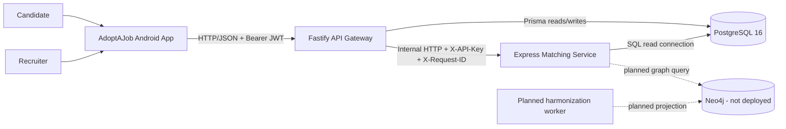

### 2.1.2 Goals and Context

The immediate goal is a reproducible local demonstration with synthetic data, not a public recruiting platform. The architecture must keep database access out of Android, scope recruiter operations to the authenticated company, retain candidate actions safely, and make ranking failure non-fatal to feed delivery. The full SRS also defines future chat, applications, unmatching, reporting, notification, privacy, graph and quality requirements; their database foundations must not be mistaken for delivered user-facing features. [R2] [R12] [R13]

### 2.1.3 Significant Driving Requirements

**Discovery and state:** `REQ-FUNC-008/009` and `REQ-FUNC-011–017` drive company-scoped cards, published-card discovery, one swipe per candidate/card, feedback actions and recruiter decisions. Only a `LIKE` on a Job Card is eligible for recruiter review; Company Card likes are ranking signals only. A human recruiter, not the ranking algorithm, creates a match. [R2]

**Identity and privacy:** `REQ-FUNC-001–004`, `REQ-FUNC-025`, `REQ-SEC-*` and `REQ-COMP-*` drive password hashing, age/notice affirmation, consent records, JWT validation and revocation, company membership, authorization, transport security, data minimization, export and deletion. The current registration handler records a draft notice version and a boolean age affirmation; it does not verify a person's age or establish legal approval of the notice. Account export/deletion, rate limiting and several privacy operations remain unimplemented. [R2] [R9] [R10]

**Reliability and quality:** `REQ-REL-001/002`, `REQ-OBS-001–003` and `REQ-ML-001–008` drive idempotent writes, feed fallback, request correlation, ranking behavior and the planned graph deletion/rebuild rules. `REQ-INST-*`, `REQ-BUILD-*`, `REQ-MAINT-*` and `REQ-POC-001` drive repeatable local setup, seeded fixtures, automated checks and a device demonstration. Code presence alone does not establish those acceptance criteria. [R2] [R12] [R14] [R19]

## 2.2 Solution Background

The implemented solution separates presentation, API policy, relational persistence and ranking. Android is a client only; Fastify is the public API and write owner; Express is an internal ranking component; PostgreSQL is authoritative. The current deployment configuration packages the backend and ranker with PostgreSQL in Docker Compose. Neo4j remains a target extension, not a current runtime dependency. [R1] [R9] [R10] [R11] [R12]

### 2.2.1 Architectural Approaches

| Decision | Approach | Rationale and trade-off |
|---|---|---|
| A1 | Native Android over the initial Expo plan | Kotlin/Jetpack Compose is the checked-in mobile implementation. It reuses the earlier interface concept, not Expo runtime code. This provides one Android client and no delivered iOS client. [R6] [R8] [R13] [R16] [R22] |
| A2 | Fastify/Prisma owns application writes | The gateway is the client-facing authorization boundary and Prisma migrations define PostgreSQL. This centralizes writes, but the ranker currently reads the same database using a connection string that is not provisioned as a read-only role. Least-privilege SQL access is a deployment/security target. [R9] [R10] [R11] [R12] |
| A3 | Deterministic ranking with a gateway fallback | Express applies weighted tag overlap and prior-swipe exclusion. Fastify times out the ranker call and falls back to newest-first eligible cards. This keeps the feed available but does not yet implement the full SRS feedback, cold-start diversity, pagination or graph signals. [R2] [R9] [R11] |
| A4 | Public gateway with authenticated internal ranker | Android calls Fastify; Fastify calls `POST /internal/matching/rank` with `X-API-Key` and `X-Request-ID`. The ranker does not expose its raw SQL rows as a public mobile API. The local Compose file still publishes port 4000 on the host, so network isolation is not enforced by the current local configuration. [R9] [R11] [R12] [R35] |
| A5 | PostgreSQL-authoritative matching records | `Match` has candidate, recruiter and card foreign keys and a unique key per candidate/recruiter/card. However, the recruiter decision remains a single field on `Swipe`; the current interested-list flow therefore does not fully implement independent decisions by multiple recruiters. The design needs a recruiter-decision relation or equivalent state model. [R2] [R10] [R36] |

### 2.2.2 Analysis Results

This revision is a static architecture review of the pinned GitHub source, schema, migrations, contracts, Compose file, test sources and manual test guide. No build, test suite, live database, emulator or end-to-end command was executed as part of preparing this document. The committed backend test sources contain three Fastify foundation tests and thirteen seed-generator test cases; the Android contract test source contains three JSON-serialization tests. These are source inventories, not a claim that the tests passed in this review. [R14] [R17] [R18]

**Implemented behavior visible in source:** registration/login/session/logout handlers; candidate profile read/update; feed ranking integration and PostgreSQL fallback; swipe persistence with an idempotency key; recruiter card list/create; interested-candidate listing; recruiter accept/decline handler; match listing; health/readiness probes; Express internal ranking endpoint with API-key validation; and three-service Compose configuration. Automated tests currently cover only a small subset of those behaviors. [R9] [R10] [R11] [R12] [R17] [R18]

**Material limits:** the feed fetches at most 100 eligible cards in Fastify, returns `nextCursor: null`, and does not implement cursor pagination. The matching service ranks the eligible set it reads from PostgreSQL and sorts by score then publication date, without a tertiary deterministic tie-break. The fallback sorts the gateway's fetched set newest-first. Feed performance and fairness targets have not been measured. [R2] [R9] [R11]

**Recruiter transaction limits:** the schema permits a separate `Match` row per candidate/recruiter/card, but `Swipe.decision` is shared by the candidate/card pair and the interested list only returns `PENDING` swipes. After one recruiter accepts or declines, the swipe disappears from the list for every other recruiter in that company. The decision handler also lacks an explicit pending-state guard; repeated accepts can hit the match uniqueness constraint, and decline is not grouped atomically with a match-state check. This does not fully satisfy `REQ-FUNC-017`. [R2] [R9] [R10]

**Quality-attribute scenarios (targets, not measurements):** the SRS targets feed p95 at or below 1.5 seconds for a 20-card feed under the specified five-minute/1,000-card/50-candidate load; swipe acknowledgement p95 at or below 500 ms; and a UI card advance below 200 ms even when server acknowledgement is delayed. The reliability target calls for a newest-first PostgreSQL fallback after a one-second ranker failure and graph-signal omission after a 300 ms graph delay. The graph design also calls for synchronization at least every 15 minutes and applicable erasure within 24 hours. None of these performance, freshness or erasure targets is measured or demonstrated by the current test evidence. The current 100-card fetch cap, missing cursor, non-deterministic tie handling and absent Neo4j pipeline are material barriers to claiming those targets. [R2] [R4] [R9] [R10] [R11]

**Security and privacy limits:** JWTs are signed with HS256 and expire after 24 hours; logout records the token JTI for revocation. Passwords are hashed with scrypt. Registration hard-codes privacy notice version `0.1-draft`; the age field is a user affirmation, not age verification. The Fastify logger redacts authorization and cookie headers, but the Express ranker uses `console.error` and does not provide structured request-ID correlation. The interested-candidate DTO falls back to candidate email when display name is null. The matching service uses the same database credentials supplied to the backend in Compose; no read-only database role is provisioned. No rate-limiting implementation is visible in the backend package or route registration. [R9] [R10] [R11] [R12]

**Operational limits:** Compose declares PostgreSQL, backend and matching containers, health checks, dependencies and a persistent PostgreSQL volume. It publishes host ports 5432, 3000 and 4000. The backend Dockerfile applies migrations at container startup before launching Fastify. The backend `/ready` route actively probes PostgreSQL and the matching service and returns 503 when a dependency is unavailable. The backend container health check uses `/health`, not `/ready`. Compose also gates backend startup on matching being healthy, so the runtime feed fallback does not remove the matching service as a cold-start dependency. No GitHub Actions workflow is present in the pinned repository tree. [R1] [R9] [R11] [R12] [R19]

### 2.2.3 Requirements Coverage

**Accounts and profile:** registration, login, current-session validation, logout/revocation and candidate profile routes are implemented in Fastify. Registration stores consent timestamp/version and age/privacy booleans, but uses a draft notice version and creates a new company for each recruiter registration. Company invitation/join endpoints, account export/deletion, brute-force/rate-limit controls and full privacy acceptance evidence remain outstanding. [R2] [R9] [R10]

**Cards, swipes and matches:** candidate feed/swipe and recruiter card/interested/decision/match routes are present. Card creation is implemented, but card edit/unpublish/delete endpoints are not present. The swipe route supports `LIKE`, `PASS`, `GREEN_FLAG` and `RED_FLAG`; the current ranker excludes previously swiped cards but does not implement the SRS green/red similar-card feedback. The multiple-recruiter decision requirement remains only partially supported. [R2] [R9] [R10] [R11]

**Post-match and moderation:** the schema contains `Message`, `Application` and `Report` models and `Match.endedAt`, but the reviewed Fastify route registration and Android client do not provide chat, CV upload/application, unmatch or report operations. Database tables are not evidence of delivered workflows. [R2] [R6] [R9] [R10]

**Feed, fairness and privacy:** the ranker implements weighted overlap of candidate/card tags (SKILL 3, ROLE 2, other tag types 1) and excludes cards with a prior swipe. It does not yet implement full green/red flag influence, sector-diverse cold start, graph ranking, cursor pagination or measured quality/performance targets. Protected attributes are deliberately absent from the current schema; proxy-fairness review remains a requirement. [R2] [R10] [R11]

**Delivery and operations:** local Compose services, a PostgreSQL volume, container health checks, backend readiness probes, npm scripts, seed generation and manual test instructions are checked in. No configured Actions workflow or recorded end-to-end test report is present in the pinned tree. A manual test guide is a procedure, not proof of execution. [R12] [R14] [R17] [R19] [R26] [R37]

### 2.2.4 Summary of Background Changes Reflected in Current Version

**Earlier baseline:** the previous SAD described commit `8c9e2e7`, where product routes were mostly stubs and the Express ranker was standalone. That commit remains a valid historical reference; it is simply no longer the current architecture baseline. [R38]

**W9 backend and integration work:** Jean-Baptiste's later commits add Prisma runtime initialization and validated configuration; JWT/password/consent handling; revoked-token and idempotency schema; normalized errors and request IDs; candidate profile/feed/swipe routes; recruiter card/interested/decision routes; match listing; internal matching authentication and API contract reconciliation; Docker service wiring; and manual test/traceability documentation. The current SAD records those modules as implemented in source while preserving the remaining workflow and verification gaps. [R9] [R10] [R11] [R12] [R35] [R38]

**Other team contributions:** Peter's native Android client and frontend contract, Nils's Express ranking implementation, Alba's PostgreSQL schema/seed and SRS, and Levis's planned Neo4j graph design are represented in the relevant module, data and allocation views. The graph pipeline itself is not represented as implemented. [R6] [R10] [R11] [R14] [R22] [R23] [R24]

## 2.3 Product Line Reuse Considerations

AdoptAJob has no committed software product line. The single Android application supports two roles, and the debug/release API transport modes support development versus deployment rather than separate products. [R6] [R16]

The REST boundary, synthetic seed generator and independent ranker are candidates for reuse in later course work, but no second application, production deployment or iOS equivalent is delivered by this document. The adapter must be stabilized before reusing it. [R2] [R3] [R8] [R11] [R26]

# 3 Views

The four views describe the same pinned system from different architectural concerns: source organization, runtime interaction, execution allocation and data ownership. Solid connectors indicate a source/configuration-backed relationship; dashed connectors identify planned or unimplemented elements. A handler present in source is not automatically an end-to-end tested capability. [R1] [R20]

| Name of view | Viewtype that defines this view | Types of elements and relations shown | Is this a module view? | Is this a component-and-connector view? | Is this an allocation view? |
|---|---|---|---|---|---|
| Module | Module | Source packages, code ownership, dependency and schema ownership | Yes | No | No |
| C&C | Runtime | Processes, HTTP/SQL connectors, request sequences and failure paths | No | Yes | No |
| Deploy. | Deployment | Device, workstation, Compose services, ports, volumes and build environment | No | No | Yes |
| Data | Data / information | Relational entities, keys, cardinality, authority and target projection | Yes | No | No |

## 3.1 Module View

### 3.1.1 View Description

The Module View decomposes the pinned source into the Android client, Fastify backend, Express matching service, PostgreSQL schema/migrations and planned Neo4j projection. It shows source responsibility and dependency, not runtime success. [R1]

### 3.1.2 View Packet Overview

Packet #1 maps the modules and their ownership. Runtime behavior is described in §3.2, deployment in §3.3 and persisted relationships in §3.4.

### 3.1.3 Architecture Background

The earlier project plan mentioned Expo and Python/FastAPI. The current mobile source is native Kotlin/Jetpack Compose, and the current matching service is TypeScript/Express. Those earlier technologies are historical context, not part of the pinned runtime. [R5] [R6] [R11] [R13]

### 3.1.4 Variability Mechanisms

Android's API base URL is configured through the Gradle build configuration. Backend host, port, database URL, JWT secret, matching URL, timeout and matching API key are environment-driven. Matching port and database connection are environment-driven. The Prisma schema and migration history are version-controlled rather than runtime-selectable. [R9] [R10] [R11] [R16]

### 3.1.5 View Packets

#### 3.1.5.1 View packet #1: Source structure and ownership

##### 3.1.5.1.1 Primary Presentation

Figure 2 shows the current module responsibilities and connectors. The graph projection remains a dashed target element.

### Figure 2: AdoptAJob implementation modules

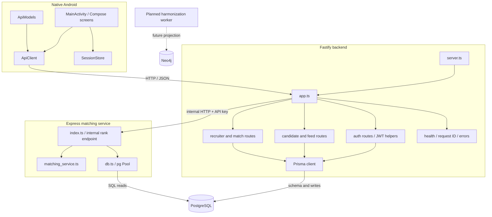

##### 3.1.5.1.2 Element Catalog

###### 3.1.5.1.2.1 Elements

**Android — Peter:** `src/mobile/AdoptAJob/app`. `MainActivity.kt` hosts the role-aware Compose experience: authentication, candidate feed, profile, matches and recruiter workspace. `ApiClient.kt` uses `HttpURLConnection`, coroutine IO and Gson for HTTP/JSON; `ApiModels.kt` defines DTOs; `SessionStore.kt` stores the bearer token using encrypted preferences. The checked-in Android contract tests verify JSON serialization, not a live server flow. [R6] [R7] [R14] [R18] [R33] [R34]

**Backend — Jean-Baptiste:** `src/backend/src`. `server.ts` loads validated configuration and starts Fastify. `app.ts` creates the Prisma client, configures request-ID and normalized error handling, and registers health, auth, feed, candidate, recruiter and match routes. Route modules implement the public API and use `currentUser` for token validation and role checks. Prisma schema/migrations and seed code live under `src/backend/prisma`. [R9] [R10] [R14] [R27]

**Matching — Nils:** `src/matching-service/src`. `index.ts` exposes `/health` and the API-key-protected `POST /internal/matching/rank`; `matching_service.ts` retrieves eligible cards and computes weighted tag-overlap scores; `db.ts` creates the PostgreSQL `pg` pool. The matching process is a separate service, not a Python/FastAPI service. [R11] [R32]

**Data design — Alba and Levis:** Alba owns the PostgreSQL schema, migrations and synthetic seed. Levis owns the Neo4j model/projection design with Alba's data harmonization input. The Neo4j worker, graph database and projection are not present as a running component at this revision. [R4] [R10] [R14] [R28]

###### 3.1.5.1.2.2 Relations

`MainActivity` composes screens and delegates network calls to `ApiClient`; `SessionStore` supplies the bearer token. Fastify route modules call Prisma for application reads/writes. The feed route calls the Express ranking endpoint and then hydrates ranked card IDs from PostgreSQL. Express independently queries PostgreSQL through `pg`; it does not write canonical application records. [R6] [R7] [R9] [R10] [R11]

###### 3.1.5.1.2.3 Interfaces

Android sends JSON over HTTP(S) using `BuildConfig.API_BASE_URL`; protected requests use `Authorization: Bearer <JWT>`. Fastify uses Prisma-generated client models and the backend-owned migration history. Fastify calls Express at `/internal/matching/rank` with `X-API-Key` and `X-Request-ID`. Express reads mapped snake_case PostgreSQL tables. The current Compose environment supplies the matching service with the same database credentials as the backend; a dedicated read-only role is not configured. [R9] [R10] [R11] [R12] [R16] [R33]

###### 3.1.5.1.2.4 Behavior

On app startup, the client restores a locally stored token and calls `/auth/me`; invalid sessions are cleared. Candidate users see Feed, Profile and Matches; recruiters see the recruiter workspace. Candidate actions and recruiter decisions are sent through the API client. UI role selection is not a security boundary: authorization must be enforced by Fastify. [R6] [R7] [R9]

###### 3.1.5.1.2.5 Constraints

Android must not connect directly to PostgreSQL or Express. The Express ranker must not become a second write authority. The graph store, when implemented, must remain a derived and minimized projection. API DTOs must remain distinct from Prisma/database rows. [R2] [R6] [R9] [R10] [R11]

##### 3.1.5.1.3 Context Diagram

The repository contains three distinct contract artifacts: SRS v1.0 (requirements), `API_CONTRACT.md` (API v1) (intended integration contract) and `openapi.yaml` v0.1.0 (historical API baseline). The latter two are not fully reconciled with each other or every runtime response. The API contract file declares API version `v1`; it does not declare a separate document revision. [R2] [R3] [R35]

### Figure 3: Module boundaries and contract artifacts

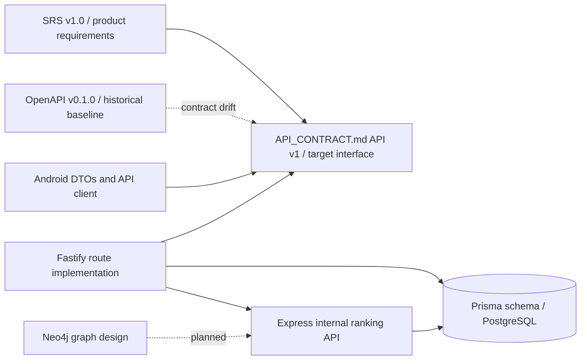

##### 3.1.5.1.4 Variability Mechanisms

The Android client uses one APK with role-specific screens. The backend and matching service can run as separate processes or as Compose containers. API URL, ports and credentials are environment/build configuration. There is no separate recruiter binary, web client or iOS module in the pinned source. [R6] [R11] [R12] [R16]

##### 3.1.5.1.5 Architecture Background

The gateway isolates the Android client from persistence and ranking internals. The independent matching package allows scoring logic to evolve without exposing raw SQL records to the mobile client. The current implementation still shares PostgreSQL credentials and has an incomplete multi-recruiter decision model; those are explicit architecture risks, not hidden assumptions. [R9] [R10] [R11] [R12]

##### 3.1.5.1.6 Related View Packets

§3.2 describes route behavior and runtime calls; §3.3 maps processes to Android and Compose hosts; §3.4 describes PostgreSQL authority, match cardinality and the target graph projection.

## 3.2 Component-and-Connector View

### 3.2.1 View Description

This view describes the processes that communicate at runtime: Android, Fastify, Express and PostgreSQL. Neo4j and the harmonization worker are target-only. It distinguishes route code from verified end-to-end execution. [R1] [R9] [R10] [R11]

### 3.2.2 View Packet Overview

Packet #1 contains the current runtime topology, public and internal interfaces, authentication/feed/swipe/recruiter sequences and service failure behavior. Appendix A.1 provides the API crosswalk.

### 3.2.3 Architecture Background

Fastify is the public API and authorization boundary. It owns transactional application writes through Prisma. Express performs ranking and reads PostgreSQL. A candidate's ranked feed is not a hiring decision; only an authorized recruiter can accept a Job Card like. [R2] [R9] [R10] [R11]

### 3.2.4 Variability Mechanisms

The matching timeout is configured by `MATCHING_TIMEOUT_MS` (Compose sets 1000 ms). If the internal rank request fails, times out or returns a non-success response, Fastify uses a PostgreSQL-backed newest-first fallback. There is no Neo4j timeout path in the current runtime because Neo4j is not connected. [R9] [R11] [R12]

### 3.2.5 View Packets

#### 3.2.5.1 View packet #1: Public gateway, ranking and product sequences

##### 3.2.5.1.1 Primary Presentation

Figure 4 shows the implemented request path. The dotted Neo4j connector is planned only.

### Figure 4: Runtime containers and connectors

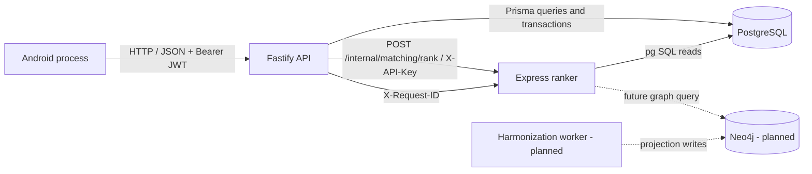

##### 3.2.5.1.2 Element Catalog

###### 3.2.5.1.2.1 Elements

**Android:** one device/emulator process using Compose, HTTP/JSON, bearer-token storage and loading/empty/error UI states. The client is a consumer of the gateway, not an authorization authority. [R6] [R7] [R16]

**Fastify:** Node.js/TypeScript API process. It registers authentication, candidate profile/feed, swipe, recruiter cards/interested/decision, matches, health and readiness routes. It validates JWTs, checks revoked token JTIs and user roles, applies company scoping in recruiter handlers, and returns normalized application errors. [R9]

**Express matching service:** TypeScript/Express process. It exposes `/health` and `POST /internal/matching/rank`; the rank route checks `X-API-Key` using a length check and `timingSafeEqual`, validates candidate ID and limit, and returns ordered `{items:[{cardId,score}]}`. It reads PostgreSQL via `pg`. [R11]

**PostgreSQL:** PostgreSQL 16 is the canonical store. Fastify accesses it through Prisma. Express uses a separate `pg` connection pool but currently receives the same database user credentials in Compose. [R10] [R11] [R12]

###### 3.2.5.1.2.2 Relations

Android calls Fastify over HTTP/JSON. Fastify uses the request ID created or accepted by its request hook, returns it in `X-Request-ID`, and forwards it to Express on ranking requests. Express currently does not add a matching response header or implement a structured cross-service trace/log correlation layer. [R9] [R11]

Fastify performs candidate and recruiter reads/writes through Prisma. The feed route first fetches eligible cards from PostgreSQL, calls Express for ranking, maps returned card IDs to the gateway's eligible records, and returns public card DTOs. If ranking is unavailable, it sorts the gateway-fetched eligible records by publication date. [R9] [R10] [R11]

###### 3.2.5.1.2.3 Interfaces

**Authentication and account:** `POST /auth/register`, `POST /auth/login`, `GET /auth/me` and `POST /auth/logout` are implemented. Passwords are hashed with scrypt. JWTs use HS256 and a 24-hour expiry. `currentUser` verifies token signature/claims, checks the revoked-token table and loads the user. Logout stores the token JTI and expiry in `revoked_tokens`. [R9] [R10]

**Candidate:** `GET/PUT /candidate/profile`, `GET /candidate/feed` and `POST /candidate/swipes` are implemented. Candidate routes require a valid candidate role. The profile uses tag records for desired roles, skills, locations and contract preference. [R9] [R10]

**Recruiter:** `GET/POST /recruiter/cards`, `GET /recruiter/interested` and `POST /recruiter/interested/:swipeId/decision` are implemented. Recruiter handlers require the recruiter role and a company ID, scope card/interested queries to that company, and validate that a decision targets a Job Card like belonging to the same company. Card edit, unpublish and delete routes are not present. [R9] [R10]

**Matches:** `GET /matches` returns active matches scoped to the authenticated candidate or recruiter. Chat, application/CV, unmatch and report endpoints are not registered in the reviewed Fastify app. [R9] [R10]

**Internal ranking:** Fastify calls `POST /internal/matching/rank` with `{candidateId,limit,cursor:null}`, `X-API-Key` and `X-Request-ID`. Express validates the key and returns ordered card IDs and scores. The matching route validates `candidateId` and `limit` but currently ignores cursor semantics. [R9] [R11] [R35]

**Health:** Fastify `GET /health` reports process health. `GET /ready` executes `SELECT 1` against PostgreSQL and calls Express `/health`; it returns 503 if either dependency is unavailable. The Compose backend container health check uses `/health`, while `/ready` is the dependency-readiness probe. Express `/health` is implemented. [R9] [R11] [R12]

###### 3.2.5.1.2.4 Behavior

**Registration, login and session.** Registration normalizes email and role, requires a display name, a password of at least eight characters, `ageConfirmed=true` and `privacyAccepted=true`; recruiter registration additionally requires company name and sector. In one database transaction it creates a new company for a recruiter, creates the user and stores consent time, `privacyNoticeVersion="0.1-draft"`, and the two boolean confirmations. Password hashing uses scrypt. Successful registration returns 201 with `{user,token}`; duplicate email returns 409 and validation failures return 422. Login returns `{user,token}` on success and a generic 401 for invalid credentials. `/auth/me` returns the authenticated user; logout records the JTI and returns 204. The draft notice version and automatic new-company creation are limitations: no invitation/join API exists, and the current route does not establish an approved privacy notice or independently verify age. [R2] [R9] [R10]

### Figure 5: Registration, consent and login

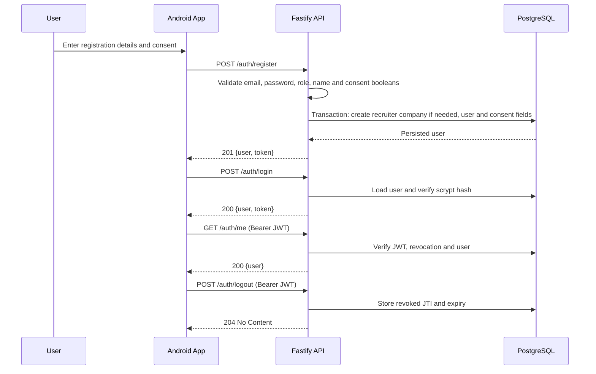

**Candidate feed.** Fastify authenticates the candidate and fetches up to 100 published, not-previously-swiped cards from PostgreSQL. It calls Express with a one-second timeout. Express reads eligible cards and tags, assigns 3 points for a matching SKILL tag, 2 for ROLE and 1 for other matching tag types, then sorts by score descending and publication date descending. Fastify maps returned IDs to its fetched card set and returns `{cards,source,nextCursor}`. If the ranker fails, Fastify sorts its eligible set newest-first and reports `POSTGRESQL_FALLBACK`. `nextCursor` is currently always null; cursor pagination is not implemented. The Fastify query has no explicit order before its 100-row cap, and the ranker sort has no tertiary tie-break, so ranking order and feed completeness are not yet deterministic at larger data volumes. Green/red flags are stored as swipe actions but do not yet influence similar-card scores. [R2] [R9] [R10] [R11]

### Figure 6: Candidate feed and ranking fallback

```mermaid
sequenceDiagram
    participant A as Android App
    participant F as Fastify API
    participant E as Express Ranker
    participant P as PostgreSQL
    A->>F: GET /candidate/feed (Bearer JWT)
    F->>P: Fetch up to 100 published cards without prior candidate swipe
    F->>E: POST /internal/matching/rank (candidateId, limit, cursor=null)
    Note over F,E: X-API-Key and X-Request-ID; timeout 1000 ms
    E->>P: Read eligible cards and candidate/card tags
    E-->>F: Ordered cardId and score items
    F->>F: Hydrate IDs from fetched eligible set; limit response
    F-->>A: 200 {cards, source, nextCursor:null}
    alt Ranker unavailable or timeout
        F->>F: Sort fetched eligible cards by publishedAt descending
        F-->>A: 200 {cards, source: POSTGRESQL_FALLBACK, nextCursor:null}
    end
```

**Swipe and recruiter decision.** Candidate swipe requests accept `LIKE`, `PASS`, `GREEN_FLAG` and `RED_FLAG` and require a UUID v4 `Idempotency-Key`. The handler first checks the candidate/key pair; a reused key with a different card/action returns 409. It then checks whether the candidate/card pair already exists and returns that existing action if so; otherwise it inserts one swipe. Only a Job Card `LIKE` receives `PENDING` recruiter decision state. The handler currently returns the framework's default 200 response rather than the API contract's 201; the same-key replay is not explicitly returned with the original 201 status. [R9] [R10] [R35]

The recruiter interested list is scoped to the recruiter's company and includes Job Card likes with `decision=PENDING`. `ACCEPT` updates the shared Swipe decision and creates a Match in one Prisma transaction. `DECLINE` updates the Swipe decision without creating a match. Match rows are unique per candidate/recruiter/card, but the single decision field on Swipe means that the first decision removes the candidate from the interested list for every recruiter in that company. The route does not require the swipe to remain pending before processing a decision. Repeated accept can hit the Match unique constraint; a later decline can change the swipe state while leaving an already-created match. Therefore, the route exists but the SRS's independent multi-recruiter decision behavior is not complete. [R2] [R9] [R10]

### Figure 7: Candidate swipe and recruiter decision flow

```mermaid
sequenceDiagram
    participant C as Candidate
    participant A as Android App
    participant F as Fastify API
    participant P as PostgreSQL
    participant R as Recruiter
    participant RA as Recruiter Android UI
    C->>A: Like a Job Card
    A->>F: POST /candidate/swipes {cardId, action: LIKE}
Idempotency-Key: UUIDv4
    F->>P: Check idempotency key and candidate/card uniqueness
    F->>P: Insert swipe with PENDING decision
    F-->>A: 200 {recorded, cardId, action}
    R->>RA: Open interested-candidates list
    RA->>F: GET /recruiter/interested (Bearer JWT)
    F->>P: Query PENDING Job Card likes for recruiter's company
    F-->>RA: 200 {swipes}
    R->>RA: Accept or decline
    RA->>F: POST /recruiter/interested/{swipeId}/decision
    alt ACCEPT
        F->>P: Transaction: set swipe ACCEPTED and create recruiter-scoped Match
        F-->>RA: 200 {decision: ACCEPT, match}
    else DECLINE
        F->>P: Update shared swipe decision to DECLINED
        F-->>RA: 200 {decision: DECLINE, match: null}
    end
    A->>F: GET /matches (Bearer JWT)
    F->>P: Query active matches for candidate
    F-->>A: 200 {matches}
    Note over F,P: One shared Swipe.decision currently prevents independent multi-recruiter review
```

###### 3.2.5.1.2.5 Constraints

All public product operations must authenticate and authorize on the server. Recruiter card and interested-candidate access is company-scoped in the current route handlers. The current interested DTO falls back to candidate email when display name is null; this is a privacy-sensitive behavior to remove or explicitly approve. Local Compose uses plain HTTP and publishes database/matching ports on the host; deployed use requires TLS and private service/database networking. Rate limiting, account deletion/export and complete consent governance are not implemented. [R2] [R9] [R10] [R12]

##### 3.2.5.1.3 Context Diagram

The intended public ingress is Fastify. The current local Compose file also publishes Express port 4000 and PostgreSQL port 5432 on the host for development; the internal API key protects the rank endpoint but does not replace network isolation. A hardened deployment should expose only the gateway and keep the database and ranker on a private network. [R11] [R12]

### Figure 8: Runtime ingress and trust boundaries

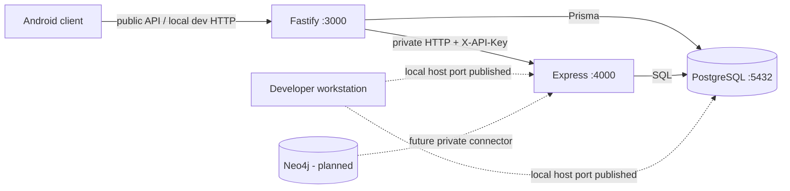

##### 3.2.5.1.4 Variability Mechanisms

Candidate/recruiter behavior is selected in the client by the authenticated user's role, but Fastify enforces role and company authorization. Matching timeout and service URL are configurable. The ranking fallback is automatic. Cursor paging, graph augmentation and a production TLS/private-network deployment are not active runtime options at this revision. [R2] [R9] [R11] [R12]

##### 3.2.5.1.5 Architecture Background

The architecture separates responsibilities by trust: Android presents actions, Fastify authenticates and applies policy, PostgreSQL persists authoritative state, and Express ranks opportunities. The human recruiter remains responsible for acceptance. The main current design risk is not the absence of the backend adapter—it exists—but the incomplete recruiter-decision cardinality and incomplete feed behavior around it. [R2] [R9] [R10] [R11]

##### 3.2.5.1.6 Related View Packets

§3.1 names the route and service modules; §3.3 describes the Compose deployment; §3.4 records the exact relational cardinalities and known schema/design discrepancies; Appendix A.1 compares Android, API contract, OpenAPI and runtime behavior.

## 3.3 Allocation View

### 3.3.1 View Description

The Allocation View maps the Android client to a device/emulator and maps PostgreSQL, Fastify and Express to the local Docker Compose environment. It describes the academic local topology only; no production deployment is claimed. [R1] [R12] [R16]

### 3.3.2 View Packet Overview

Packet #1 covers the local device, Compose services, ports, volume, configuration, build/test tooling and current CI status.

### 3.3.3 Architecture Background

The current repository supports a three-service local stack: PostgreSQL 16.13, the Fastify backend and the Express matching service. The Android app runs separately on an emulator or physical device and connects to the host's gateway port. Compose service health checks and dependency ordering support local startup; migrations and seed execution remain explicit setup steps. [R11] [R12] [R26]

### 3.3.4 Variability Mechanisms

Host ports and credentials are configured through the root `.env`; the backend uses `HOST`, `PORT`, `DATABASE_URL`, `JWT_SECRET`, `MATCHING_SERVICE_URL`, `MATCHING_TIMEOUT_MS` and `MATCHING_SERVICE_API_KEY`. Matching uses `MATCHING_PORT`, `MATCHING_DATABASE_URL` and the same internal key. Android selects its API base URL through Gradle configuration. [R9] [R11] [R12] [R16] [R25]

### 3.3.5 View Packets

#### 3.3.5.1 View packet #1: Local development, delivery and observability

##### 3.3.5.1.1 Primary Presentation

Figure 9 shows the checked-in Compose topology. The database and matching ports are published to the development host; this is a local-development convenience and should be restricted in a deployed environment.

### Figure 9: Local deployment allocation

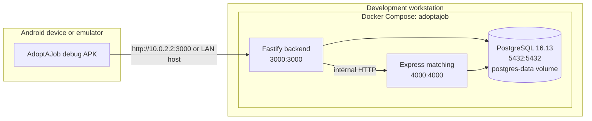

##### 3.3.5.1.2 Element Catalog

###### 3.3.5.1.2.1 Elements

**Android device/emulator:** The native app is built with the Gradle wrapper and Android SDK. The emulator commonly reaches the host gateway through `http://10.0.2.2:3000`; a physical device uses a development LAN address. The app is not a Compose service. [R6] [R16] [R25]

**PostgreSQL container:** `postgres:16.13`, health-checked with `pg_isready`, persistent named volume `postgres-data`, host port 5432 by default. [R12]

**Backend container:** built from `src/backend/Dockerfile` using Node.js 22, listens on port 3000 and uses validated environment configuration. The image build installs dependencies, generates the Prisma client and compiles TypeScript. Its startup command runs `npm run db:deploy` before `npm start`; its container health check calls `/health`. Compose waits for PostgreSQL and matching to become healthy before starting the backend. [R9] [R12] [R27]

**Matching container:** built from `src/matching-service/Dockerfile`, listens on port 4000, connects to PostgreSQL with `MATCHING_DATABASE_URL` (falling back to `DATABASE_URL` in source) and exposes `/health`. Compose publishes port 4000 to the host. The current Compose configuration supplies the same PostgreSQL username/password to both backend and matching. [R11] [R12] [R32]

**GitHub and build tooling:** the repository includes backend npm scripts for build, typecheck, tests and Prisma operations; matching scripts for build/dev/start; and Android Gradle wrapper/test tasks. No `.github/workflows` file is present in the pinned repository tree, so there is no committed Actions pipeline evidenced by this baseline. [R1] [R15] [R16] [R17] [R18] [R19] [R27] [R32]

###### 3.3.5.1.2.2 Relations

Compose starts PostgreSQL first and waits for its health check. Matching depends on healthy PostgreSQL. Backend depends on both PostgreSQL and matching health. Its Dockerfile runs committed Prisma migrations on container startup before starting Fastify; the Prisma client is generated during image build. The backend `/ready` endpoint separately probes PostgreSQL and matching; its container health check uses `/health`, which only reports process health. Seed data is optional and destructive to existing local application rows. When running the backend manually outside Compose, use the documented npm migration/generation commands. [R9] [R10] [R11] [R12] [R26]

###### 3.3.5.1.2.3 Interfaces

The backend listens on host/container port 3000, matching on 4000 and PostgreSQL on 5432 unless overridden. `MATCHING_SERVICE_URL` points to `http://matching:4000` inside Compose. The Android emulator uses `10.0.2.2` to reach host-published port 3000. The local stack uses HTTP; release Android configuration disables cleartext and deployed use requires HTTPS. The host-published matching and database ports should be removed or loopback-bound in a hardened deployment. [R12] [R16] [R25]

###### 3.3.5.1.2.4 Behavior

The documented local procedure is: configure root `.env`; run `docker compose up -d --build`; allow the backend container to run `prisma migrate deploy` on startup; optionally seed a throwaway local database; verify `/health` and `/ready`; then install/run the Android app against the gateway URL. The manual guide provides commands for registration, profile, feed/fallback, swipe replay, recruiter decision and matches. Those are test instructions, not evidence that a live run has passed. [R12] [R26] [R37]

The matching service is health-checked separately. Backend `/ready` returns 503 if the database or matching health endpoint is unavailable. The current service health checks do not prove that Android can complete a full user journey or that database migration state is current. [R9] [R11] [R12]

###### 3.3.5.1.2.5 Constraints

The current Compose file is for local development, not production. It publishes database and ranker ports, uses one database credential for both services, and does not configure TLS, secrets management, network policy, backup/restore, or production monitoring. No automated GitHub Actions workflow or measured coverage gate is evidenced. [R12] [R15] [R19]

##### 3.3.5.1.3 Context Diagram

Figure 10 shows the repository as the source of code/configuration and the build tools used by each component. GitHub is source control; it is not a deployed runtime service.

### Figure 10: Source control and build environment

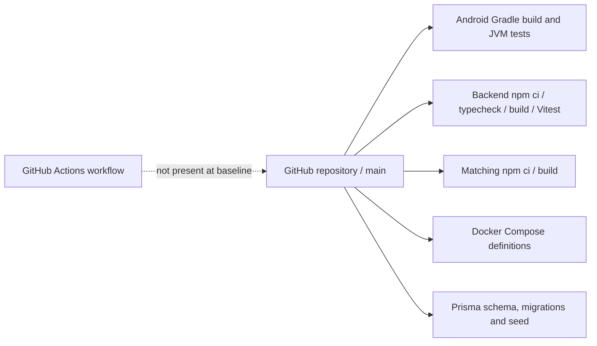

##### 3.3.5.1.4 Variability Mechanisms

Local host ports, database name/user/password, API base URL and matching timeout are configurable. The architecture and data ownership do not change with those settings. The target CI pipeline should run locked installs, type checks/builds and tests on pull requests and protected branch updates; that pipeline is not checked in at this baseline. [R12] [R15] [R19]

##### 3.3.5.1.5 Architecture Background

Compose provides a reproducible local service topology and health-based startup order. It does not replace migration management, secrets handling, private network policy, device verification, load tests or operational acceptance evidence. [R12] [R26] [R37]

##### 3.3.5.1.6 Related View Packets

§3.1 identifies buildable modules; §3.2 defines process connectors and health behavior; §3.4 describes persistent records and access privileges; Appendix A.2 defines evidence needed to close remaining delivery gates.

## 3.4 Data View

### 3.4.1 View Description

The Data View defines PostgreSQL as the canonical system of record and describes the proposed Neo4j projection separately. The Prisma schema and committed migration SQL define the current physical model; the database design document provides rationale but contains some planned decisions not yet implemented. [R4] [R10] [R36]

### 3.4.2 View Packet Overview

Packet #1 covers current relational entities, foreign-key cardinality, unique constraints, application-level rules, data access and target graph projection.

### 3.4.3 Architecture Background

PostgreSQL is authoritative. Fastify uses Prisma for application persistence; Express reads PostgreSQL for ranking. Neo4j is planned as a minimized, rebuildable graph projection. It must not become an independent write authority or an authorization source. [R2] [R10] [R11]

### 3.4.4 Variability Mechanisms

Seed size and deterministic seed value can vary. Schema shape and integrity constraints change only through versioned backend migrations. Neo4j projection is not a runtime option at this revision because the graph service and worker are not implemented. [R10] [R11] [R26]

### 3.4.5 View Packets

#### 3.4.5.1 View packet #1: PostgreSQL authority and planned Neo4j projection

##### 3.4.5.1.1 Primary Presentation

Figure 11 corrects the previous conceptual model to match the current Prisma schema. It deliberately does not invent a `MEMBERSHIP` or `RECRUITER_DECISION` table and does not draw a foreign key from `SWIPE` to `MATCH`. [R10] [R28] [R36]

### Figure 11: Current relational model and planned graph projection

```mermaid
erDiagram
    COMPANY ||--o{ USER : employs
    USER ||--o| CANDIDATE_PROFILE : has
    USER ||--o{ SWIPE : makes
    CARD ||--o{ SWIPE : receives
    COMPANY ||--o{ CARD : owns
    CARD ||--o{ CARD_TAG : has
    TAG ||--o{ CARD_TAG : classifies
    CANDIDATE_PROFILE ||--o{ CANDIDATE_TAG : has
    TAG ||--o{ CANDIDATE_TAG : classifies
    USER ||--o{ MATCH : candidate
    USER ||--o{ MATCH : recruiter
    CARD ||--o{ MATCH : concerns
    MATCH ||--o{ MESSAGE : contains
    USER ||--o{ MESSAGE : sends
    MATCH ||--o| APPLICATION : has
    USER ||--o{ REPORT : submits
    COMPANY ||--o{ INVITATION_CODE : issues
    USER ||--o{ INVITATION_CODE : creates
    USER ||--o{ INVITATION_CODE : redeems

    USER {
        uuid id PK
        string email UK
        string role
        uuid company_id FK
        string password_hash
        datetime privacy_consent_at
        string privacy_notice_version
        boolean age_confirmed
        boolean privacy_accepted
    }
    COMPANY {
        uuid id PK
        string name
        string sector
    }
    CANDIDATE_PROFILE {
        uuid user_id PK
        string education_level
        int years_experience
    }
    CARD {
        uuid id PK
        uuid company_id FK
        string kind
        string status
        datetime published_at
    }
    SWIPE {
        uuid id PK
        uuid candidate_id FK
        uuid card_id FK
        string action
        string decision
        string idempotency_key
    }
    MATCH {
        uuid id PK
        uuid candidate_id FK
        uuid recruiter_id FK
        uuid card_id FK
        datetime created_at
        datetime ended_at
    }
    TAG {
        int id PK
        string type
        string slug
    }
    CARD_TAG {
        uuid card_id PK_FK
        int tag_id PK
    }
    CANDIDATE_TAG {
        uuid candidate_id PK
        int tag_id PK
    }
```

##### 3.4.5.1.2 Element Catalog

###### 3.4.5.1.2.1 Elements

**Canonical PostgreSQL entities:** `users`, `companies`, `invitation_codes`, `candidate_profiles`, `tags`, `candidate_tags`, `cards`, `card_tags`, `swipes`, `matches`, `messages`, `applications`, `revoked_tokens` and `reports`. The current schema does not contain a `memberships` table or a `recruiter_decisions` table. Recruiter-to-company association is stored directly in nullable `users.company_id`; a company can be associated with multiple recruiter users. [R10]

**Candidate profile cardinality:** `candidate_profiles.user_id` is its primary key and foreign key to `users.id`; a user has zero or one candidate profile. The previous Figure 11 incorrectly showed one user to many candidate profiles. [R10]

**Swipe and match cardinality:** one swipe row is unique per `(candidate_id, card_id)` and has one global `decision` field. It also has a unique `(candidate_id, idempotency_key)` key. A Match is a separate entity with candidate, recruiter and card foreign keys and uniqueness on `(candidate_id, recruiter_id, card_id)`. It has `createdAt` and nullable `endedAt`, but no persisted `status` column; the API currently serializes the status string `MATCHED` for returned active rows. Match has no `swipe_id` foreign key; the swipe-to-match relation is a business workflow, not a declared database relationship. [R10] [R36]

**Company membership and invitation:** the `InvitationCode` table exists and the seed generator includes used and unused example codes. However, the reviewed Fastify route set has no invitation creation or redemption endpoint; recruiter registration creates a new company. Therefore, multi-recruiter company membership is represented in the schema and fixtures but is not fully available through the current API. [R9] [R10] [R26]

**Cards:** `COMPANY` or `JOB`, with `DRAFT`, `PUBLISHED`, `UNPUBLISHED` and `DELETED` states. The database has columns for salary bounds/currency, image URL and perks. The current recruiter create handler persists perks but does not map the client's `salaryRange` string into salary fields; card update/unpublish/delete routes are absent. [R9] [R10]

**Other entities:** `RevokedToken` stores JWT JTI/expiry without a user foreign key. `Message`, `Application` and `Report` models are present, but their user-facing workflows are not implemented in the current route registration. [R9] [R10]

**Target Neo4j model:** proposed nodes include Candidate, Card, Company and Tag, with minimized interaction and tag/company relationships. The graph database, harmonization worker, deletion-first synchronization and graph ranking query are not present in the pinned runtime. [R2] [R4] [R14]

###### 3.4.5.1.2.2 Relations

Prisma migrations are the only approved schema-evolution path. Fastify writes canonical product data. Express executes SQL reads using `MATCHING_DATABASE_URL` or `DATABASE_URL`; the current Compose file supplies the same database credentials as the backend, so the source does not prove least-privilege or read-only enforcement. [R10] [R11] [R12]

The current migration `20261121180737_match_per_recruiter` changes Match uniqueness to `(candidate_id,recruiter_id,card_id)`, adds age/privacy boolean fields and swipe idempotency key, and creates `revoked_tokens`. It does not create a `recruiter_decisions` table or change the single `swipes.decision` column into recruiter-specific decisions. [R36]

The separate `database.md` v0.4 describes a planned `recruiter_decisions` table and nullable match participants for deleted-account survivor behavior. Those design decisions are not reflected in the current Prisma schema/migrations: `Match.candidateId` and `Match.recruiterId` are non-null and cascade on user deletion. The schema and design document must be reconciled before claiming those requirements are satisfied. [R4] [R10] [R36]

###### 3.4.5.1.2.3 Interfaces

Fastify uses Prisma for reads/writes. Express uses parameterized SQL through `pg`. No dedicated read-only database role is created by Compose, and the matching container is given the same user/password pair as the backend. The target deployment should provision a least-privilege ranker role, restrict its network path, and keep secrets outside source control. [R10] [R11] [R12] [R15]

###### 3.4.5.1.2.4 Behavior

**Consent and identity:** registration stores `privacyConsentAt`, `privacyNoticeVersion="0.1-draft"`, `ageConfirmed` and `privacyAccepted`; password hashes use scrypt; JWTs expire after 24 hours and logout stores a revoked JTI. No age-verification service, finalized notice version, account deletion/export route, or scheduled revoked-token cleanup is evidenced. [R2] [R9] [R10]

**Swipe and decision:** candidate/card uniqueness enforces one swipe per candidate/card; idempotency key uniqueness supports retry identification. The single `Swipe.decision` field is not per recruiter. The current Match unique key permits separate match records for different recruiter IDs, but the interested-list and decision state machine prevents independent multi-recruiter processing through the normal list workflow. A separate `RecruiterDecision` relation (or equivalent design) and transactional state guard are required to meet the SRS. [R2] [R9] [R10] [R36]

**Graph projection target:** the planned pipeline must minimize graph fields, use canonical IDs, remove deleted candidates before every rebuild attempt, reconcile projected counts, retry failures and preserve only the allowed graph state. The SRS requires deletion to proceed independently of graph rebuild success. Neither Neo4j deployment nor the harmonization worker is checked in as an operational component at this baseline. [R2] [R4] [R24] [R30] [R31]

### Figure 12: Planned deletion-first graph projection and rebuild failure

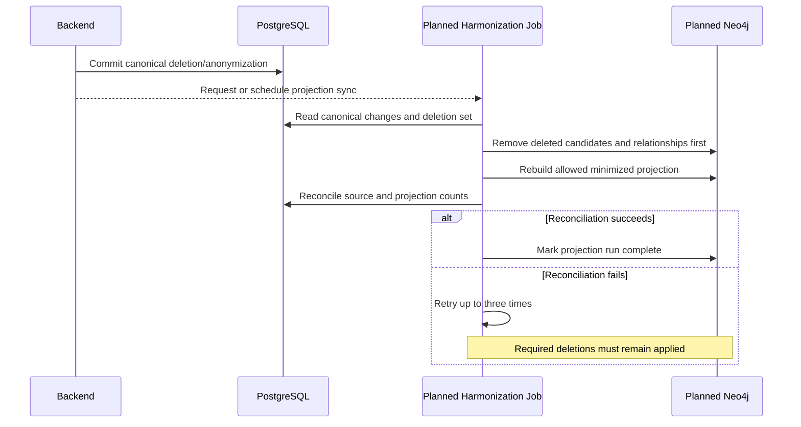

**Deletion and retention:** SRS deletion, export, CV cleanup, survivor-match anonymization and retention schedules are requirements, not completed flows. Current Match foreign keys cascade on user deletion, contrary to the database design's proposed survivor entry. The graph deletion-first mechanism is not deployed. [R2] [R4] [R10]

###### 3.4.5.1.2.5 Constraints

The graph must exclude names, email addresses, password hashes, messages, CVs, protected attributes and other non-approved fields. The current relational schema deliberately omits protected demographic attributes. Do not claim the planned graph allowlist, read-only database role, retention jobs or deletion guarantees are enforced until their code and tests exist. [R2] [R4] [R10] [R11]

##### 3.4.5.1.3 Context Diagram

Figure 13 distinguishes current data paths from the planned graph. The label on the ranker connector is deliberately “SQL read connection”; read-only privileges are not enforced by the current Compose credentials. [R10] [R11] [R12]

### Figure 13: Data authority and access boundaries

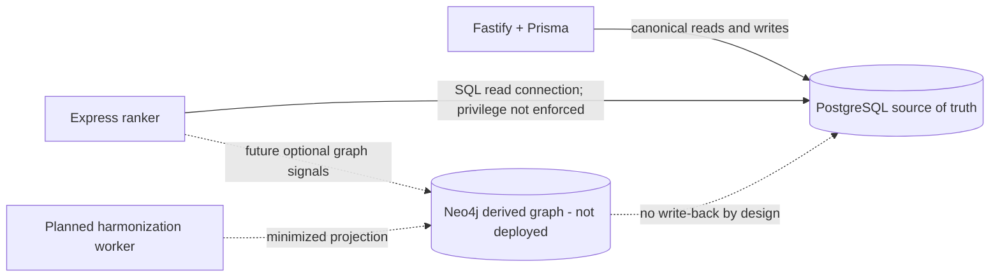

##### 3.4.5.1.4 Variability Mechanisms

Seed counts and seed values can vary without changing the schema. Schema migrations are versioned and applied by the backend owner. Neo4j properties and synchronization policy are design-controlled, not runtime toggles in the current stack. [R10] [R26]

##### 3.4.5.1.5 Architecture Background

PostgreSQL provides transactional integrity and a single authority. The separate matching reader improves algorithm isolation but currently shares credentials. The graph is intended to optimize relationship queries, but it introduces synchronization and deletion risk; it must remain optional and rebuildable. [R2] [R4] [R10] [R11]

##### 3.4.5.1.6 Related View Packets

§3.1 identifies Prisma and ranker modules; §3.2 describes swipe/decision transactions and ranker access; §3.3 shows the three-container topology; Appendix A.2 defines transaction, least-privilege, deletion and end-to-end acceptance evidence.

# 4 Relations Among Views

The views are consistent only when the same module, connector, host and data relationship is described consistently. The following cross-view relations identify the current integration boundaries and the remaining architecture work. [R1] [R20]

## 4.1 General Relations Among Views

**Client/API contract:** Android and the current Fastify route registrations use the singular route family (`/candidate/...`, `/recruiter/...`) and `{user,token}`/wrapper DTOs. OpenAPI v0.1.0 uses plural self-scoped routes and different response shapes. `API_CONTRACT.md` (API v1) is the intended contract but still contains an implementation note claiming several routes are 501/absent; that note is stale at the pinned commit. Its statement that unmatched Fastify URLs return the default Fastify 404 body is also stale because the current app installs a normalized not-found handler. The swipe status/replay and cursor behavior still differ from the target contract. The SAD's runtime descriptions therefore follow source, while the API contract remains the intended interface authority pending reconciliation. [R3] [R6] [R7] [R9] [R35]

**Runtime and observability:** Fastify-to-Express ranking integration is implemented with an API key and request ID forwarding. Fastify responds with `X-Request-ID`; Express does not currently provide end-to-end correlation logging. The backend readiness route probes PostgreSQL and Express, but automated tests do not exercise the dependency failure paths. [R9] [R11] [R17]

**Recruiter decision/data model:** the migration changes Match uniqueness to include recruiter ID, but the `Swipe` table retains one decision for the candidate/card pair. The interested-list query only returns pending swipes. Thus, the schema permits multiple recruiter-scoped Match rows but the normal workflow does not let multiple recruiters independently decide the same swipe. The database design's proposed `recruiter_decisions` table is not migrated. [R2] [R4] [R9] [R10] [R36]

**Company membership:** `companyId` is stored directly on User and an `InvitationCode` table exists, but the public route set has no invitation create/redeem operations. Recruiter registration creates a new company. Seed data that includes invited recruiters is not evidence of an operational membership API. [R9] [R10] [R26]

**Deployment/security:** Compose now defines PostgreSQL, backend and matching containers, but publishes all three service ports to the host. The matching container shares the database credentials with the backend. This is acceptable only as a local development arrangement; it is not the intended production trust boundary. [R11] [R12]

**Verification:** the repository has backend and Android test sources and a manual test guide. The tests do not cover the full live database/device workflow; the guide is not a completed test report. No Actions workflow is checked in at the pinned revision. [R14] [R17] [R18] [R19] [R37]

**Companion-document drift:** `API_CONTRACT.md` (API v1) still describes several current routes as 501/absent, and `src/backend/README.md` still describes the matching component as Python although the checked-in service is TypeScript/Express. `database.md` v0.4 describes a recruiter-specific decisions table and nullable survivor-match participants that are not in the current Prisma schema/migrations. Update these companion artifacts alongside this SAD so the repository has one coherent architecture story. [R4] [R11] [R26] [R35] [R36]

## 4.2 View-to-View Relations

- **Android modules → Android device process → HTTP/JSON calls to Fastify.** Android stores the bearer token locally and does not connect directly to PostgreSQL or Express. See §§3.1–3.3. [R6] [R7] [R16]
- **Fastify modules → backend container/process → Prisma reads/writes to PostgreSQL.** The gateway also calls the matching container for feed ranking. See §§3.1–3.3. [R9] [R10] [R12]
- **Express modules → matching container/process → SQL reads from PostgreSQL.** The current Compose environment uses shared DB credentials; a separate read-only role is a required hardening task. See §§3.1–3.4. [R11] [R12]
- **PostgreSQL entities → current schema/migrations.** Candidate profiles are zero-or-one per user; swipes are unique per candidate/card; matches are unique per candidate/recruiter/card but decisions remain one per swipe. See §3.4. [R10] [R36]
- **Neo4j design → planned graph deployment and harmonization worker.** No current allocation or runtime connector exists. See §§3.2–3.4. [R4] [R10]

### Table 2: Integration issues, owners and closure evidence

| Issue / evidence | Owner(s) | Current status and evidence required to close |
|---|---|---|
| I1. Contract documents are inconsistent. Android and Fastify use singular paths; OpenAPI v0.1.0 uses plural paths; API_CONTRACT (API v1) has a stale implementation-status note. [R3] [R6] [R7] [R9] [R35] | Jean-Baptiste, Peter | Reconcile API_CONTRACT and OpenAPI to the observed routes, request/response wrappers, status codes, enums and errors; add contract tests and a device/API integration run. |
| I2. Swipe is implemented but response/idempotency semantics are not fully aligned. The route defaults to 200, while the target contract specifies 201; a second key for an already-swiped card returns the old action. [R9] [R10] [R35] | Jean-Baptiste, Peter | Specify replay and conflicting-action behavior; return agreed status/body; test same-key replay, same-key/different-body conflict, different-key/same-card behavior and concurrent requests. |
| I3. Multi-recruiter decisions are incomplete. Match uniqueness includes recruiter ID, but `Swipe.decision` is global and interested list excludes decided swipes. [R2] [R4] [R9] [R10] [R36] | Alba, Jean-Baptiste, Peter | Implement recruiter-specific decision storage/state; allow multiple authorized recruiters to review the same like; guard repeat decisions; test atomic accept, decline, retries and cross-company denial. |
| I4. Company invitation/membership is not exposed by the API. InvitationCode exists in schema/seed; recruiter registration creates a new company. [R9] [R10] [R26] | Jean-Baptiste, Alba | Implement or formally defer invitation creation/redemption; enforce one-time use and company authorization; test two recruiters in one company through the API. |
| I5. Feed behavior is only partially complete. Ranker integration and fallback exist, but cursor paging is absent, the backend caps its eligible set at 100, ties lack a stable final key, and flags do not influence similar-card scores. [R2] [R9] [R11] | Nils, Jean-Baptiste, Alba | Implement stable pagination/order, full eligibility/hydration, cold-start and green/red feedback rules; test ranker timeout/failure and performance targets with controlled fixtures. |
| I6. Privacy/security hardening remains. Consent version is `0.1-draft`; age is self-attested; no rate limiting or account export/deletion route is present; interested DTO may expose email as fallback; DB role is shared. [R2] [R9] [R10] [R11] [R12] | Jean-Baptiste, Peter, Alba | Approve/version notice; minimize DTO; implement rate limits and deletion/export; provision read-only ranker credentials; verify TLS, secrets, authorization and logging. |
| I7. Neo4j and deletion-first projection are design-only. [R2] [R4] [R10] | Levis, Alba, Nils, Jean-Baptiste | Implement deployment, allowlisted projection, scheduled sync, deletion-before-rebuild and reconciliation; force rebuild failure and prove deletion remains applied. |
| I8. Verification and CI evidence are incomplete. Backend/Android tests exist, but do not prove live product flows; manual guide has no completed run record; no Actions workflow is checked in. [R14] [R17] [R18] [R19] [R37] | All owners; Peter coordinates SAD | Run and retain DB-backed API tests, Android device flow, ranker failure tests, migration/seed checks and a PR CI pipeline; record commit, environment, commands and results. |
| I9. Local network configuration is not production isolation. Compose publishes PostgreSQL 5432 and matching 4000 to host; backend 3000 is the client entry point. [R12] | Jean-Baptiste | Keep only gateway ingress in deployed topology; bind local data/ranker ports to loopback or remove host mappings; add private network policy and TLS. |
| I10. Compose makes matching a backend cold-start dependency even though the feed has a runtime fallback. Backend `depends_on` requires matching health before API startup. [R12] | Jean-Baptiste | Decide whether this startup coupling is intentional; if fallback availability is a requirement, allow the gateway to start when matching is unavailable and verify `/ready`/feed degradation behavior separately. |

# 5 Referenced Materials

| Reference | Material |
|---|---|
| R1 | Immutable repository baseline, `main` commit `a921065d9dbd85906da1696bb04262f66a70bb16`: https://github.com/bhsei/26A/commit/a921065d9dbd85906da1696bb04262f66a70bb16 |
| R2 | Software Requirements Specification v1.0: https://github.com/bhsei/26A/blob/a921065d9dbd85906da1696bb04262f66a70bb16/docs/requirements/SRS.md |
| R3 | Historical OpenAPI 3.0.3 contract v0.1.0: https://github.com/bhsei/26A/blob/a921065d9dbd85906da1696bb04262f66a70bb16/docs/design/openapi.yaml |
| R4 | Database Design v0.4, including the planned Neo4j projection and decisions not yet fully migrated: https://github.com/bhsei/26A/blob/a921065d9dbd85906da1696bb04262f66a70bb16/docs/design/database.md |
| R5 | Historical architecture draft, now retained as `Old SAD.md`: https://github.com/bhsei/26A/blob/a921065d9dbd85906da1696bb04262f66a70bb16/docs/design/Old%20SAD.md |
| R6 | Native Android Compose application: https://github.com/bhsei/26A/tree/a921065d9dbd85906da1696bb04262f66a70bb16/src/mobile/AdoptAJob/app/src/main |
| R7 | Android API client, DTOs and encrypted session store: https://github.com/bhsei/26A/tree/a921065d9dbd85906da1696bb04262f66a70bb16/src/mobile/AdoptAJob/app/src/main/java/com/adoptajob/android/data |
| R8 | Android contract status: https://github.com/bhsei/26A/blob/a921065d9dbd85906da1696bb04262f66a70bb16/src/mobile/AdoptAJob/CONTRACT_STATUS.md |
| R9 | Fastify backend source, route registrations, authentication, errors, request IDs and readiness: https://github.com/bhsei/26A/tree/a921065d9dbd85906da1696bb04262f66a70bb16/src/backend/src |
| R10 | Prisma schema, migrations and synthetic seed: https://github.com/bhsei/26A/tree/a921065d9dbd85906da1696bb04262f66a70bb16/src/backend/prisma |
| R11 | Express matching service source and SQL ranking: https://github.com/bhsei/26A/tree/a921065d9dbd85906da1696bb04262f66a70bb16/src/matching-service/src |
| R12 | Three-service Docker Compose topology: https://github.com/bhsei/26A/blob/a921065d9dbd85906da1696bb04262f66a70bb16/docker-compose.yml |
| R13 | Root README, repository overview and setup context: https://github.com/bhsei/26A/blob/a921065d9dbd85906da1696bb04262f66a70bb16/README.md |
| R14 | Team backlog, assignments and work ownership: https://github.com/bhsei/26A/blob/a921065d9dbd85906da1696bb04262f66a70bb16/plans/BACKLOG.md |
| R15 | Repository contribution and review workflow: https://github.com/bhsei/26A/blob/a921065d9dbd85906da1696bb04262f66a70bb16/CONTRIBUTING.md |
| R16 | Android Gradle build configuration: https://github.com/bhsei/26A/blob/a921065d9dbd85906da1696bb04262f66a70bb16/src/mobile/AdoptAJob/app/build.gradle.kts |
| R17 | Backend npm scripts and dependencies: https://github.com/bhsei/26A/blob/a921065d9dbd85906da1696bb04262f66a70bb16/src/backend/package.json |
| R18 | Android JSON contract unit tests: https://github.com/bhsei/26A/blob/a921065d9dbd85906da1696bb04262f66a70bb16/src/mobile/AdoptAJob/app/src/test/java/com/adoptajob/android/ContractTests.kt |
| R19 | GitHub Actions page (no workflow file present in pinned tree): https://github.com/bhsei/26A/actions |
| R20 | SEI *Views and Beyond* documentation template: https://sei.cmu.edu/library/views-and-beyond-documentation-template/ |
| R21 | Regulation (EU) 2016/679, GDPR: https://eur-lex.europa.eu/eli/reg/2016/679/oj |
| R22 | Peter's native Android source addition: https://github.com/bhsei/26A/commit/15e674bbc3b34565358daf4d8fd5ace30bf9343c |
| R23 | Nils's matching-service revision: https://github.com/bhsei/26A/commit/6b4785c6e8deb326ece69175b7dd15a9fe597fbd |
| R24 | SRS v1.0 / graph design revision: https://github.com/bhsei/26A/commit/cc888161e51fd8a7ac673869302983b8de0d051a |
| R25 | Android local build and API connection instructions: https://github.com/bhsei/26A/blob/a921065d9dbd85906da1696bb04262f66a70bb16/src/mobile/AdoptAJob/README.md |
| R26 | Backend setup, seed behavior and schema ownership: https://github.com/bhsei/26A/blob/a921065d9dbd85906da1696bb04262f66a70bb16/src/backend/README.md |
| R27 | Backend package scripts and pinned dependencies: https://github.com/bhsei/26A/blob/a921065d9dbd85906da1696bb04262f66a70bb16/src/backend/package.json |
| R28 | Committed relational UML source: https://github.com/bhsei/26A/blob/a921065d9dbd85906da1696bb04262f66a70bb16/docs/design/database-uml.mmd |
| R29 | Historical OpenAPI validation/security metadata change: https://github.com/bhsei/26A/commit/71b4e0e |
| R30 | Team E peer-review issue A-04: https://github.com/bhsei/26A/issues/2 |
| R31 | Group F peer-review issue F-01: https://github.com/bhsei/26A/issues/1 |
| R32 | Matching-service package scripts and dependencies: https://github.com/bhsei/26A/blob/a921065d9dbd85906da1696bb04262f66a70bb16/src/matching-service/package.json |
| R33 | Android HTTP transport and Gson serialization: https://github.com/bhsei/26A/blob/a921065d9dbd85906da1696bb04262f66a70bb16/src/mobile/AdoptAJob/app/src/main/java/com/adoptajob/android/data/ApiClient.kt |
| R34 | Android encrypted bearer-token storage: https://github.com/bhsei/26A/blob/a921065d9dbd85906da1696bb04262f66a70bb16/src/mobile/AdoptAJob/app/src/main/java/com/adoptajob/android/data/SessionStore.kt |
| R35 | Frontend-to-backend API Contract (API v1) (intended interface; implementation-status note requires refresh): https://github.com/bhsei/26A/blob/a921065d9dbd85906da1696bb04262f66a70bb16/docs/design/API_CONTRACT.md |
| R36 | JB's recruiter-match/idempotency/consent migration: https://github.com/bhsei/26A/blob/a921065d9dbd85906da1696bb04262f66a70bb16/src/backend/prisma/migrations/20261121180737_match_per_recruiter/migration.sql |
| R37 | Manual V0 test guide (test procedure, not a completed test report): https://github.com/bhsei/26A/blob/a921065d9dbd85906da1696bb04262f66a70bb16/docs/testing/MANUAL_V0_TEST.md |
| R38 | Comparison from the previous SAD baseline to current `main`: https://github.com/bhsei/26A/compare/8c9e2e73a624f6419d1aad1275f3effd81dfde0a...a921065d9dbd85906da1696bb04262f66a70bb16 |
# 6 Directory

## 6.1 Index

- **Android / MainActivity / SessionStore:** defined in §3.1.5.1, Elements and Interfaces; used in §§3.2–3.3; Appendix A.1.
- **Consent, retention and erasure:** defined in §3.4.5.1, Behavior and Constraints; used in §§2.1.3, 3.2; Appendix A.2.
- **Fastify gateway / JWT / service probes / X-Request-ID:** defined in §3.2.5.1, Interfaces; used in §§3.3–4.2; Appendix A.
- **Express / SQL / weighted tag overlap / fallback:** defined in §3.2.5.1, Behavior; used in §§2.2, 3.3–3.4; Appendix A.
- **PostgreSQL / Prisma / canonical ownership:** defined in §3.4.5.1, Elements and Relations; used in §§3.1–3.3, 4.2.
- **Neo4j / deduplication / reconciliation:** defined in §3.4.5.1, Elements and Behavior; used in §§2.2, 3.2–3.3; Appendix A.2.
- **Swipe / recruiter decision / match cardinality:** defined in §3.4.5.1, Elements and Behavior; used in §§3.2, 4.1; Appendix A.
- **Deployment / Compose / CI / synthetic data:** defined in §3.3.5.1, Elements and Behavior; used in §§2.2.3, 4.1; Appendix A.2.
- **Public API / contract drift / DTO:** defined in Appendix A.1; used in §§1.2, 2.2.1, 3.2, 4.1.

## 6.2 Glossary

| Term | Definition |
|---|---|
| Canonical record and projection | PostgreSQL owns authoritative product data. Neo4j is a planned, minimized derived copy and must never write back. |
| Job Card and Company Card | A Job Card describes a role and may lead to a match. A Company Card describes a company and provides ranking feedback only. |
| Swipe, interested candidate and match | A swipe is a candidate action on a card. Eligible Job Card likes appear to authorized recruiters; a match is a recruiter-accepted like, scoped to its participants. |
| View, viewpoint and packet | A view represents one concern; its viewpoint defines the modeling conventions. A view packet is the scoped presentation and catalog used in §3. |

## 6.3 Acronym List

| Acronym | Meaning |
|---|---|
| AGP | Android Gradle Plugin |
| API | Application Programming Interface |
| APK | Android application package |
| ATAM | Architecture Tradeoff Analysis Method |
| C&C | Component and Connector |
| CI | Continuous Integration |
| CV | Curriculum Vitae |
| DB | Database |
| DTO | Data Transfer Object |
| FK | Foreign Key |
| GDPR | General Data Protection Regulation |
| HTTP(S) | Hypertext Transfer Protocol (Secure) |
| JDK | Java Development Kit |
| JSON | JavaScript Object Notation |
| JWT | JSON Web Token |
| LAN | Local Area Network |
| MVP | Minimum Viable Product |
| POC | Proof of Concept |
| PR | Pull Request |
| SAD | Software Architecture Document |
| SDK | Software Development Kit |
| SRS | Software Requirements Specification |
| TLS | Transport Layer Security |
| UML | Unified Modeling Language |

# 7 Sample Figures & Tables

The figures in this section summarize the integration state at the pinned commit. “Implemented” means the corresponding source/configuration exists; it does not mean that the feature has passed a live end-to-end test. The remaining gates are defined in Appendix A.2.

### Figure 14: Integration gates for the local proof of concept

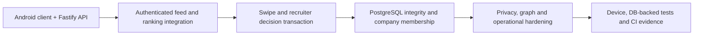

### Table 3: Implementation status and integration evidence

| Concern | Current implementation evidence | Remaining limitation / acceptance evidence |
|---|---|---|
| Android client | Kotlin/Compose screens, API client, encrypted session store and three JSON contract tests | Execute registration, feed, profile, recruiter and match flows against the live Compose stack on an emulator/device. |
| Fastify backend | Auth/session, profile, feed, swipe, recruiter card/interested/decision, matches, health and readiness routes are registered | Most route behavior lacks DB-backed automated coverage; verify authorization, validation, errors, idempotency and state transitions. |
| Matching service | Express `/health` and API-key-protected `/internal/matching/rank`; weighted tag overlap and prior-swipe exclusion | Add stable ordering, paging, full feedback/cold-start behavior, read-only DB role and timed failure tests. |
| PostgreSQL | Prisma schema, migrations, seed generator, swipe/idempotency constraints and recruiter-scoped Match uniqueness | `Swipe.decision` remains global; company invitation APIs and survivor-match deletion semantics are incomplete. Reconcile `database.md` with schema/migrations. |
| Local deployment | Compose declares PostgreSQL, backend and matching with health checks, dependencies and a persistent volume | Ports 5432/4000 are host-published; shared DB credentials; no production TLS/network policy or CI workflow. Verify migrations and full startup. |
| Neo4j | Data model and deletion-first synchronization design documented | No Neo4j service, harmonization worker, projection, graph query or failure test is implemented. |
| Verification | Three backend app tests, thirteen seed test cases, three Android serialization tests, and a manual test procedure | Run tests and capture outputs; add DB-backed/API integration tests, emulator run, load/security checks and GitHub Actions. |

# Appendix A: Appendices

The appendices provide the contract crosswalk and the evidence required to move from source implementation to verified integration.

## A.1 API Contract Crosswalk

The table compares the Android route family, the intended `API_CONTRACT.md` (API v1), the historical OpenAPI v0.1.0 and the current Fastify/Express source. The current implementation is described from the pinned route registrations and handlers; the contract files are not treated as proof that a handler exists. [R2] [R3] [R6] [R7] [R9] [R11] [R35]

### Table 4: Android, API contract, OpenAPI and observed runtime

| Operation | Android client | API_CONTRACT (API v1) target | OpenAPI v0.1.0 | Current source at baseline |
|---|---|---|---|---|
| Register / login | `POST /auth/register`, `POST /auth/login`; expects `{user,token}` | Same paths and client-shaped DTOs | Same paths but different registration fields/token key and password rule | Implemented; register 201, login 200; validation/duplicate errors handled. Consent version is hard-coded draft. |
| Session | `GET /auth/me`, `POST /auth/logout` | Defines current-user and logout behavior | Not fully represented | Implemented; `/auth/me` validates token/revocation; logout stores JTI and returns 204. |
| Candidate profile | `GET/PUT /candidate/profile`; `{profile}` wrapper | Same singular paths and wrapper | `GET/PUT /candidates/me` with a different DTO | Implemented at Android paths; field validation/normalization still needs tests. |
| Candidate feed | `GET /candidate/feed`; expects `{cards}` | Same path; optional `limit`/`cursor`, `{cards,source,nextCursor}` | `GET /candidates/me/feed`; `{items,nextCursor,source}` | Implemented at Android path; limit accepted, cursor ignored, `nextCursor` always null, eligible set capped at 100. |
| Candidate swipe | `POST /candidate/swipes`, `{cardId,action}`, UUID `Idempotency-Key` | Same path; defines idempotency and 201 response | `POST /candidates/me/swipes` | Implemented; supports four actions and unique keys, but response defaults to 200 and existing candidate/card swipe with another key returns existing action. |
| Recruiter cards | `GET/POST /recruiter/cards`; `{cards}` / `{card}` | Same singular paths and wrapper | `GET/POST /recruiters/me/cards` | Implemented list/create; no edit, publish, unpublish or delete endpoints. Salary range is not mapped by current create handler. |
| Interested / decision | `GET /recruiter/interested`, `POST /recruiter/interested/{swipeId}/decision` | Same paths and ACCEPT/DECLINE contract | Not fully represented | Implemented, company-scoped; global `Swipe.decision` means one recruiter decision hides the swipe from other recruiters. |
| Matches | `GET /matches`; `{matches}` | Same path and participant-scoped result | Not fully represented | Implemented; returns active matches for authenticated candidate or recruiter. Chat and unmatch routes absent. |
| Internal ranking | Not called by Android | `POST /internal/matching/rank`, API-key protected | `POST /internal/matching/rank` | Implemented in Express; Fastify calls it with `X-API-Key` and `X-Request-ID`; ranker returns card IDs/scores. |
| Health / readiness | Not called directly by Android | `GET /health`, `GET /ready` | Same route names | Implemented; `/ready` checks PostgreSQL and matching health and returns 503 on dependency failure. |
| Company invitation | Not in current Android client | Design/requirements include invitation flow | Not fully represented | `InvitationCode` model and seed data exist; no create/redeem Fastify endpoint. Recruiter registration creates a new company. |

**Contract authority and status.** The SRS v1.0 remains the normative requirements document. `API_CONTRACT.md` (API v1) is the intended client/backend contract and should be updated to match actual behavior and accepted design decisions; its note that several current routes are still 501/absent and its default-404 assertion are stale. OpenAPI v0.1.0 is a historical baseline and should either be updated or explicitly marked superseded. Do not maintain two competing normative API definitions. [R2] [R3] [R35]

**Authentication and consent.** The Android registration DTO sends lowercase role, display name, age confirmation, privacy acceptance and recruiter company name/sector. Fastify normalizes role to uppercase, checks the required booleans, creates a new company for each recruiter, stores `privacyConsentAt` and `privacyNoticeVersion="0.1-draft"`, hashes the password with scrypt and returns `{user,token}`. This is implemented but not a final consent/legal approval flow. Invitation-based joining and a finalized versioned notice remain outstanding. [R6] [R9] [R10]

**Candidate profile and feed.** The Android and Fastify paths/wrappers align for profile and feed. The feed implementation returns cards, source and a null cursor; it does not yet implement the optional cursor behavior in the target contract. The matching service scores tag overlap but the current ranker does not implement all SRS feedback/cold-start requirements. [R2] [R6] [R9] [R11] [R35]

**Swipe semantics.** The client sends a fresh UUID v4 `Idempotency-Key` for each swipe action. The backend recognizes same-key/same-body replay and rejects same-key/different-body use. If a candidate/card swipe already exists under a different key, the handler returns the old action rather than treating the new action as a separate event. The endpoint's default status is 200, while the target contract specifies 201. These semantics must be explicitly agreed and covered by tests. [R9] [R10] [R35]

**Recruiter decisions.** The API validates recruiter role, company membership and card company ownership. Accept writes the shared swipe decision and creates a recruiter-scoped match inside one transaction. However, because the decision is stored once on `Swipe`, the interested list excludes the swipe after the first decision for all recruiters. The current implementation therefore does not meet the SRS requirement for independent acceptance by multiple recruiters of the same company. [R2] [R9] [R10] [R36]

**Internal ranking and health.** The Fastify adapter sends `candidateId`, `limit` and `cursor:null` to Express with an API key and request ID. Express returns ordered IDs and scores. `/ready` probes both PostgreSQL and Express. Neither a successful internal request nor a healthy probe is evidence of ranking quality, stable pagination, cross-service log correlation or end-to-end Android behavior. [R9] [R11] [R12]

**Deferred product workflows.** Chat, applications/CV transfer, unmatch, report, in-app notifications, account export/deletion and graph projection are not current end-to-end operations. Their relational models or SRS requirements must not be described as delivered functionality. [R2] [R6] [R9] [R10]

## A.2 Verification and Acceptance Gates

**Review method and evidence boundary.** This document was prepared by static inspection of the pinned source files, Prisma schema/migrations, Compose configuration, contract documents, test sources and manual test guide. No command execution or live-stack test was performed for this revision. Do not cite this SAD as a test-pass report.

**Committed test inventory by source inspection:**

- Backend `tests/app.test.ts`: three Fastify injection tests (health response/request ID, propagation of a supplied request ID, and malformed login validation).
- Backend `tests/seed.test.ts`: thirteen seed-generator test cases, including parameterized default/1,000-card data rules.
- Android `ContractTests.kt`: three Gson serialization tests for registration, login and swipe DTOs.
- Matching service: no matching-service test file is present in the pinned tree.

The test inventory does not cover real PostgreSQL persistence, JWT revocation lifecycle, role/company isolation, multi-recruiter decisions, concurrent idempotency, matching-service timeout/fallback, feed pagination, Android device networking, or Neo4j. The manual V0 guide defines useful commands and scenarios, but it contains no completed acceptance record in the reviewed evidence. [R17] [R18] [R37]

**Not established at this baseline:** passing full-stack run, live database migration/seed result, emulator/device flow, matching fallback under forced failure, multi-recruiter transaction test, performance/load measurements, TLS deployment, privacy approval, Neo4j projection/deletion test, cross-service structured trace, CI workflow or coverage report. [R2] [R12] [R17] [R18] [R19] [R37]

### G1 — Contract, identity and consent

**Owners:** Jean-Baptiste and Peter, with Alba for data. Reconcile the API contract and OpenAPI to the actual Android/Fastify route set. Test registration success, duplicate email, malformed input, missing consent, login failure, `/auth/me`, logout/revocation and expired/revoked tokens. Approve and version the privacy notice; verify that the age/consent wording matches the SRS. Implement invitation creation/redemption or explicitly defer `REQ-FUNC-025`. Record route, status, response, request ID and test environment. [R2] [R3] [R9] [R10] [R35]

### G2 — Candidate and recruiter transactions

**Owners:** Jean-Baptiste, Alba and Peter. Test candidate profile read/update, all four swipe actions, same-key replay, conflicting-key/body, concurrent requests and candidate/card uniqueness. Implement recruiter-specific decision state and guard transitions before claiming multi-recruiter support. Test two recruiters in the same company, cross-company denial, accept, decline, repeated accept and match visibility for both participants. [R2] [R9] [R10] [R36]

### G3 — Feed ranking, resilience and fairness

**Owners:** Nils and Jean-Baptiste, with Alba for fixtures and Levis for future graph signals. Verify eligible-card filtering, weighted score fixtures, stable tie-breaking, pagination, the 100-card cap behavior, no-profile cold start, green/red feedback and fallback. Force matching timeout, non-2xx and unavailable database scenarios. Measure SRS feed/swipe performance on the specified test host and document the dataset, concurrency, tool versions and p95 results. [R2] [R10] [R11]

### G4 — Privacy, deletion and graph

**Owners:** Alba, Levis and Jean-Baptiste, with Peter for client behavior. Reconcile the database design with Prisma schema/migrations. Implement and test account export/deletion, retention, CV cleanup and survivor-match behavior. If Neo4j is implemented, test the allowlist, deletion-before-every-rebuild, forced rebuild failure, retry, reconciliation and 24-hour erasure independently of ranking availability. Remove or approve the candidate-email fallback in recruiter DTOs and provision a read-only ranker DB role. [R2] [R4] [R10] [R11] [R36]

### G5 — Deployment, security and observability

**Owners:** Jean-Baptiste, Peter and Nils. Reproduce full Compose startup from a clean checkout, apply migrations, seed synthetic data and record `/health` and `/ready` results. Restrict database/matching ports in the deployed topology, use TLS, protect secrets, add rate limiting, verify no sensitive data in logs, and correlate one request across Fastify and Express. Add GitHub Actions checks for locked installs, typecheck/build/tests and retain run artifacts. Record actual coverage rather than a target percentage. [R9] [R11] [R12] [R15] [R17] [R19] [R37]

