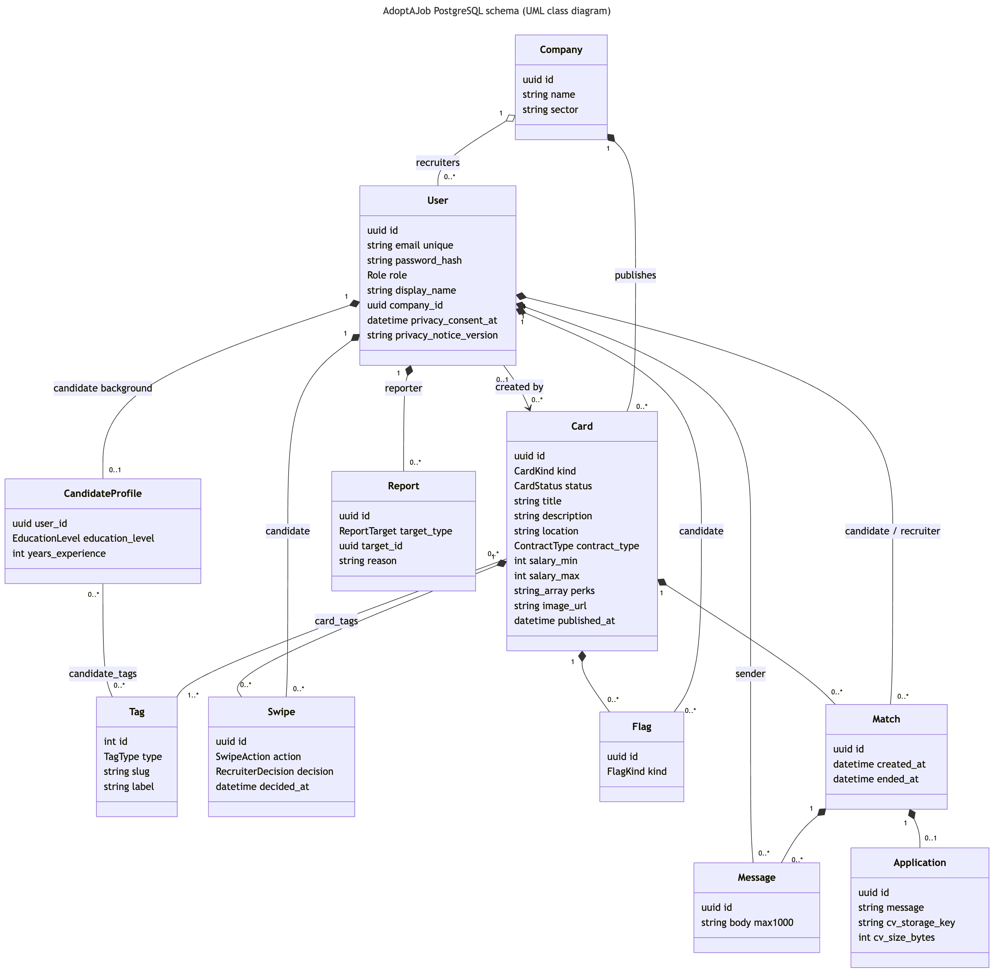

# Database Design
## For AdoptAJob

Version 0.1  
Prepared by Alba (Qiu Runxiao), database owner  
Software Engineering course, Team A (repository `bhsei/26A`)  
2026-10-16

## Table of Contents
<!-- TOC -->
* [1. Purpose and Scope](#1-purpose-and-scope)
* [2. Architecture Decisions](#2-architecture-decisions)
* [3. PostgreSQL Data Model](#3-postgresql-data-model)
* [4. Integrity Rules](#4-integrity-rules)
* [5. Indexes](#5-indexes)
* [6. Privacy and Deletion](#6-privacy-and-deletion)
* [7. Neo4j Graph Store (planned)](#7-neo4j-graph-store-planned)
* [8. Local Setup and Change Process](#8-local-setup-and-change-process)
* [9. Open Issues](#9-open-issues)
<!-- TOC -->

## Revision History

| Name | Date | Reason For Changes | Version |
|------|------|--------------------|---------|
| Alba (Qiu Runxiao) | 2026-10-16 | First version: PostgreSQL data model and planned Neo4j graph store | 0.1 |

## 1. Purpose and Scope

This document describes how AdoptAJob stores its data and why. It covers the
PostgreSQL schema that is implemented (commit `61ba7d3`) and the Neo4j graph
store the team has agreed to add.

It complements the [architecture document](Architecture_Design.md), section
6.2, which asks for tables, indexes, constraints and relationships to be
documented alongside the schema. The schema itself is code and lives in
[`src/backend/prisma/schema.prisma`](../../src/backend/prisma/schema.prisma);
the SQL that creates it is in
[`src/backend/prisma/migrations/`](../../src/backend/prisma/migrations/).

| Store | Role | Status |
|-------|------|--------|
| PostgreSQL 16 | Main database and single source of truth for all application data | Implemented, no data yet (seed data is INIT_PLAN Commit 09) |
| Neo4j 5 Community | Harmonized graph projection used by the matching service | Planned, owner: Levis |

## 2. Architecture Decisions

| # | Decision | Reason | Alternative considered |
|---|----------|--------|------------------------|
| D1 | **PostgreSQL is the source of truth.** Every write from the app goes to PostgreSQL through the backend. | Transactions, foreign keys and constraints protect accounts, swipes and matches. One place to back up, seed and delete data. | Writing to both databases from the API (harder to keep consistent). |
| D2 | **The backend owns the schema** through Prisma migrations. No other service creates or changes tables. | One migration history, no conflicting schema changes (INIT_PLAN, architecture doc 4.1.4). | Each service managing its own tables. |
| D3 | **The matching pipeline reads canonical data from PostgreSQL and writes only the approved Neo4j projection.** | PostgreSQL remains the relational source of truth while the graph receives only normalized, minimized data. | Letting the matching service write application data directly. |
| D4 | **snake_case table and column names** (`swipes.candidate_id`). | The matching service and the Neo4j sync use plain SQL; snake_case avoids quoted identifiers. Prisma maps them to camelCase in TypeScript. | Prisma's default PascalCase names. |
| D5 | **Ranking signals are expressed through tags.** Cards and candidate backgrounds link to a fixed tag vocabulary. | REQ-ML-001 to 004 compare a candidate's background, likes and flags with cards; shared tags make that comparison simple and explainable. | Free-text matching. |
| D6 | **Neo4j is added as a minimized graph projection, rebuilt from PostgreSQL.** The app never writes to Neo4j directly. | The team wants "candidates who liked the same jobs also liked these" recommendations, which are short path queries in a graph but many joins in SQL. A rebuildable projection keeps D1 and D2 intact. | PostgreSQL only; Apache AGE (graph queries inside PostgreSQL). |
| D7 | **The feed must work without Neo4j.** The graph only adds an extra score. | Keeps REQ-REL-002 (fallback feed) true and limits the risk of the new component. | Making Neo4j a required dependency. |
| D8 | **No protected attributes are stored** in either database. | Ranking must not use gender, age, ethnicity, nationality, religion, disability, marital status or photos (REQ-COMP-004). If the data does not exist, it cannot be used. | Storing them and filtering in code. |

## 3. PostgreSQL Data Model



The diagram source is [`database-uml.mmd`](database-uml.mmd) (Mermaid). Filled
diamonds mean the child rows are deleted together with the parent. Creation and
update timestamps are omitted for space.

### 3.1 Tables

| Table | Purpose | Key fields | SRS |
|-------|---------|------------|-----|
| `users` | Candidates and recruiters | `email` (unique), `password_hash`, `role`, `company_id`, `privacy_consent_at`, `privacy_notice_version` | REQ-FUNC-001..004, REQ-SEC-001, REQ-COMP-001 |
| `companies` | Company shared by one or more recruiters | `name`, `sector` | REQ-FUNC-003, REQ-ML-002 |
| `candidate_profiles` | Optional candidate background | `education_level`, `years_experience` (all nullable) | REQ-FUNC-005..006 |
| `tags` | Fixed vocabulary loaded by the seed | `type` (skill, role, sector, location, contract), `slug`, `label` | REQ-FUNC-008, REQ-ML-001 |
| `card_tags` | Tags of a card | `card_id`, `tag_id` | REQ-FUNC-008, REQ-ML-001 |
| `candidate_tags` | Desired roles, skills, locations and contract types of a candidate | `candidate_id`, `tag_id` | REQ-FUNC-005, REQ-ML-001 |
| `cards` | Company and job cards | `kind`, `status` (draft, published, unpublished), `title`, `description`, `location`, `contract_type`, salary range, `perks`, `image_url`, `published_at` | REQ-FUNC-008..011 |
| `swipes` | One like or pass per candidate and card; likes carry the recruiter decision | `action`, `decision` (pending, accepted, declined), `decided_at` | REQ-FUNC-011..017, REQ-REL-001 |
| `flags` | Green and red flags | `kind` | REQ-FUNC-014..015, REQ-ML-003..004 |
| `matches` | Accepted likes | `candidate_id`, `recruiter_id`, `card_id`, `ended_at` | REQ-FUNC-017..019, REQ-FUNC-022, REQ-ML-006 |
| `messages` | Chat messages inside a match | `body` (max 1,000 characters) | REQ-FUNC-020 |
| `applications` | Application message and CV reference | `message`, `cv_storage_key`, `cv_size_bytes` | REQ-FUNC-021 |
| `reports` | User reports for moderation | `target_type`, `target_id`, `reason` | REQ-FUNC-023 |

### 3.2 Modelling decisions

| Decision | Reason |
|----------|--------|
| A recruiter belongs to one company; several recruiters can share it. | "Create or join a company" (REQ-FUNC-003). |
| Swipes and recruiter decisions share one table. | The recruiter decides on a like, so the decision belongs to that row. A pass has no decision. |
| Flags are a separate table from swipes. | A candidate can flag a card and still like or pass it; the signals are independent. |
| Green-flagged cards stay in the feed; liked, passed and red-flagged cards leave it. | REQ-FUNC-011 only removes liked, passed and red-flagged cards. |
| A match is created only by a recruiter accepting a like. | REQ-ML-006: the final decision is always the recruiter's. |
| `reports.target_id` has no foreign key. | A report must survive the deletion of the card, user or message it points to. |
| CV files are stored outside the database. | Only the storage key and size are kept; large binary files do not belong in PostgreSQL. |
| Primary keys are UUIDs generated by PostgreSQL (`gen_random_uuid()`), except `tags` (integer). | IDs cannot be guessed from the API, and rows inserted with plain SQL (seed, tests) get IDs too. Tags are a small internal list. |
| All timestamps are `timestamptz`. | No time-zone ambiguity between services. |

## 4. Integrity Rules

Rules Prisma cannot express are `CHECK` constraints at the end of the initial
migration.

| Rule | Constraint | SRS |
|------|------------|-----|
| One swipe per candidate and card; a retried request does not create a second row | `UNIQUE (candidate_id, card_id)` on `swipes` | REQ-REL-001 |
| One flag per candidate and card | `UNIQUE (candidate_id, card_id)` on `flags` | REQ-FUNC-014..015 |
| One match per candidate and card | `UNIQUE (candidate_id, card_id)` on `matches` | REQ-FUNC-017 |
| One application per match | `UNIQUE (match_id)` on `applications` | REQ-FUNC-021 |
| A like has a decision; a pass has none | `swipes_decision_check` | REQ-FUNC-017 |
| A published card has a publish date | `cards_published_at_check` | REQ-REL-002 |
| Salary values are positive and min ≤ max | `cards_salary_positive_check`, `cards_salary_range_check` | REQ-FUNC-008 |
| Years of experience between 0 and 60 | `candidate_profiles_years_experience_check` | REQ-FUNC-005 |
| Messages are 1 to 1,000 characters | `VARCHAR(1000)`, `messages_body_not_blank_check` | REQ-FUNC-020 |
| CV at most 5 MB | `applications_cv_size_check` | REQ-FUNC-021 |

Rules that depend on the card type (a job card needs a location, contract type
and at least one tag) are validated by the backend, because company cards do
not need them.

## 5. Indexes

| Index | Used by | SRS |
|-------|---------|-----|
| `cards (status, published_at DESC)` | Published cards for the feed; most-recent fallback and cold start | REQ-FUNC-011, REQ-REL-002, REQ-ML-002 |
| `swipes (candidate_id, card_id)` (unique) | Excluding cards a candidate already swiped | REQ-FUNC-011 |
| `swipes (card_id, action, decision)` | Interested-candidates list per card | REQ-FUNC-016 |
| `flags (candidate_id, card_id)` (unique), `flags (card_id)` | Flag signals for ranking | REQ-ML-003..004 |
| `card_tags (tag_id)`, `candidate_tags (tag_id)` | Finding cards that share tags | REQ-ML-001 |
| `matches (recruiter_id, created_at DESC)`, `matches (candidate_id, created_at DESC)` | Matches list, most recent first | REQ-FUNC-019 |
| `messages (match_id, created_at)` | Loading a chat in order | REQ-FUNC-020 |
| `users (company_id)`, `cards (company_id)` | Company members and cards | REQ-FUNC-003, REQ-SEC-003 |
| `reports (target_type, target_id)` | Finding reports about one target | REQ-FUNC-023 |

## 6. Privacy and Deletion

- **Account deletion** (REQ-FUNC-004): deleting a row in `users` cascades to the
  user's profile, tags, swipes, flags, matches (as candidate or recruiter),
  messages and reports. Cards and companies remain; `cards.created_by_id`
  becomes `NULL`.
- **Passwords** are stored only as adaptive hashes (`password_hash`,
  REQ-SEC-001); hashing is done by the backend.
- **Consent** is recorded with a timestamp and the privacy-notice version
  (REQ-COMP-001).
- **Synthetic data only** in development, tests and the repository
  (REQ-ML-005). No real personal data is committed.
- **Neo4j** stores only the minimized identifiers, tags, status, publish date,
  sector and permitted relationships described in section 7. Deleted accounts
  disappear from it on the next sync.

## 7. Neo4j Graph Store (planned)

Owner: Levis. Not implemented yet. The graph is part of the matching
architecture, while the synchronization implementation, algorithm selection
and operational checks remain to be completed.

### 7.1 Why a graph

Tag overlap in PostgreSQL already ranks cards similar in content to those a
candidate liked (REQ-ML-001 to 004). The graph adds similarity by behaviour:
cards liked by candidates who liked the same cards.

```cypher
(me:Candidate)-[:LIKED]->(:Card)<-[:LIKED]-(other:Candidate)-[:LIKED]->(rec:Card)
```

This is a single path pattern in Cypher; in SQL it needs several self-joins on
`swipes`, and longer paths (related skills, same sector or company) become
harder to write and maintain.

### 7.2 Graph model

Only IDs, tags and relationships are copied. No names, emails, passwords,
messages, CVs or protected attributes.

```text
(:Candidate {id})
(:Card {id, status, publishedAt})
(:Company {id, sector})
(:Tag {id, type, slug})

(:Candidate)-[:LIKED|PASSED|GREEN_FLAGGED|RED_FLAGGED {at}]->(:Card)
(:Card)-[:HAS_TAG]->(:Tag)
(:Candidate)-[:HAS_TAG]->(:Tag)
(:Card)-[:OF_COMPANY]->(:Company)
```

Each node label has a uniqueness constraint on `id`.

| Graph element | PostgreSQL source |
|---------------|-------------------|
| `Candidate` | `users` where `role = 'CANDIDATE'` |
| `Card` | `cards` |
| `Company` | `companies` |
| `Tag` | `tags` |
| `LIKED`, `PASSED` | `swipes.action` |
| `GREEN_FLAGGED`, `RED_FLAGGED` | `flags.kind` |
| `HAS_TAG` | `card_tags`, `candidate_tags` |
| `OF_COMPANY` | `cards.company_id` |

### 7.3 Synchronisation

- A harmonization pipeline jointly designed by Alba and Levis reads canonical
  PostgreSQL data with the approved access boundary and writes Neo4j through
  the official driver.
- Proposed first version: **full rebuild** (clear the graph, then load nodes
  and relationships in batches with `UNWIND`). The trigger and cadence remain
  open and must be selected with the matching algorithm.
- Because the graph is rebuilt, deleted accounts and cards disappear on the next
  run. The maximum delay must be documented with the script.
- The sync never writes to PostgreSQL.

### 7.4 Use in ranking

The matching service (Nils) combines both scores:

```text
score = tag-overlap score (PostgreSQL, REQ-ML-001..004)
      + weight × number of similar candidates who liked the card (Neo4j)
```

If Neo4j does not answer in time, the matching service uses the PostgreSQL score
alone, so the feed keeps working (D7, REQ-REL-002). Cards the candidate already
liked, passed or red-flagged are never recommended.

### 7.5 Costs and risks

| Risk | Mitigation |
|------|------------|
| The graph lags behind PostgreSQL (a passed card could reappear) | The feed filter in PostgreSQL removes swiped cards regardless of the graph score. |
| Personal data copied into the graph | Copy only the fields in 7.2; a test checks that no email or name exists in Neo4j. |
| Deleted accounts remain in the graph | Full rebuild; a test checks that a deleted user is gone after the next sync. |
| Extra container (about 1 GB RAM) | Limit the heap in Compose; Neo4j is optional for running the app. |
| Two databases in tests and CI | Graph tests run separately from backend tests. |
| Docker Hub blocked on the team network | Use a VPN or a registry mirror to pull the image. |

## 8. Local Setup and Change Process

Setup steps and database commands are in the
[backend README](../../src/backend/README.md). Summary:

1. Put the database variables in the root `.env` file (listed in the backend
   README).
2. Start PostgreSQL with `docker compose up -d`.
3. In `src/backend`, run `npm ci` and `npm run db:deploy`.

To change the schema:

1. Edit `src/backend/prisma/schema.prisma`.
2. Run `npm run db:migrate -- --name <change>` to create a new migration.
   Committed migrations are never edited.
3. Update this document and the UML diagram, then commit the schema, migration
   and documentation together.

## 9. Open Issues

| # | Issue | Owner | Status |
|---|-------|-------|--------|
| 1 | Update the backlog with the actual database and architecture work already completed. | Jean-Baptiste | Open |
| 2 | Define the canonical PostgreSQL-to-Neo4j field mapping and deduplication rules. | Alba, Levis | Open |
| 3 | Select and evaluate the matching algorithm on synthetic graph fixtures. | Nils | Open |
| 4 | Implement the Neo4j pipeline, including freshness, retry, idempotency and deletion checks. | Alba, Levis | Open |
| 5 | Load synthetic seed data with overlapping candidate likes so graph ranking has patterns to find. | Alba, Nils | Open |
| 6 | Confirm the GDPR retention and deletion policy for both stores. | Team | Open |
