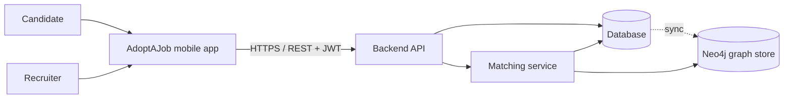

# Software Requirements Specification
## For AdoptAJob

Version 0.5
Prepared by Runxiao Qiu, Nils Förg, Peter (Shek, Peter Richard Shekidele), Levis Bangoh, Jean-Baptiste SIMON
Software Engineering course, Team A (repository `bhsei/26A`)  
2026-10-28

## Table of Contents
<!-- TOC -->
* [1. Introduction](#1-introduction)
    * [1.1 Document Purpose](#11-document-purpose)
    * [1.2 Product Scope](#12-product-scope)
    * [1.3 Definitions, Acronyms, and Abbreviations](#13-definitions-acronyms-and-abbreviations)
    * [1.4 References](#14-references)
    * [1.5 Document Overview](#15-document-overview)
* [2. Product Overview](#2-product-overview)
    * [2.1 Product Perspective](#21-product-perspective)
    * [2.2 Product Functions](#22-product-functions)
    * [2.3 Product Constraints](#23-product-constraints)
    * [2.4 User Characteristics](#24-user-characteristics)
    * [2.5 Assumptions and Dependencies](#25-assumptions-and-dependencies)
    * [2.6 Apportioning of Requirements](#26-apportioning-of-requirements)
* [3. Requirements](#3-requirements)
    * [3.1 External Interfaces](#31-external-interfaces)
    * [3.2 Functions](#32-functions)
    * [3.3 Quality of Service](#33-quality-of-service)
    * [3.4 Compliance](#34-compliance)
    * [3.5 Design and Implementation](#35-design-and-implementation)
    * [3.6 AI/ML](#36-aiml)
* [4. Verification](#4-verification)
* [5. Appendixes](#5-appendixes)
<!-- TOC -->

## Revision History

| Name | Date | Reason For Changes | Version |
|------|------|--------------------|---------|
| Team A | 2026-10-10 | Initial draft: Sections 1 to 5 | 0.1 |
| Team A | 2026-10-16 | Adjusted the priority of some requirements after evaluating them against the project scope and schedule | 0.2 |
| Team A | 2026-10-16 | Neo4j adopted as a read-only graph store for ranking: updated 2.1 and 2.6, added Neo4j to 1.3, added REQ-ML-007 (graph-based ranking, Should) and REQ-ML-008 (graph data minimisation, Must) | 0.3 |
| Team A | 2026-10-17 | Confirmed candidate-only swiping, recruiter acceptance, PostgreSQL as relational source of truth, and Runxiao Qiu/Levis ownership of the PostgreSQL-to-Neo4j harmonization pipeline | 0.4 |
| Team A | 2026-10-28 | Closed all open issues in Appendix B; recorded GDPR as the jurisdiction for REQ-COMP-003 | 0.5 |
|      |      |                    |         |

## 1. Introduction

### 1.1 Document Purpose
This SRS defines what AdoptAJob shall do and the qualities it shall have. It is the agreed baseline between the five team members. Developers use it to design and build the system, testers use it to derive test cases, and reviewers use it to check completeness and consistency through GitHub Issues.

### 1.2 Product Scope
**AdoptAJob v1.0** is a mobile job-matching application that applies the swipe interaction of dating apps to the job market. Recruiters publish visual cards for their company or open roles; candidates swipe through these cards without filling in a full profile first. The candidate profile is built progressively from the stated background, swipes, and green/red flags, and the card ranking adapts to it. When a candidate shows interest and the recruiter accepts, a match is created and both parties can chat, or the candidate can apply.

**In scope (v1.0):** account management for candidates and recruiters, recruiter card builder, swipe feed, flags, adaptive ranking, matching, in-app chat, simple application submission.

**Out of scope (v1.0):** payment or premium plans, web client, video interviews, integration with external job boards (LinkedIn, etc.), push notifications outside the app, recruiter analytics dashboards, multi-language UI (English only).

### 1.3 Definitions, Acronyms, and Abbreviations

| Term | Definition |
|------|------------|
| API | Application Programming Interface. |
| Application | A message plus optional CV that a candidate sends to a recruiter after a match. |
| Candidate | A user looking for a job. |
| Card | A recruiter-created visual unit describing a company (Company Card) or an open role (Job Card) that candidates swipe on. |
| Feed | The ordered sequence of cards shown to a candidate for swiping. |
| Green flag | A candidate signal meaning "show me more cards like this", without expressing interest in this specific card. |
| JWT | JSON Web Token, used to authenticate API requests. |
| Like | A right swipe: the candidate is interested in the card. |
| Match | The state reached when a candidate has liked a card and the card's recruiter has accepted that candidate. |
| MoSCoW | Prioritisation scheme: Must, Should, Could, Won't (this release). |
| MVP | Minimum Viable Product. |
| Neo4j | Graph database used as a minimized, read-only application projection to find relationships relevant to matching (REQ-ML-007, REQ-ML-008). |
| Pass | A left swipe: the candidate is not interested in the card. |
| p95 | 95th percentile of a measured value. |
| Recruiter | A user who represents a company and publishes cards. |
| Red flag | A candidate signal meaning "stop showing me cards like this". |
| REST | Representational State Transfer, the API style used between the app and the backend. |
| SRS | Software Requirements Specification. |
| Tag | A normalised keyword attached to a card or profile (skill, sector, contract type, location, etc.). |

### 1.4 References

| ID | Title | Owner | Version / Date | Location | Type |
|----|-------|-------|----------------|----------|------|
| R1 | Markdown SRS Template (MSRS) | ovikrai | Accessed 2026-10-10 | https://github.com/ovikrai/SRS-Template-IEEE | Normative (format) |

### 1.5 Document Overview
Section 2 gives the product context, users and constraints. Section 3 contains the verifiable requirements, each with a unique ID, MoSCoW priority and acceptance criteria. Section 4 maps every requirement to its verification method and test artifact. Section 5 holds non-normative material and open issues.

**Conventions:**
- "shall" = mandatory, "should" = recommended, "may" = optional.
- Requirement ID format: `REQ-[AREA]-[NNN]`, where AREA ∈ {FUNC, INT, PERF, SEC, REL, AVAIL, OBS, COMP, INST, BUILD, MAINT, PORT, COST, DEAD, POC, ML}. IDs are never reused; a changed requirement gets a `-v2` suffix and an entry in the Revision History.
- This file lives in `docs/requirements/SRS.md`. Every change is a separate commit: `W<week> - SRS v<x.y>; <description>`.

## 2. Product Overview

### 2.1 Product Perspective
AdoptAJob is a new, standalone product. It is a client-server system made of a mobile app, a backend API, a matching service, a PostgreSQL database (the source of truth) and a Neo4j graph store, which is a read-only copy of part of the database used for ranking. It has no dependency on existing job platforms.

### 2.2 Product Functions
- **Accounts:** register and sign in as a candidate or a recruiter.
- **Light onboarding:** candidates describe their background in a few optional fields and start swiping immediately.
- **Card builder:** recruiters create, edit, publish and unpublish company and job cards.
- **Swipe feed:** candidates like, pass, green-flag or red-flag cards.
- **Adaptive ranking:** the feed order adapts to the candidate's background, likes and flags.
- **Matching:** recruiters review interested candidates and accept or decline; acceptance creates a match.
- **Connect:** matched parties chat in the app; the candidate can send an application.

### 2.3 Product Constraints
- **C1:** The repository is public; no secrets or real personal data may be committed.
- **C2:** The budget is zero; only free and open-source tools and free tiers may be used.
- **C3:** The system processes personal data of job seekers and must respect applicable data-protection law (see 3.4).

### 2.4 User Characteristics

| User class | Description | Expertise | Frequency | Access |
|-----------|-------------|-----------|-----------|--------|
| Candidate | Students and job seekers, mainly 18 to 35 years old, used to swipe-based apps | Basic smartphone skills | Daily, short sessions (5 to 10 min) | Own profile, feed, own matches and chats |
| Recruiter | HR staff or hiring managers of small and medium companies | Basic computer and smartphone skills | Several times per week | Own company and cards, interested candidates, own matches and chats |
| Administrator | Team member operating the demo system | Technical | As needed | Database and logs; handles reports (no admin UI in v1.0) |

UI language is English. Basic accessibility (text contrast, readable font sizes, alternatives to swipe gestures) is required, see 3.1.1.

### 2.5 Assumptions and Dependencies
- **A1:** Users have an Android 10+ smartphone with internet access. Impact if false: the app may not run; iOS is best effort.
- **A2:** Demo data (companies, cards, candidates) will be synthetic, so no real recruiter is required for v1.0.
- **A3:** A match requires a candidate like and a recruiter accept. Candidates are the only users who swipe; recruiters review interested candidates and accept or decline them.
- **A4:** Free hosting (or a team laptop with Docker) is available for demos. Impact if false: demo runs locally only.
- **A5:** Open-source libraries (React Native, Expo, Node.js, Python, PostgreSQL) remain available under their current licences.

### 2.6 Apportioning of Requirements

| Requirement(s) | Subsystem | Release |
|----------------|-----------|---------|
| REQ-FUNC-001 to 006, REQ-SEC-* | Backend API, mobile app | Iteration 1 (MVP) |
| REQ-FUNC-008, 009, 011 to 015 | Backend API, mobile app | Iteration 1 (MVP) |
| REQ-FUNC-016 to 020, REQ-ML-* | Backend API, matching service, mobile app | Iteration 2 |
| REQ-FUNC-007, 010, 021 to 024 | Backend API, mobile app | Iteration 3 |
| Neo4j graph store and sync (REQ-ML-007, REQ-ML-008) | Matching service, graph store | Iteration 2 |

## 3. Requirements

Each requirement has the fields: **Statement**, **Priority** (MoSCoW), **Acceptance criteria (AC)** and the **Constraint** it relates to, when applicable.

### 3.1 External Interfaces

#### 3.1.1 User Interfaces

**REQ-INT-001: Main screens**  
Statement: The mobile app shall provide these screens: sign-in/registration, candidate onboarding, swipe feed, card detail, matches list, chat, candidate profile, recruiter card builder, recruiter card list, interested-candidates list.  
Priority: Must  
AC: Each listed screen is reachable from the navigation in at most 3 taps from the home screen of the corresponding role.

**REQ-INT-002: Swipe gesture alternatives**  
Statement: Every swipe action (like, pass, green flag, red flag) shall also be available through a visible button.  
Priority: Should  
AC: A tester can complete each action without performing a gesture.

**REQ-INT-003: Feedback and empty states**  
Statement: The app shall show a loading indicator for operations longer than 300 ms, an explicit message when the feed is empty, and a human-readable message when a request fails.  
Priority: Should  
AC: With the backend stopped, every screen shows an error message instead of crashing or showing a blank screen.

**REQ-INT-004: Readability**  
Statement: Text shall meet a contrast ratio of at least 4.5:1 (WCAG 2.1 level AA) and shall respect the device font-size setting.  
Priority: Should  
AC: A contrast checker confirms the ratio on the main screens; increasing the system font size enlarges app text without truncating buttons.

#### 3.1.2 Hardware Interfaces
No hardware interface requirements in v1.0.

#### 3.1.3 Software Interfaces

**REQ-INT-005: Client-API protocol**  
Statement: The mobile app and the backend shall communicate through a REST API using JSON over HTTPS, documented in an OpenAPI 3 file stored in `docs/design/`.  
Priority: Should  
AC: Every endpoint used by the app appears in the OpenAPI file; the file validates without errors.

**REQ-INT-006: API-matching service interface**  
Statement: The backend shall obtain ranked card lists from the matching service through an internal HTTP endpoint that receives a candidate ID and returns an ordered list of card IDs with scores.  
Priority: Should  
AC: A contract test sends a known candidate ID and receives a list sorted by descending score.

**REQ-INT-007: Error format**  
Statement: All API errors shall return an appropriate HTTP status code and a JSON body `{ "code": string, "message": string }`.  
Priority: Should  
AC: Invalid input returns 400, missing or invalid token returns 401, forbidden resource returns 403, unknown resource returns 404, each with the defined body.

### 3.2 Functions

#### 3.2.1 Accounts and authentication

**REQ-FUNC-001: Registration**  
Statement: The system shall allow a visitor to register with an email address, a password and a role (candidate or recruiter).  
Priority: Must  
AC:
- Registration with a new email succeeds and the user is signed in.
- Registration with an already-used email is rejected with a clear message.
- Passwords shorter than 8 characters are rejected.

**REQ-FUNC-002: Sign-in and sign-out**  
Statement: The system shall allow a registered user to sign in with email and password and to sign out.  
Priority: Must  
AC: Correct credentials grant access; wrong credentials show a generic error that does not reveal whether the email exists; after sign-out, protected screens require sign-in again.

**REQ-FUNC-003: Recruiter company**  
Statement: On first sign-in, a recruiter shall create or join a company by entering at least the company name and sector.  
Priority: Should  
AC: A recruiter cannot publish a card before the company exists.

**REQ-FUNC-004: Account deletion**  
Statement: The system shall allow a user to delete their account, removing their profile, swipes, flags, matches and messages within 24 hours.  
Priority: Should (see REQ-COMP-002)  
AC: After deletion, the user cannot sign in and none of their data is returned by any API endpoint.

#### 3.2.2 Candidate profile

**REQ-FUNC-005: Light onboarding**  
Statement: The system shall let a candidate enter a background (desired roles, skills, education level, years of experience, preferred locations, contract type), with all fields optional, and start swiping right after registration.  
Priority: Must  
AC: A candidate who skips every field reaches the feed in at most 2 screens after registration.

**REQ-FUNC-006: Edit profile**  
Statement: The system shall let a candidate view and edit their background at any time.  
Priority: Should  
AC: The edited values are saved and used by the next feed request.

**REQ-FUNC-007: Learned preferences view**  
Statement: The system may show the candidate a summary of the preferences learned from their swipes and flags (for example, the top 5 preferred tags).  
Priority: Could  
AC: After at least 10 likes on cards sharing a tag, that tag appears in the summary.

#### 3.2.3 Recruiter cards

**REQ-FUNC-008: Create card**  
Statement: The system shall let a recruiter create a Company Card or a Job Card. A Job Card shall contain a title, description, location, contract type and at least 1 tag, and may contain a salary range, perks and an image.  
Priority: Must  
AC: Saving a card with a missing mandatory field is rejected and names the missing field.

**REQ-FUNC-009: Edit, publish, unpublish, delete card**  
Statement: The system shall let a recruiter edit, publish, unpublish and delete their own cards.  
Priority: Must  
AC: Unpublished and deleted cards never appear in any candidate feed; existing matches on a deleted card remain visible to the candidate as "position closed".

**REQ-FUNC-010: Card preview**  
Statement: The card builder should show a preview of the card exactly as candidates will see it.  
Priority: Should  
AC: The preview and the feed card display the same fields and layout.

#### 3.2.4 Feed and swiping

**REQ-FUNC-011: Feed content**  
Statement: The feed shall show only published cards that the candidate has not yet liked, passed or red-flagged, ordered by the matching service ranking (REQ-ML-001).  
Priority: Must  
AC: After swiping a card, it never appears again in that candidate's feed.

**REQ-FUNC-012: Like**  
Statement: A right swipe (or Like button) shall record the candidate's interest in the card.  
Priority: Must  
AC: The candidate appears in the recruiter's interested-candidates list for that card within 5 seconds.

**REQ-FUNC-013: Pass**  
Statement: A left swipe (or Pass button) shall record that the candidate is not interested in the card.  
Priority: Must  
AC: The card is removed from the feed; the recruiter is not notified.

**REQ-FUNC-014: Green flag**  
Statement: The system shall let the candidate green-flag a card, which increases the rank of similar cards (REQ-ML-003) without expressing interest in that card.  
Priority: Must  
AC: The card is not added to the recruiter's interested list; similar cards move up in the next feed load.

**REQ-FUNC-015: Red flag**  
Statement: The system shall let the candidate red-flag a card, which removes it and lowers or excludes similar cards (REQ-ML-004).  
Priority: Must  
AC: See REQ-ML-004.

**REQ-FUNC-024: Like notification**  
Statement: The system shall notify the card's recruiter inside the app when a candidate likes one of their cards (REQ-FUNC-012).  
Priority: Should  
AC: The next time the recruiter opens the app (or within 10 seconds if open), a new-interest indicator is shown on the card.

#### 3.2.5 Matching and connecting

**REQ-FUNC-016: Interested candidates**  
Statement: The system shall show the recruiter, for each of their cards, the list of candidates who liked it, with each candidate's background summary.  
Priority: Must  
AC: The list contains exactly the candidates who liked the card and have not been accepted or declined yet.

**REQ-FUNC-017: Accept or decline**  
Statement: The system shall let the recruiter accept or decline each interested candidate. Accepting shall create a match.  
Priority: Must  
AC: After accept, the match appears in both users' match lists; after decline, the candidate is not notified and is removed from the list.

**REQ-FUNC-018: Match notification**  
Statement: The system shall notify both parties inside the app when a match is created.  
Priority: Should  
AC: The next time either user opens the app (or within 10 seconds if open), a match indicator is shown.

**REQ-FUNC-019: Matches list**  
Statement: The system shall show each user the list of their matches, most recent first.  
Priority: Must  
AC: Each entry shows the other party's name, the card title and the last message, if any.

**REQ-FUNC-020: Chat**  
Statement: The system shall let the two parties of a match exchange text messages of up to 1,000 characters.  
Priority: Should  
AC: A message sent by one party is visible to the other within 5 seconds while both have the chat open; users who are not matched cannot message each other.

**REQ-FUNC-021: Apply**  
Statement: The system shall let a matched candidate send an application consisting of a short message and an optional PDF CV of at most 5 MB.  
Priority: Should  
AC: The recruiter can open the application and download the CV; files that are not PDF or are larger than 5 MB are rejected.

**REQ-FUNC-022: Unmatch**  
Statement: The system should let either party end a match, which closes the chat for both.  
Priority: Should  
AC: After unmatch, neither party can send messages in that chat.

#### 3.2.6 Safety and moderation

**REQ-FUNC-023: Report**  
Statement: The system should let a user report a card, a user or a message, with a reason.  
Priority: Should  
AC: The report is stored with reporter, target, reason and timestamp, and is visible to the administrator in the database.

### 3.3 Quality of Service

#### 3.3.1 Performance

**REQ-PERF-001: Feed load time**  
Statement: The API shall return the next batch of 20 feed cards with a p95 response time of at most 1.5 s.  
Priority: Should  
AC: Load test in the test environment (3.5.1) with 1,000 published cards and 50 concurrent candidates; p95 ≤ 1.5 s over 5 minutes.

**REQ-PERF-002: Swipe acknowledgement**  
Statement: The API shall acknowledge a swipe or flag with a p95 response time of at most 500 ms.  
Priority: Should  
AC: Same load test as REQ-PERF-001; p95 ≤ 500 ms.

**REQ-PERF-003: Smooth swiping**  
Statement: The app shall display the next card immediately after a swipe, without waiting for the server response.  
Priority: Should  
AC: With a simulated 1 s network delay, the next card appears in less than 200 ms after the swipe.

#### 3.3.2 Security

**REQ-SEC-001: Password storage**  
Statement: Passwords shall be stored only as salted hashes using an adaptive algorithm (bcrypt, scrypt or Argon2).  
Priority: Must  
AC: Database inspection shows no plain-text or reversibly encrypted passwords.

**REQ-SEC-002: Authentication of requests**  
Statement: Every API endpoint except registration, sign-in and health check shall require a valid JWT. Access tokens shall expire after at most 24 hours.  
Priority: Must  
AC: Requests without a token, with a modified token, or with an expired token return 401.

**REQ-SEC-003: Authorization**  
Statement: A user shall only read or change their own data. Recruiters shall only manage cards of their company. Candidate data shall only be visible to a recruiter after that candidate liked one of the recruiter's cards.  
Priority: Must  
AC: Automated tests attempting to access another user's profile, cards, matches or chats return 403 or 404.

**REQ-SEC-004: Transport security**  
Statement: All traffic between the app and the backend shall use HTTPS (TLS 1.2 or higher) in any deployed environment.  
Priority: Should  
AC: Plain HTTP requests to the deployed API are refused or redirected.

**REQ-SEC-005: Input validation**  
Statement: The API shall validate all inputs (type, length, format) and use parameterised queries.  
Priority: Must  
AC: Requests with invalid types, missing fields or oversized values are rejected with 400 and do not alter data.

**REQ-SEC-006: Brute-force protection**  
Statement: The API should limit sign-in attempts to 10 per account per 15 minutes.  
Priority: Should  
AC: The 11th failed attempt within 15 minutes returns 429.

**REQ-SEC-007: Secrets management**  
Statement: Secrets (JWT signing key, database passwords, API keys) shall be provided through environment variables and shall never be committed to the repository.  
Priority: Must (constraint C1)  
AC: `.env` is listed in `.gitignore`; a secret scan of the repository (e.g. GitHub secret scanning or gitleaks) finds no secrets.

#### 3.3.3 Reliability

**REQ-REL-001: Idempotent swipes**  
Statement: Sending the same swipe twice (e.g. after a network retry) shall result in a single recorded swipe.  
Priority: Should  
AC: Two identical swipe requests produce one database record.

**REQ-REL-002: Matching fallback**  
Statement: If the matching service does not answer within 1 s, the backend shall return a feed ordered by most recently published cards.  
Priority: Should  
AC: With the matching service stopped, the feed still loads within the REQ-PERF-001 target.

#### 3.3.4 Availability

**REQ-AVAIL-001: Demo availability**  
Statement: The demo deployment shall be available during scheduled review sessions and the final presentation.  
Priority: Should  
AC: Health-check endpoint responds 200 during each session.

#### 3.3.5 Observability

**REQ-OBS-001: Request logging**  
Statement: The backend and matching service shall log each request with timestamp, endpoint, status code, duration and a request ID propagated between services.  
Priority: Should  
AC: One feed request can be followed across both services using its request ID.

**REQ-OBS-002: No sensitive data in logs**  
Statement: Logs shall not contain passwords, tokens, message contents or CV files.  
Priority: Should  
AC: Log inspection after a full test run shows none of these values.

**REQ-OBS-003: Health check**  
Statement: Each service shall expose a `GET /health` endpoint.  
Priority: Should  
AC: The endpoint returns 200 when the service and its database connection are up.

### 3.4 Compliance

**REQ-COMP-001: Privacy notice and consent**  
Statement: At registration, the app shall display a privacy notice describing which personal data is collected, why, and how long it is kept, and shall require explicit consent before the account is created.  
Priority: Must (constraint C3)  
AC: Registration cannot be completed without ticking the consent checkbox; the notice is reachable from the profile screen.

**REQ-COMP-002: Data subject rights**  
Statement: Users shall be able to export their personal data in JSON format and delete their account (REQ-FUNC-004).  
Priority: Should  
AC: The export contains the profile, swipes, flags, matches and messages of the user only.

**REQ-COMP-003: Applicable law**  
Statement: Processing of personal data shall follow the data-protection law of the deployment country (e.g. China's Personal Information Protection Law (PIPL); the EU GDPR if users in the EU are targeted). The team shall record the chosen jurisdiction in Appendix B.  
Priority: Must  
AC: Inspection: the privacy notice references the chosen law.

**REQ-COMP-004: Non-discrimination**  
Statement: The matching logic shall not use gender, age, ethnicity, nationality, religion, disability, marital status or photos as ranking inputs.  
Priority: Must  
AC: Code and data-schema inspection shows none of these attributes is an input to REQ-ML-001.

**REQ-COMP-005: Development process**  
Statement: All artifacts shall be stored in the team repository, follow the commit convention defined in 1.5, and be reviewed through GitHub Issues.  
Priority: Should  
AC: Inspection of the repository and its commit history.

### 3.5 Design and Implementation

#### 3.5.1 Installation
**REQ-INST-001: One-command setup**  
Statement: The backend, matching service and database shall start locally with a single command (e.g. `docker compose up`) using documented environment variables.  
Priority: Should  
AC: A team member who has never run the project starts it from the README in under 15 minutes.

**REQ-INST-002: Seed data**  
Statement: The project shall include a script that loads synthetic demo data (at least 10 companies, 50 job cards, 10 candidates).  
Priority: Should  
AC: After running the script, the feed of a demo candidate is non-empty.

#### 3.5.2 Build and Delivery
**REQ-BUILD-001: Reproducible dependencies**  
Statement: Each component shall pin its dependencies with a lock file (`package-lock.json`, `requirements.txt` with versions or equivalent).  
Priority: Should  
AC: A clean install on a new machine installs the same versions.

**REQ-BUILD-002: Automated tests on push**  
Statement: Automated tests should run on every push to `main` (e.g. GitHub Actions).  
Priority: Should  
AC: Each commit on `main` shows a test status in GitHub.

#### 3.5.3 Distribution
No distribution requirements in v1.0; the system runs on a single host (see REQ-INST-001).

#### 3.5.4 Maintainability
**REQ-MAINT-001: Documentation**  
Statement: Each component shall have a README with purpose, setup, run and test instructions.  
Priority: Should  
AC: Inspection.

**REQ-MAINT-002: Test coverage**  
Statement: Backend and matching-service unit tests shall cover at least 60% of lines.  
Priority: Should  
AC: Coverage report attached to the test report.

**REQ-MAINT-003: Code style**  
Statement: Each component shall use an automatic formatter and linter (ESLint/Prettier for JavaScript/TypeScript, Ruff or Black for Python).  
Priority: Should  
AC: Linter runs without errors on `main`.

#### 3.5.5 Reusability
No reusability requirements in v1.0.

#### 3.5.6 Portability
**REQ-PORT-001: Mobile platforms**  
Statement: The app shall run on Android 10 or higher; it should run on iOS 15 or higher.  
Priority: Must (Android), Could (iOS)  
AC: Demonstration on at least one Android device or emulator; iOS on simulator if available.

#### 3.5.7 Cost
**REQ-COST-001: Zero budget**  
Statement: Development and demo operation shall not require paid services.  
Priority: Must (constraint C2)  
AC: Inspection: all tools and hosting are free or free tier.

#### 3.5.8 Deadline
**REQ-DEAD-001: Milestones**  
Statement: The team shall deliver the following milestones on the dates set in the project plan (`plans/`):

| Milestone | Deliverable | Date |
|-----------|-------------|------|
| M1 | Project plan and Gantt chart | 2026-10-14 |
| M2 | SRS v1.0 (after peer review) | 2026-10-14 |
| M3 | Architecture design document v1.0 | 2026-10-14 |
| M4 | MVP (Iteration 1) demo | TBD |
| M5 | Iteration 2 feature-complete | TBD |
| M6 | Test report | TBD |
| M7 | Release and final pitch | TBD |

Priority: Must  
AC: Each deliverable is committed to its folder by its date.

#### 3.5.9 Proof of Concept
**REQ-POC-001: Swipe-feed POC**  
Statement: Before M4, the team shall build a timeboxed (1 week) POC in which the app loads cards from the API and records swipes in the database.  
Priority: Should  
AC: Demonstration: 20 swipes on the device result in 20 database records.

### 3.6 AI/ML

#### 3.6.1 Model Specification
**REQ-ML-001: Card ranking**  
Statement: The matching service shall compute a relevance score for each candidate-card pair from (a) the candidate's stated background, (b) tags of liked cards, (c) green flags and (d) red flags, and shall return cards sorted by descending score.  
Priority: Must  
AC: For a test candidate with known inputs, the returned order equals the expected order defined in the test fixture.

**REQ-ML-002: Cold start**  
Statement: For a candidate with no background and no swipes, the feed shall show the most recent cards, covering at least 3 different sectors in the first 20 cards.  
Priority: Should  
AC: Test on a new candidate.

**REQ-ML-003: Green flag effect**  
Statement: After a green flag on a card, cards sharing at least one tag with it shall rank higher than before the flag.  
Priority: Must  
AC: The average rank of those cards in the next feed is better than before the flag.

**REQ-ML-004: Red flag effect**  
Statement: After a red flag on a card, cards from the same company with the same job title shall be excluded from the feed, and cards sharing at least one tag with it shall rank lower than before the flag.  
Priority: Must  
AC: In the next 20 feed cards, no card has the same company and title; the average rank of similar cards worsens.

**REQ-ML-007: Graph-based ranking**  
Statement: The matching service should raise the score of a card when other candidates who liked at least one of the same cards as the current candidate also liked that card. These relationships shall be read from the Neo4j graph store. If the graph store is unavailable, the matching service shall rank with REQ-ML-001 alone.  
Priority: Should  
AC: With synthetic data where candidates A and B both liked card X and B also liked card Y, card Y ranks higher in A's next feed than before B's like; with the graph store stopped, A's feed still loads within the REQ-PERF-001 target.

#### 3.6.2 Data Management
**REQ-ML-005: Training and evaluation data**  
Statement: Only synthetic data shall be used for development, evaluation and the public repository. Real user data shall never be exported from the production database for these purposes.  
Priority: Must (constraint C1)  
AC: Inspection: the `assets/` and `tests/` folders contain only generated data, with the generator script included.

**REQ-ML-008: Graph data minimisation**  
Statement: The graph store shall be rebuilt from the main database and shall contain only identifiers, tags, card status and publish date, company sector, and like, pass and flag relationships. It shall contain no names, email addresses, password hashes, messages, CVs or attributes listed in REQ-COMP-004, and a deleted account shall be removed from it within the period set by REQ-FUNC-004.  
Priority: Must (constraint C3)  
AC: Inspection of node and relationship properties finds only the listed fields; after a synthetic account is deleted and the sync runs, no node with its identifier exists.

#### 3.6.3 Guardrails
The feed exclusions are defined in REQ-FUNC-009 and REQ-FUNC-011.

#### 3.6.4 Ethics
No explanation feature in v1.0. Fairness constraints are defined in REQ-COMP-004.

#### 3.6.5 Human-in-the-Loop
**REQ-ML-006: Human decision**  
Statement: The system shall never create a match or reject a candidate automatically; the final decision is always the recruiter's (REQ-FUNC-017).  
Priority: Must  
AC: Inspection: no code path creates a match without a recruiter action.

#### 3.6.6 Model Lifecycle and Operations
No model lifecycle requirements in v1.0; the scoring logic is versioned with the source code.

## 4. Verification

Methods: **T** = Test (automated or manual), **A** = Analysis, **I** = Inspection, **D** = Demonstration. Test case IDs follow `TC-<REQ ID>-<n>` and live in `tests/` and `docs/testing/`.

| Requirement ID | Verification Method | Test/Artifact Link | Status | Evidence |
|----------------|---------------------|--------------------|--------|----------|
| REQ-INT-001 | D | TC-INT-001 | Planned | |
| REQ-INT-002 | T (manual) | TC-INT-002 | Planned | |
| REQ-INT-003 | T (manual) | TC-INT-003 | Planned | |
| REQ-INT-004 | I | TC-INT-004 | Planned | |
| REQ-INT-005 | I | `docs/design/openapi.yaml` | Planned | |
| REQ-INT-006 | T (contract) | TC-INT-006 | Planned | |
| REQ-INT-007 | T | TC-INT-007 | Planned | |
| REQ-FUNC-001 | T | TC-FUNC-001 | Planned | |
| REQ-FUNC-002 | T | TC-FUNC-002 | Planned | |
| REQ-FUNC-003 | T | TC-FUNC-003 | Planned | |
| REQ-FUNC-004 | T | TC-FUNC-004 | Planned | |
| REQ-FUNC-005 | T (manual) | TC-FUNC-005 | Planned | |
| REQ-FUNC-006 | T | TC-FUNC-006 | Planned | |
| REQ-FUNC-007 | T | TC-FUNC-007 | Planned | |
| REQ-FUNC-008 | T | TC-FUNC-008 | Planned | |
| REQ-FUNC-009 | T | TC-FUNC-009 | Planned | |
| REQ-FUNC-010 | D | TC-FUNC-010 | Planned | |
| REQ-FUNC-011 | T | TC-FUNC-011 | Planned | |
| REQ-FUNC-012 | T | TC-FUNC-012 | Planned | |
| REQ-FUNC-013 | T | TC-FUNC-013 | Planned | |
| REQ-FUNC-014 | T | TC-FUNC-014 | Planned | |
| REQ-FUNC-015 | T | TC-FUNC-015 | Planned | |
| REQ-FUNC-016 | T | TC-FUNC-016 | Planned | |
| REQ-FUNC-017 | T | TC-FUNC-017 | Planned | |
| REQ-FUNC-018 | T | TC-FUNC-018 | Planned | |
| REQ-FUNC-019 | T | TC-FUNC-019 | Planned | |
| REQ-FUNC-020 | T | TC-FUNC-020 | Planned | |
| REQ-FUNC-021 | T | TC-FUNC-021 | Planned | |
| REQ-FUNC-022 | T | TC-FUNC-022 | Planned | |
| REQ-FUNC-023 | T | TC-FUNC-023 | Planned | |
| REQ-FUNC-024 | T | TC-FUNC-024 | Planned | |
| REQ-PERF-001 | T (load) | TC-PERF-001 | Planned | |
| REQ-PERF-002 | T (load) | TC-PERF-002 | Planned | |
| REQ-PERF-003 | T (manual) | TC-PERF-003 | Planned | |
| REQ-SEC-001 | I | TC-SEC-001 | Planned | |
| REQ-SEC-002 | T | TC-SEC-002 | Planned | |
| REQ-SEC-003 | T | TC-SEC-003 | Planned | |
| REQ-SEC-004 | T | TC-SEC-004 | Planned | |
| REQ-SEC-005 | T | TC-SEC-005 | Planned | |
| REQ-SEC-006 | T | TC-SEC-006 | Planned | |
| REQ-SEC-007 | I | Secret scan report | Planned | |
| REQ-REL-001 | T | TC-REL-001 | Planned | |
| REQ-REL-002 | T | TC-REL-002 | Planned | |
| REQ-AVAIL-001 | D | Session log | Planned | |
| REQ-OBS-001 | D | TC-OBS-001 | Planned | |
| REQ-OBS-002 | I | Log review | Planned | |
| REQ-OBS-003 | T | TC-OBS-003 | Planned | |
| REQ-COMP-001 | T (manual) | TC-COMP-001 | Planned | |
| REQ-COMP-002 | T | TC-COMP-002 | Planned | |
| REQ-COMP-003 | I | Privacy notice | Planned | |
| REQ-COMP-004 | I | Code and schema review | Planned | |
| REQ-COMP-005 | I | Repository review | Planned | |
| REQ-INST-001 | D | README walkthrough | Planned | |
| REQ-INST-002 | T | TC-INST-002 | Planned | |
| REQ-BUILD-001 | I | Lock files | Planned | |
| REQ-BUILD-002 | I | GitHub Actions | Planned | |
| REQ-MAINT-001 | I | READMEs | Planned | |
| REQ-MAINT-002 | A | Coverage report | Planned | |
| REQ-MAINT-003 | I | Linter output | Planned | |
| REQ-PORT-001 | D | TC-PORT-001 | Planned | |
| REQ-COST-001 | I | Tool list | Planned | |
| REQ-DEAD-001 | I | `plans/` | Planned | |
| REQ-POC-001 | D | TC-POC-001 | Planned | |
| REQ-ML-001 | T | TC-ML-001 | Planned | |
| REQ-ML-002 | T | TC-ML-002 | Planned | |
| REQ-ML-003 | T | TC-ML-003 | Planned | |
| REQ-ML-004 | T | TC-ML-004 | Planned | |
| REQ-ML-005 | I | Data folders | Planned | |
| REQ-ML-006 | I | Code review | Planned | |
| REQ-ML-007 | T | TC-ML-007 | Planned | |
| REQ-ML-008 | I, T | TC-ML-008 | Planned | |

## 5. Appendixes

### Appendix A: Main user flows (non-normative)

**Candidate:** register → (optional) background → swipe feed → like / pass / green flag / red flag → match notification → chat or apply.

**Recruiter:** register → create company → build and publish cards → review interested candidates → accept or decline → chat and receive applications.

### Appendix B: Open issues

| # | Issue | Owner | Status |
|---|-------|-------|--------|
| 1 | Confirm the GDPR retention and deletion policy for PostgreSQL and Neo4j. | Team | Closed |
| 2 | Select the matching algorithm and document its evaluation criteria. | Nils | Closed |
| 3 | Define the PostgreSQL-to-Neo4j harmonization cadence, freshness target, retry policy and reconciliation checks. | Runxiao Qiu, Levis | Closed |
| 4 | Choose the data-protection jurisdiction for REQ-COMP-003. Resolved: GDPR. | Team | Closed |
