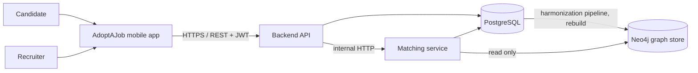

# Software Requirements Specification
## For AdoptAJob

Version 0.7
Prepared by Runxiao Qiu, Nils Förg, Peter Richard Shekidele, Levis Bangoh, Jean-Baptiste Simon
Software Engineering course, Team A (repository `bhsei/26A`)  
2026-10-29

## Table of Contents
<!-- TOC -->
* [1. Introduction](#1-introduction)
    * [1.1 Document Purpose](#11-document-purpose)
    * [1.2 Product Scope](#12-product-scope)
    * [1.3 Definitions, Acronyms, and Abbreviations](#13-definitions-acronyms-and-abbreviations)
    * [1.4 References](#14-references)
    * [1.5 Document Overview](#15-document-overview)
* [2. Product Overview](#2-product-overview)
    * [2.1 Product Perspective](#21-product-perspective)
    * [2.2 Product Functions](#22-product-functions)
    * [2.3 Product Constraints](#23-product-constraints)
    * [2.4 User Characteristics](#24-user-characteristics)
    * [2.5 Assumptions and Dependencies](#25-assumptions-and-dependencies)
    * [2.6 Apportioning of Requirements](#26-apportioning-of-requirements)
* [3. Requirements](#3-requirements)
    * [3.1 External Interfaces](#31-external-interfaces)
    * [3.2 Functions](#32-functions)
    * [3.3 Quality of Service](#33-quality-of-service)
    * [3.4 Compliance](#34-compliance)
    * [3.5 Design and Implementation](#35-design-and-implementation)
    * [3.6 AI/ML](#36-aiml)
* [4. Verification](#4-verification)
* [5. Appendixes](#5-appendixes)
<!-- TOC -->

## Revision History

| Name | Date | Reason For Changes | Version |
|------|------|--------------------|---------|
| Team A | 2026-10-10 | Initial draft: Sections 1 to 5 | 0.1 |
| Team A | 2026-10-16 | Adjusted the priority of some requirements after evaluating them against the project scope and schedule | 0.2 |
| Team A | 2026-10-16 | Neo4j adopted as a read-only graph store for ranking: updated 2.1 and 2.6, added Neo4j to 1.3, added REQ-ML-007 (graph-based ranking, Should) and REQ-ML-008 (graph data minimisation, Must) | 0.3 |
| Team A | 2026-10-17 | Confirmed candidate-only swiping, recruiter acceptance, PostgreSQL as relational source of truth, and Runxiao Qiu/Levis ownership of the PostgreSQL-to-Neo4j harmonization pipeline | 0.4 |
| Team A | 2026-10-28 | Removed REQ-CM-001 (requirement change process; ID retired); closed all open issues in Appendix B; recorded GDPR as the jurisdiction for REQ-COMP-003 | 0.5 |
| Team A | 2026-10-28 | SRS corrections after review of the product: REQ-COMP-003 set to GDPR; REQ-FUNC-004 and REQ-COMP-002 raised to Must; recorded the decisions behind the closed Appendix B issues in REQ-ML-001, REQ-ML-008 and REQ-COMP-001; added minimum age to REQ-FUNC-001; listed password reset, email verification, undo swipe, liked-cards view, moderation tools and blocking as out of scope; clarified REQ-INT-001, 003, 004, REQ-FUNC-001, 003, 004, 009, 011, 014, 017, 019, REQ-PERF-001, REQ-SEC-002, 006, REQ-AVAIL-001, REQ-BUILD-002, REQ-COMP-005, REQ-MAINT-001, REQ-INST-002, REQ-ML-002, 003, 004, 007, 008; aligned shall/should with priorities; updated milestones, apportioning, glossary, references and verification status | 0.6 |
| Team A | 2026-10-29 | Restructured all requirements to the R1 requirement template: added ID, Title, Rationale, Verification Method and More Information fields; renamed AC to Acceptance Criteria; moved constraint and cross-references from Priority to More Information; updated 1.5 and the introduction of Section 3 | 0.7 |

## 1. Introduction

### 1.1 Document Purpose
This SRS defines what AdoptAJob shall do and the qualities it shall have. It is the agreed baseline between the five team members. Developers use it to design and build the system, testers use it to derive test cases, and reviewers use it to check completeness and consistency through GitHub Issues.

### 1.2 Product Scope
**AdoptAJob v1.0** is a mobile job-matching application that applies the swipe interaction of dating apps to the job market. Recruiters publish visual cards for their company or open roles; candidates swipe through these cards without filling in a full profile first. The candidate profile is built progressively from the stated background, swipes, and green/red flags, and the card ranking adapts to it. When a candidate shows interest and the recruiter accepts, a match is created and both parties can chat, or the candidate can apply.

**In scope (v1.0):** account management for candidates and recruiters, recruiter card builder, swipe feed, flags, adaptive ranking, matching, in-app chat, simple application submission.

**Out of scope (v1.0):** payment or premium plans, web client, video interviews, integration with external job boards (LinkedIn, etc.), push notifications outside the app, recruiter analytics dashboards, administrator user interface and moderation tools beyond storing reports, password reset and email verification, undoing a swipe, a candidate view of liked cards and their status, blocking users, multi-language UI (English only).

v1.0 is an academic product demonstrated with synthetic data (A2). The compliance requirements in 3.4 still apply so that the product could be operated with real users without redesign.

### 1.3 Definitions, Acronyms, and Abbreviations

| Term | Definition |
|------|------------|
| Administrator | A team member who operates the demo system through the database and scripts (no admin UI in v1.0). |
| API | Application Programming Interface. |
| Application | A message plus optional CV that a candidate sends to a recruiter after a match. |
| Background | The optional information a candidate states about themselves: desired roles, skills, education level, years of experience, preferred locations, contract type. |
| Candidate | A user looking for a job. |
| Card | A recruiter-created visual unit that candidates swipe on. It is either a Company Card or a Job Card. |
| Company Card | A card presenting a company as a whole. Its title is the company name. |
| CV | Curriculum vitae, uploaded as a PDF file. |
| Feed | The ordered sequence of cards shown to a candidate for swiping, delivered in batches of 20. |
| GDPR | General Data Protection Regulation, Regulation (EU) 2016/679. |
| Green flag | A candidate signal meaning "show me more cards like this", without expressing interest in this specific card. |
| HTTPS | HTTP over TLS. |
| Interested candidate | A candidate who liked a card and has not yet been accepted or declined for it. |
| Job Card | A card presenting one open role. |
| JSON | JavaScript Object Notation, the data format of the API. |
| JWT | JSON Web Token, used to authenticate API requests. |
| Like | A right swipe: the candidate is interested in the card. |
| Match | The state reached when a candidate has liked a card and the card's recruiter has accepted that candidate. |
| MoSCoW | Prioritisation scheme: Must, Should, Could, Won't (this release). |
| MVP | Minimum Viable Product. |
| Neo4j | Graph database used as a minimized, read-only application projection to find relationships relevant to matching (REQ-ML-007, REQ-ML-008). |
| OpenAPI | A standard, machine-readable format for describing REST APIs. |
| Pass | A left swipe: the candidate is not interested in the card. |
| p95 | 95th percentile of a measured value. |
| POC | Proof of Concept. |
| Recruiter | A user who represents a company and publishes cards. |
| Red flag | A candidate signal meaning "stop showing me cards like this". |
| REST | Representational State Transfer, the API style used between the app and the backend. |
| Sector | The industry of a company (e.g. software, retail, health), stored as a tag. |
| SRS | Software Requirements Specification. |
| Swipe | Any of the four candidate actions on a card: like, pass, green flag or red flag. |
| Tag | A normalised keyword attached to a card or profile (skill, sector, contract type, location, etc.). |
| TLS | Transport Layer Security. |
| WCAG | Web Content Accessibility Guidelines. |

### 1.4 References

| ID | Title | Owner | Version / Date | Location | Type |
|----|-------|-------|----------------|----------|------|
| R1 | Markdown SRS Template (MSRS) | ovikrai | Accessed 2026-10-10 | https://github.com/ovikrai/SRS-Template-IEEE | Normative (format) |
| R2 | General Data Protection Regulation, Regulation (EU) 2016/679 | European Union | 2016-04-27 | https://eur-lex.europa.eu/eli/reg/2016/679/oj | Normative (REQ-COMP-*) |
| R3 | Web Content Accessibility Guidelines (WCAG) 2.1 | W3C | 2018-06-05 | https://www.w3.org/TR/WCAG21/ | Normative (REQ-INT-004) |
| R4 | OpenAPI Specification 3.x | OpenAPI Initiative | 3.0 or later | https://spec.openapis.org/oas/ | Normative (REQ-INT-005) |
| R5 | Architecture Design | Team A | Current | `docs/design/Architecture_Design.md` | Informative |
| R6 | Database Design (PostgreSQL model and Neo4j projection) | Team A | Current | `docs/design/database.md` | Informative |
| R7 | Neo4j Mapping | Team A | Current | `docs/design/neo4j-mapping.md` | Informative |
| R8 | API contract | Team A | Current | `docs/design/openapi.yaml` | Informative |
| R9 | Project plan and Gantt chart | Team A | Current | `plans/` | Informative |

### 1.5 Document Overview
Section 2 gives the product context, users and constraints. Section 3 contains the verifiable requirements, written with the requirement template of R1. Section 4 summarises the verification method, test artifact and status of every requirement. Section 5 holds non-normative material and open issues.

**Conventions:**
- "shall" is used for Must requirements, "should" for Should requirements and "may" for Could requirements. A requirement with a split priority (REQ-PORT-001) uses the verb that matches each part.
- Requirement ID format: `REQ-[AREA]-[NNN]`, where AREA ∈ {FUNC, INT, PERF, SEC, REL, AVAIL, OBS, COMP, INST, BUILD, MAINT, PORT, COST, DEAD, POC, ML}. IDs are never reused, including retired IDs (REQ-CM-001). A requirement whose intent changes gets a `-v2` suffix; clarifications, priority changes and acceptance-criteria refinements keep the ID. Every change is listed in the Revision History.
- Requirements are grouped by topic, so IDs within a section are not always consecutive.
- This file lives in `docs/requirements/SRS.md`. Every change is a separate commit: `W<week> - SRS v<x.y>; <description>`.

## 2. Product Overview

### 2.1 Product Perspective
AdoptAJob is a new, standalone product. It is a client-server system made of a mobile app, a backend API, a matching service, a PostgreSQL database (the source of truth) and a Neo4j graph store, which is a read-only copy of part of the database used for ranking. The harmonization pipeline, owned by the matching service team, rebuilds the graph store from PostgreSQL (REQ-ML-008). It has no dependency on existing job platforms.

### 2.2 Product Functions
- **Accounts:** register and sign in as a candidate or a recruiter.
- **Light onboarding:** candidates describe their background in a few optional fields and start swiping immediately.
- **Card builder:** recruiters create, edit, publish and unpublish company and job cards.
- **Swipe feed:** candidates like, pass, green-flag or red-flag cards.
- **Adaptive ranking:** the feed order adapts to the candidate's background, likes and flags.
- **Matching:** recruiters review interested candidates and accept or decline; acceptance creates a match.
- **Connect:** matched parties chat in the app; the candidate can send an application.

### 2.3 Product Constraints
- **C1:** The repository is public; no secrets or real personal data may be committed.
- **C2:** The budget is zero; only free and open-source tools and free tiers may be used.
- **C3:** The system processes personal data of job seekers and must respect the GDPR (see 3.4).

### 2.4 User Characteristics

| User class | Description | Expertise | Frequency | Access |
|-----------|-------------|-----------|-----------|--------|
| Candidate | Adult students and job seekers (18 or older), mainly 18 to 35 years old, used to swipe-based apps | Basic smartphone skills | Daily, short sessions (5 to 10 min) | Own profile, feed, own likes, matches and chats |
| Recruiter | HR staff or hiring managers of small and medium companies | Basic computer and smartphone skills | Several times per week | Own company and cards, interested candidates, own matches and chats |
| Administrator | Team member operating the demo system | Technical | As needed | Database, scripts and logs; handles reports (no admin UI in v1.0) |

UI language is English. Basic accessibility (text contrast, readable font sizes, alternatives to swipe gestures) is required, see 3.1.1.

### 2.5 Assumptions and Dependencies
- **A1:** Users have an Android 10+ smartphone with internet access. Impact if false: the app may not run; iOS is best effort.
- **A2:** Demo data (companies, cards, candidates) will be synthetic, so no real recruiter is required for v1.0.
- **A3:** A match requires a candidate like and a recruiter accept. Candidates are the only users who swipe; recruiters review interested candidates and accept or decline them.
- **A4:** Free hosting (or a team laptop with Docker) is available for demos. Impact if false: demo runs locally only.
- **A5:** Open-source libraries (React Native, Expo, Node.js, Python, PostgreSQL, Neo4j Community Edition) remain available under their current licences.

### 2.6 Apportioning of Requirements

| Requirement(s) | Subsystem | Release |
|----------------|-----------|---------|
| REQ-FUNC-001 to 006, 008, 009, 011 to 015; REQ-INT-001 to 003, 005, 007; REQ-SEC-*; REQ-REL-001, 002; REQ-OBS-003; REQ-COMP-001, 004; REQ-INST-*; REQ-BUILD-*; REQ-POC-001 | Backend API, mobile app | Iteration 1 (MVP) |
| REQ-FUNC-016 to 020; REQ-INT-006; REQ-ML-001 to 006; REQ-PERF-*; REQ-OBS-001, 002; REQ-COMP-002, 003 | Backend API, matching service, mobile app | Iteration 2 |
| REQ-ML-007, 008 (Neo4j graph store and harmonization pipeline) | Matching service, graph store | Iteration 2 |
| REQ-FUNC-007, 010, 021 to 024; REQ-INT-004; REQ-AVAIL-001; REQ-PORT-001 (iOS) | Backend API, mobile app | Iteration 3 |
| REQ-COMP-005, REQ-MAINT-*, REQ-COST-001, REQ-DEAD-001, REQ-PORT-001 (Android) | Whole project | All iterations |

In Iteration 1, before REQ-ML-001 is available, the feed (REQ-FUNC-011) is ordered by the fallback rule of REQ-REL-002 (most recently published first).

## 3. Requirements

Each requirement uses the requirement template of R1, with the fields **ID**, **Title**, **Statement**, **Rationale**, **Acceptance Criteria**, **Verification Method** and **More Information**. The team adds a **Priority** field (MoSCoW, see 1.5) after the Rationale. More Information lists the constraints (2.3), assumptions (2.5), references (1.4) and related requirements. The Verification Method matches the table in Section 4, which also tracks status and evidence.

### 3.1 External Interfaces

#### 3.1.1 User Interfaces

**REQ-INT-001: Main screens**

- ID: REQ-INT-001
- Title: Main screens
- Statement: The mobile app shall provide these screens: sign-in/registration, candidate onboarding, swipe feed, card detail, matches list, chat, candidate profile, recruiter card builder, recruiter card list, interested-candidates list.
- Rationale: Candidates and recruiters use the app in short sessions (2.4) and must reach every core task quickly; a fixed screen list lets the team plan the UI and its tests.
- Priority: Must
- Acceptance Criteria: Each listed screen is reachable in at most 3 taps from the home screen of the corresponding role. The home screen is the swipe feed for candidates and the card list for recruiters.
- Verification Method: Demonstration. Artifact: TC-INT-001 (Section 4).
- More Information: The screens cover REQ-FUNC-001 to REQ-FUNC-024. Main user flows in Appendix A.

**REQ-INT-002: Swipe gesture alternatives**

- ID: REQ-INT-002
- Title: Swipe gesture alternatives
- Statement: Every swipe action (like, pass, green flag, red flag) should also be available through a visible button.
- Rationale: Swipe gestures are not discoverable and are hard for some users (motor impairments, small screens); buttons keep every action available to everyone (2.4).
- Priority: Should
- Acceptance Criteria: A tester can complete each action without performing a gesture.
- Verification Method: Test (manual). Artifact: TC-INT-002 (Section 4).
- More Information: Applies to REQ-FUNC-012 to REQ-FUNC-015.

**REQ-INT-003: Feedback and empty states**

- ID: REQ-INT-003
- Title: Feedback and empty states
- Statement: The app should show a loading indicator for operations longer than 300 ms, an explicit message when the feed is empty, and a human-readable message when a request fails.
- Rationale: Without feedback, users cannot tell a slow request from a broken app, and a blank screen on error looks like a crash, which makes users leave.
- Priority: Should
- Acceptance Criteria:
  - With a simulated 1 s network delay, a loading indicator is visible during the request.
  - A candidate who has swiped every published card sees a "No more cards" message.
  - With the backend stopped, every screen shows an error message instead of crashing or showing a blank screen.
- Verification Method: Test (manual). Artifact: TC-INT-003 (Section 4).
- More Information: Empty feed: REQ-FUNC-011. Error body: REQ-INT-007.

**REQ-INT-004: Readability**

- ID: REQ-INT-004
- Title: Readability
- Statement: Text should meet a contrast ratio of at least 4.5:1 (WCAG 2.1 level AA, R3) and should respect the device font-size setting.
- Rationale: Users with low vision or large system fonts must be able to read the app (2.4); WCAG 2.1 AA is the common baseline for contrast.
- Priority: Should
- Acceptance Criteria: A contrast checker confirms the ratio on the main screens; with the system font size set to 200%, app text is enlarged and no button label is truncated.
- Verification Method: Inspection. Artifact: TC-INT-004 (Section 4).
- More Information: R3.

#### 3.1.2 Hardware Interfaces
No hardware interface requirements in v1.0. Card images and CV files are selected through the operating system's file and photo pickers (REQ-FUNC-008, REQ-FUNC-021); no direct camera access is required.

#### 3.1.3 Software Interfaces

**REQ-INT-005: Client-API protocol**

- ID: REQ-INT-005
- Title: Client-API protocol
- Statement: The mobile app and the backend should communicate through a REST API using JSON over HTTPS, documented in an OpenAPI 3 file (R4) stored in `docs/design/openapi.yaml`.
- Rationale: A documented, machine-readable contract lets the mobile and backend developers work in parallel and makes the API checkable by tools.
- Priority: Should
- Acceptance Criteria: Every endpoint used by the app appears in the OpenAPI file; the file validates without errors.
- Verification Method: Inspection. Artifact: `docs/design/openapi.yaml` (Section 4).
- More Information: R4, R8. Error format: REQ-INT-007.

**REQ-INT-006: API-matching service interface**

- ID: REQ-INT-006
- Title: API-matching service interface
- Statement: The backend should obtain ranked card lists from the matching service through an internal HTTP endpoint that receives a candidate ID and returns an ordered list of card IDs with scores.
- Rationale: Keeping ranking in its own service lets the matching team change the algorithm without changing the backend; a fixed contract also makes the fallback of REQ-REL-002 possible.
- Priority: Should
- Acceptance Criteria: A contract test sends a known candidate ID and receives a list sorted by descending score.
- Verification Method: Test (contract). Artifact: TC-INT-006 (Section 4).
- More Information: Architecture: R5. Related: REQ-ML-001, REQ-REL-002.

**REQ-INT-007: Error format**

- ID: REQ-INT-007
- Title: Error format
- Statement: All API errors should return an appropriate HTTP status code and a JSON body `{ "code": string, "message": string }`.
- Rationale: A single error format lets the app show consistent messages (REQ-INT-003) and lets tests check failures without parsing free text.
- Priority: Should
- Acceptance Criteria: Invalid input returns 400, missing or invalid token returns 401, forbidden resource returns 403, unknown resource returns 404, too many requests returns 429, each with the defined body.
- Verification Method: Test. Artifact: TC-INT-007 (Section 4).
- More Information: Status codes produced by REQ-SEC-002 (401), REQ-SEC-003 (403/404), REQ-SEC-005 (400) and REQ-SEC-006 (429).

### 3.2 Functions

#### 3.2.1 Accounts and authentication

**REQ-FUNC-001: Registration**

- ID: REQ-FUNC-001
- Title: Registration
- Statement: The system shall allow a visitor to register with an email address, a password and a role (candidate or recruiter), after confirming that they are at least 18 years old.
- Rationale: Every other function depends on knowing who the user is and which role they have. The age confirmation is needed because the product targets adults (2.4) and processes their personal data (C3).
- Priority: Must
- Acceptance Criteria:
  - Registration with a new email succeeds and the user is signed in.
  - Registration with an already-used email is rejected with the message "This email cannot be used for registration".
  - Passwords shorter than 8 characters are rejected.
  - Registration cannot be completed without the age confirmation.
- Verification Method: Test. Artifact: TC-FUNC-001 (Section 4).
- More Information: Password storage: REQ-SEC-001. Privacy notice at registration: REQ-COMP-001. Email verification is out of scope (1.2).

**REQ-FUNC-002: Sign-in and sign-out**

- ID: REQ-FUNC-002
- Title: Sign-in and sign-out
- Statement: The system shall allow a registered user to sign in with email and password and to sign out.
- Rationale: Users must return to their profile, matches and chats across sessions, and must be able to end access on a shared device.
- Priority: Must
- Acceptance Criteria: Correct credentials grant access; wrong credentials show a generic error that does not reveal whether the email exists; after sign-out, protected screens require sign-in again and the previous token is rejected by the API (REQ-SEC-002).
- Verification Method: Test. Artifact: TC-FUNC-002 (Section 4).
- More Information: Token handling: REQ-SEC-002. Brute-force protection: REQ-SEC-006. Password reset is out of scope (1.2).

**REQ-FUNC-003: Recruiter company**

- ID: REQ-FUNC-003
- Title: Recruiter company
- Statement: On first sign-in, a recruiter should either create a company by entering at least the company name and sector, or join an existing company with an invitation code generated by a recruiter who already belongs to it.
- Rationale: Cards and interested candidates belong to a company, not to a single recruiter, so several recruiters of one company must share them; the invitation code stops strangers from joining a company.
- Priority: Should
- Acceptance Criteria: A recruiter cannot publish a card before belonging to a company; joining a company without a valid, unused invitation code is rejected.
- Verification Method: Test. Artifact: TC-FUNC-003 (Section 4).
- More Information: Related: REQ-FUNC-008, REQ-FUNC-009, REQ-FUNC-016, REQ-SEC-003.

**REQ-FUNC-004: Account deletion**

- ID: REQ-FUNC-004
- Title: Account deletion
- Statement: The system shall allow a user to delete their account. From the moment of deletion, the account and its data shall no longer be accessible through the API; the profile, swipes, flags, matches, messages, applications and CVs shall be permanently removed from PostgreSQL, CV storage and the graph store within 24 hours.
- Rationale: Job seekers have the right to erasure under the GDPR (C3). Cutting API access immediately protects the user at once, while the 24-hour window allows deletion from every store, including the graph store.
- Priority: Must
- Acceptance Criteria:
  - Immediately after deletion, the user cannot sign in, their token is rejected, and none of their data is returned by any API endpoint.
  - The other party of each of the user's matches sees the match as "Account deleted" and can no longer send messages in it.
  - When the last recruiter of a company deletes their account, all cards of that company are unpublished.
  - 24 hours after deletion, database, CV storage and graph inspection find no record with the user's identifier.
- Verification Method: Test, Inspection. Artifact: TC-FUNC-004 (Section 4).
- More Information: Constraint C3. Related: REQ-COMP-002, REQ-SEC-002, REQ-ML-008. Decision recorded in Appendix B, issue 1.

#### 3.2.2 Candidate profile

**REQ-FUNC-005: Light onboarding**

- ID: REQ-FUNC-005
- Title: Light onboarding
- Statement: The system shall let a candidate enter a background (desired roles, skills, education level, years of experience, preferred locations, contract type), with all fields optional, and start swiping right after registration.
- Rationale: Swiping without first filling in a full profile is the product's main difference from job boards (1.2); a long form at sign-up would lose candidates before they see any card.
- Priority: Must
- Acceptance Criteria: A candidate who skips every field reaches the feed in at most 2 screens after registration.
- Verification Method: Test (manual). Artifact: TC-FUNC-005 (Section 4).
- More Information: Background is a ranking input of REQ-ML-001. Empty background is handled by REQ-ML-002.

**REQ-FUNC-006: Edit profile**

- ID: REQ-FUNC-006
- Title: Edit profile
- Statement: The system should let a candidate view and edit their background at any time.
- Rationale: A candidate's goals change over time and the background is a ranking input (REQ-ML-001), so outdated values would make the feed less relevant.
- Priority: Should
- Acceptance Criteria: The edited values are saved and used by the next feed request.
- Verification Method: Test. Artifact: TC-FUNC-006 (Section 4).
- More Information: Related: REQ-ML-001.

**REQ-FUNC-007: Learned preferences view**

- ID: REQ-FUNC-007
- Title: Learned preferences view
- Statement: The system may show the candidate a summary of the preferences learned from their swipes and flags (for example, the top 5 preferred tags).
- Rationale: Showing what the system has learned helps candidates understand and trust the ranking, but the product works without it.
- Priority: Could
- Acceptance Criteria: After at least 10 likes on cards sharing a tag, that tag appears in the summary.
- Verification Method: Test. Artifact: TC-FUNC-007 (Section 4).
- More Information: Related: REQ-ML-001, REQ-ML-003, REQ-ML-004. No explanation feature in v1.0 (3.6.4).

#### 3.2.3 Recruiter cards

**REQ-FUNC-008: Create card**

- ID: REQ-FUNC-008
- Title: Create card
- Statement: The system shall let a recruiter create a Company Card or a Job Card. A Company Card shall contain the company name, a description and at least 1 tag. A Job Card shall contain a title, description, location, contract type and at least 1 tag, and may contain a salary range, perks and an image (JPEG or PNG, at most 2 MB).
- Rationale: Cards are what candidates swipe on; mandatory fields make sure each card has enough information to decide and enough tags to be ranked. Image limits keep storage and feed load time bounded.
- Priority: Must
- Acceptance Criteria: Saving a card with a missing mandatory field is rejected and names the missing field; an image that is not JPEG/PNG or is larger than 2 MB is rejected.
- Verification Method: Test. Artifact: TC-FUNC-008 (Section 4).
- More Information: Tags are ranking inputs of REQ-ML-001. Preview: REQ-FUNC-010. Load time: REQ-PERF-001.

**REQ-FUNC-009: Edit, publish, unpublish, delete card**

- ID: REQ-FUNC-009
- Title: Edit, publish, unpublish, delete card
- Statement: The system shall let a recruiter edit, publish, unpublish and delete the cards of their company.
- Rationale: Positions open and close, so recruiters must keep their cards current, while candidates who already matched need to know what happened to the position.
- Priority: Must
- Acceptance Criteria:
  - Unpublished and deleted cards never appear in any candidate feed.
  - Existing matches on an unpublished or deleted card remain visible to the candidate as "Position closed".
  - Pending likes on a deleted card are removed from the recruiter's interested list.
  - Edits to a published card are visible to candidates on the next feed or card-detail load; existing likes and matches are kept.
- Verification Method: Test. Artifact: TC-FUNC-009 (Section 4).
- More Information: Feed exclusion: REQ-FUNC-011. Interested list: REQ-FUNC-016. Matches list: REQ-FUNC-019.

**REQ-FUNC-010: Card preview**

- ID: REQ-FUNC-010
- Title: Card preview
- Statement: The card builder should show a preview of the card exactly as candidates will see it.
- Rationale: Recruiters build cards without design skills; a faithful preview avoids publishing cards that look wrong to candidates.
- Priority: Should
- Acceptance Criteria: The preview and the feed card display the same fields and layout.
- Verification Method: Demonstration. Artifact: TC-FUNC-010 (Section 4).
- More Information: Related: REQ-FUNC-008.

#### 3.2.4 Feed and swiping

**REQ-FUNC-011: Feed content**

- ID: REQ-FUNC-011
- Title: Feed content
- Statement: The feed shall show only published cards on which the candidate has not yet performed any swipe (like, pass, green flag or red flag), ordered by the matching service ranking (REQ-ML-001), or by the fallback order of REQ-REL-002. Each card receives exactly one swipe.
- Rationale: Showing a card again after a decision wastes the candidate's time and makes swipes useless as ranking signals.
- Priority: Must
- Acceptance Criteria: After any swipe on a card, it never appears again in that candidate's feed.
- Verification Method: Test. Artifact: TC-FUNC-011 (Section 4).
- More Information: Ranking: REQ-ML-001. Fallback order: REQ-REL-002, used in Iteration 1 (2.6). Duplicate swipes: REQ-REL-001.

**REQ-FUNC-012: Like**

- ID: REQ-FUNC-012
- Title: Like
- Statement: A right swipe (or Like button) shall record the candidate's interest in the card.
- Rationale: The like is how a candidate expresses interest and is the input recruiters review; without it no match can happen (A3).
- Priority: Must
- Acceptance Criteria: The candidate appears in the recruiter's interested-candidates list for that card within 5 seconds.
- Verification Method: Test. Artifact: TC-FUNC-012 (Section 4).
- More Information: Assumption A3. Related: REQ-FUNC-016, REQ-FUNC-024, REQ-ML-001, REQ-REL-001.

**REQ-FUNC-013: Pass**

- ID: REQ-FUNC-013
- Title: Pass
- Statement: A left swipe (or Pass button) shall record that the candidate is not interested in the card.
- Rationale: Candidates need a quick way to dismiss irrelevant cards without sending any signal to recruiters.
- Priority: Must
- Acceptance Criteria: The card is removed from the feed; the recruiter is not notified.
- Verification Method: Test. Artifact: TC-FUNC-013 (Section 4).
- More Information: Feed exclusion: REQ-FUNC-011. Passes are stored in the graph store (REQ-ML-008).

**REQ-FUNC-014: Green flag**

- ID: REQ-FUNC-014
- Title: Green flag
- Statement: The system shall let the candidate green-flag a card, which removes it from the feed and increases the score of similar cards (REQ-ML-003) without expressing interest in that card.
- Rationale: Candidates often like the kind of position a card shows without wanting that specific job; the green flag captures this preference for ranking without creating unwanted interest.
- Priority: Must
- Acceptance Criteria: The card is removed from the feed and is not added to the recruiter's interested list; similar cards receive a higher score in the next feed load.
- Verification Method: Test. Artifact: TC-FUNC-014 (Section 4).
- More Information: Ranking effect: REQ-ML-003. Definition: "Green flag" in 1.3.

**REQ-FUNC-015: Red flag**

- ID: REQ-FUNC-015
- Title: Red flag
- Statement: The system shall let the candidate red-flag a card, which removes it and lowers or excludes similar cards (REQ-ML-004).
- Rationale: Candidates need a strong way to stop seeing a kind of card they dislike, which a pass alone does not express.
- Priority: Must
- Acceptance Criteria: See REQ-ML-004.
- Verification Method: Test. Artifact: TC-FUNC-015 (Section 4).
- More Information: Ranking and exclusion effect: REQ-ML-004. Definition: "Red flag" in 1.3.

**REQ-FUNC-024: Like notification**

- ID: REQ-FUNC-024
- Title: Like notification
- Statement: The system should notify the card's recruiter inside the app when a candidate likes one of their cards (REQ-FUNC-012).
- Rationale: Recruiters need to know when there is new interest to review; otherwise candidates wait and matches are delayed.
- Priority: Should
- Acceptance Criteria: The next time the recruiter opens the app (or within 10 seconds if open), a new-interest indicator is shown on the card.
- Verification Method: Test. Artifact: TC-FUNC-024 (Section 4).
- More Information: Related: REQ-FUNC-012, REQ-FUNC-016. Push notifications outside the app are out of scope (1.2).

#### 3.2.5 Matching and connecting

**REQ-FUNC-016: Interested candidates**

- ID: REQ-FUNC-016
- Title: Interested candidates
- Statement: The system shall show the recruiters of a company, for each of the company's cards, the list of candidates who liked it, with each candidate's background summary.
- Rationale: The recruiter makes the match decision (A3, REQ-ML-006) and needs the list of interested candidates with enough background to judge them.
- Priority: Must
- Acceptance Criteria: The list contains exactly the candidates who liked the card and have not been accepted or declined yet.
- Verification Method: Test. Artifact: TC-FUNC-016 (Section 4).
- More Information: Visibility rule: REQ-SEC-003. Decision: REQ-FUNC-017.

**REQ-FUNC-017: Accept or decline**

- ID: REQ-FUNC-017
- Title: Accept or decline
- Statement: The system shall let the recruiter accept or decline each interested candidate. Accepting shall create a match. A like on a Company Card creates a match with the company; a like on a Job Card creates a match for that role.
- Rationale: A match needs consent from both sides (A3); recruiter acceptance stops every candidate who liked a card from contacting the recruiter.
- Priority: Must
- Acceptance Criteria: After accept, the match appears in both users' match lists; after decline, the candidate is not notified and is removed from the list.
- Verification Method: Test. Artifact: TC-FUNC-017 (Section 4).
- More Information: Assumption A3. Related: REQ-ML-006, REQ-FUNC-018, REQ-FUNC-019.

**REQ-FUNC-018: Match notification**

- ID: REQ-FUNC-018
- Title: Match notification
- Statement: The system should notify both parties inside the app when a match is created.
- Rationale: Users who do not know a match was created cannot act on it; a prompt notice keeps the contact going.
- Priority: Should
- Acceptance Criteria: The next time either user opens the app (or within 10 seconds if open), a match indicator is shown.
- Verification Method: Test. Artifact: TC-FUNC-018 (Section 4).
- More Information: Related: REQ-FUNC-017. Push notifications outside the app are out of scope (1.2).

**REQ-FUNC-019: Matches list**

- ID: REQ-FUNC-019
- Title: Matches list
- Statement: The system shall show each user the list of their matches, most recent first.
- Rationale: Matches are the entry point to chat and applications; most recent first lets users continue current conversations.
- Priority: Must
- Acceptance Criteria: Each entry shows the other party's name, the card title (the company name for a Company Card) and the last message, if any.
- Verification Method: Test. Artifact: TC-FUNC-019 (Section 4).
- More Information: Related: REQ-FUNC-020, REQ-FUNC-021. Entry states "Account deleted" (REQ-FUNC-004) and "Position closed" (REQ-FUNC-009).

**REQ-FUNC-020: Chat**

- ID: REQ-FUNC-020
- Title: Chat
- Statement: The system should let the two parties of a match exchange text messages of up to 1,000 characters. Messages are stored and delivered when the recipient next opens the chat.
- Rationale: Chat lets matched parties move from interest to a conversation without leaving the app or sharing contact details early; limiting it to matches prevents unsolicited messages.
- Priority: Should
- Acceptance Criteria: A message sent by one party is visible to the other within 5 seconds while both have the chat open; a message sent while the recipient is offline is shown when they open the chat; users who are not matched cannot message each other.
- Verification Method: Test. Artifact: TC-FUNC-020 (Section 4).
- More Information: Related: REQ-FUNC-022, REQ-SEC-003. Message contents are excluded from logs (REQ-OBS-002).

**REQ-FUNC-021: Apply**

- ID: REQ-FUNC-021
- Title: Apply
- Statement: The system should let a matched candidate send an application consisting of a short message and an optional PDF CV of at most 5 MB.
- Rationale: Applying turns a match into a hiring process; format and size limits keep CVs readable and storage bounded.
- Priority: Should
- Acceptance Criteria: The recruiter can open the application and download the CV; files that are not PDF or are larger than 5 MB are rejected.
- Verification Method: Test. Artifact: TC-FUNC-021 (Section 4).
- More Information: CV retention: REQ-COMP-001. CV deletion: REQ-FUNC-004.

**REQ-FUNC-022: Unmatch**

- ID: REQ-FUNC-022
- Title: Unmatch
- Statement: The system should let either party end a match, which closes the chat for both.
- Rationale: Either party may lose interest or feel uncomfortable, and must be able to stop further contact.
- Priority: Should
- Acceptance Criteria: After unmatch, neither party can send messages in that chat.
- Verification Method: Test. Artifact: TC-FUNC-022 (Section 4).
- More Information: Related: REQ-FUNC-020. CVs are kept only until the match ends (REQ-COMP-001). Blocking users is out of scope (1.2).

#### 3.2.6 Safety and moderation

**REQ-FUNC-023: Report**

- ID: REQ-FUNC-023
- Title: Report
- Statement: The system should let a user report a card, a user or a message, with a reason.
- Rationale: Users need a way to signal fake cards and abusive users or messages; stored reports let the administrator act even without moderation tools in v1.0 (1.2).
- Priority: Should
- Acceptance Criteria: The report is stored with reporter, target, reason and timestamp, and is visible to the administrator in the database.
- Verification Method: Test. Artifact: TC-FUNC-023 (Section 4).
- More Information: Report retention: REQ-COMP-001. Administrator role: 2.4.

### 3.3 Quality of Service

#### 3.3.1 Performance

**Test environment.** Performance requirements are measured on a single host running the full stack with `docker compose up` (REQ-INST-001), with at least 4 CPU cores and 8 GB of RAM, the load generator on the same host, and data loaded with the seed script (REQ-INST-002). The hardware and tool versions used are recorded in the test report.

**REQ-PERF-001: Feed load time**

- ID: REQ-PERF-001
- Title: Feed load time
- Statement: The API should return the next batch of 20 feed cards with a p95 response time of at most 1.5 s.
- Rationale: Candidates use the app in short sessions (2.4) and leave if the feed is slow; 1.5 s keeps the wait acceptable with a realistic data volume.
- Priority: Should
- Acceptance Criteria: Load test in the test environment with 1,000 published cards and 50 concurrent candidates; p95 ≤ 1.5 s over 5 minutes.
- Verification Method: Test (load). Artifact: TC-PERF-001 (Section 4).
- More Information: Test environment: 3.3.1. Test data: REQ-INST-002. Fallback: REQ-REL-002.

**REQ-PERF-002: Swipe acknowledgement**

- ID: REQ-PERF-002
- Title: Swipe acknowledgement
- Statement: The API should acknowledge a swipe or flag with a p95 response time of at most 500 ms.
- Rationale: Swipes are the most frequent request; slow acknowledgements would pile up on the device and delay the signals used for ranking.
- Priority: Should
- Acceptance Criteria: Same load test as REQ-PERF-001; p95 ≤ 500 ms.
- Verification Method: Test (load). Artifact: TC-PERF-002 (Section 4).
- More Information: Test environment: 3.3.1. Related: REQ-PERF-003, REQ-REL-001.

**REQ-PERF-003: Smooth swiping**

- ID: REQ-PERF-003
- Title: Smooth swiping
- Statement: The app should display the next card immediately after a swipe, without waiting for the server response.
- Rationale: The swipe interaction only feels natural if cards follow each other instantly, whatever the mobile network latency.
- Priority: Should
- Acceptance Criteria: With a simulated 1 s network delay, the next card appears in less than 200 ms after the swipe.
- Verification Method: Test (manual). Artifact: TC-PERF-003 (Section 4).
- More Information: Related: REQ-PERF-002. Retries are safe because of REQ-REL-001.

#### 3.3.2 Security

**REQ-SEC-001: Password storage**

- ID: REQ-SEC-001
- Title: Password storage
- Statement: Passwords shall be stored only as salted hashes using an adaptive algorithm (bcrypt, scrypt or Argon2).
- Rationale: A database leak must not reveal users' passwords, which are often reused on other services.
- Priority: Must
- Acceptance Criteria: Database inspection shows no plain-text or reversibly encrypted passwords.
- Verification Method: Inspection. Artifact: TC-SEC-001 (Section 4).
- More Information: Related: REQ-FUNC-001.

**REQ-SEC-002: Authentication of requests**

- ID: REQ-SEC-002
- Title: Authentication of requests
- Statement: Every API endpoint except registration, sign-in and health check shall require a valid JWT. Access tokens shall expire after at most 24 hours and shall be rejected after sign-out or account deletion.
- Rationale: The API holds personal data (C3), so only identified users may use it, and a token must stop working once the user signs out or deletes the account.
- Priority: Must
- Acceptance Criteria: Requests without a token, with a modified token, with an expired token, or with a token issued before sign-out or account deletion return 401.
- Verification Method: Test. Artifact: TC-SEC-002 (Section 4).
- More Information: Constraint C3. Related: REQ-FUNC-002, REQ-FUNC-004, REQ-INT-007.

**REQ-SEC-003: Authorization**

- ID: REQ-SEC-003
- Title: Authorization
- Statement: A user shall only read or change their own data. Recruiters shall only manage cards of their company. Candidate data shall only be visible to the recruiters of a company after that candidate liked one of the company's cards.
- Rationale: Candidate profiles, matches and messages are personal data (C3); showing them to other users or other companies would breach privacy and trust.
- Priority: Must
- Acceptance Criteria: Automated tests attempting to access another user's profile, cards, matches or chats return 403 or 404.
- Verification Method: Test. Artifact: TC-SEC-003 (Section 4).
- More Information: Constraint C3. Related: REQ-FUNC-003, REQ-FUNC-016.

**REQ-SEC-004: Transport security**

- ID: REQ-SEC-004
- Title: Transport security
- Statement: All traffic between the app and the backend should use HTTPS (TLS 1.2 or higher) in any deployed environment.
- Rationale: Without encryption, credentials, tokens and personal data would travel in clear text over public networks.
- Priority: Should
- Acceptance Criteria: Plain HTTP requests to the deployed API are refused or redirected.
- Verification Method: Test. Artifact: TC-SEC-004 (Section 4).
- More Information: Applies to deployed environments only; local development (REQ-INST-001) may use HTTP. Related: REQ-INT-005.

**REQ-SEC-005: Input validation**

- ID: REQ-SEC-005
- Title: Input validation
- Statement: The API shall validate all inputs (type, length, format) and use parameterised queries.
- Rationale: Unvalidated input is the main cause of injection attacks and corrupted data.
- Priority: Must
- Acceptance Criteria: Requests with invalid types, missing fields or oversized values are rejected with 400 and do not alter data.
- Verification Method: Test. Artifact: TC-SEC-005 (Section 4).
- More Information: Error response: REQ-INT-007.

**REQ-SEC-006: Brute-force protection**

- ID: REQ-SEC-006
- Title: Brute-force protection
- Statement: The API should limit failed sign-in attempts to 10 per account per source IP address per 15 minutes, and to 100 per source IP address per 15 minutes across all accounts. Limits from one IP address should not block sign-in from other IP addresses.
- Rationale: Without limits, an attacker can guess passwords by trying many of them; limiting per IP address avoids locking out the real user.
- Priority: Should
- Acceptance Criteria: After 10 failed attempts on one account from one IP within 15 minutes, the 11th attempt from that IP returns 429 even with the correct password; a correct sign-in to the same account from another IP succeeds.
- Verification Method: Test. Artifact: TC-SEC-006 (Section 4).
- More Information: Related: REQ-FUNC-002, REQ-INT-007.

**REQ-SEC-007: Secrets management**

- ID: REQ-SEC-007
- Title: Secrets management
- Statement: Secrets (JWT signing key, database passwords, API keys) shall be provided through environment variables and shall never be committed to the repository.
- Rationale: The repository is public (C1); a committed secret would give anyone access to the system.
- Priority: Must
- Acceptance Criteria: `.env` is listed in `.gitignore`; a secret scan of the repository (e.g. GitHub secret scanning or gitleaks) finds no secrets.
- Verification Method: Inspection. Artifact: Secret scan report (Section 4).
- More Information: Constraint C1. Environment variables are documented for REQ-INST-001.

#### 3.3.3 Reliability

**REQ-REL-001: Idempotent swipes**

- ID: REQ-REL-001
- Title: Idempotent swipes
- Statement: Sending the same swipe twice (e.g. after a network retry) should result in a single recorded swipe.
- Rationale: Mobile networks drop responses and the app retries; duplicate records would distort the ranking and the recruiter's interested list.
- Priority: Should
- Acceptance Criteria: Two identical swipe requests produce one database record.
- Verification Method: Test. Artifact: TC-REL-001 (Section 4).
- More Information: Related: REQ-PERF-003, REQ-FUNC-011.

**REQ-REL-002: Matching fallback**

- ID: REQ-REL-002
- Title: Matching fallback
- Statement: If the matching service does not answer within 1 s, the backend should return a feed ordered by most recently published cards.
- Rationale: The matching service is a separate component that may be slow or down, and the feed is the core screen, so it must keep working.
- Priority: Should
- Acceptance Criteria: With the matching service stopped, the feed still loads within the REQ-PERF-001 target.
- Verification Method: Test. Artifact: TC-REL-002 (Section 4).
- More Information: Interface: REQ-INT-006. Also the Iteration 1 ordering (2.6). Graph store fallback: REQ-ML-007.

#### 3.3.4 Availability

**REQ-AVAIL-001: Demo availability**

- ID: REQ-AVAIL-001
- Title: Demo availability
- Statement: The demo deployment should be available during the review sessions and the final presentation listed in the project plan (REQ-DEAD-001).
- Rationale: The product is assessed through demos; if the deployment is down during a review, the work cannot be evaluated.
- Priority: Should
- Acceptance Criteria: The health-check endpoint (REQ-OBS-003) responds 200 at the start and end of each listed session.
- Verification Method: Demonstration. Artifact: Session log (Section 4).
- More Information: Assumption A4. Related: REQ-DEAD-001, REQ-OBS-003.

#### 3.3.5 Observability

**REQ-OBS-001: Request logging**

- ID: REQ-OBS-001
- Title: Request logging
- Statement: The backend and matching service should log each request with timestamp, endpoint, status code, duration and a request ID propagated between services.
- Rationale: Without a shared request ID, a failure that crosses the backend and the matching service cannot be traced to its cause.
- Priority: Should
- Acceptance Criteria: One feed request can be followed across both services using its request ID.
- Verification Method: Test. Artifact: TC-OBS-001 (Section 4).
- More Information: Related: REQ-INT-006, REQ-OBS-002.

**REQ-OBS-002: No sensitive data in logs**

- ID: REQ-OBS-002
- Title: No sensitive data in logs
- Statement: Logs should not contain passwords, tokens, email addresses, message contents or CV files.
- Rationale: Logs are less protected than the database and are often shared for debugging; personal data or credentials in them would break C3.
- Priority: Should
- Acceptance Criteria: Log inspection after a full test run shows none of these values.
- Verification Method: Inspection. Artifact: Log review (Section 4).
- More Information: Constraint C3. Related: REQ-OBS-001.

**REQ-OBS-003: Health check**

- ID: REQ-OBS-003
- Title: Health check
- Statement: Each service should expose a `GET /health` endpoint.
- Rationale: The team and the demo setup need a quick way to see whether a service and its database are up.
- Priority: Should
- Acceptance Criteria: The endpoint returns 200 when the service and its database connection are up.
- Verification Method: Test. Artifact: TC-OBS-003 (Section 4).
- More Information: Exempt from authentication (REQ-SEC-002). Used by REQ-AVAIL-001.

### 3.4 Compliance

**REQ-COMP-001: Privacy notice and consent**

- ID: REQ-COMP-001
- Title: Privacy notice and consent
- Statement: At registration, the app shall display a privacy notice describing which personal data is collected, why, on which legal basis, and how long it is kept, and shall require the user to accept it before the account is created. Personal data shall be kept only for these periods: account data until the account is deleted or has been inactive for 12 months, after which it is deleted as in REQ-FUNC-004; CVs until the match ends or the account is deleted; reports for 12 months after creation.
- Rationale: The GDPR requires telling users what is processed, why, on which legal basis and for how long, and keeping data no longer than needed (C3).
- Priority: Must
- Acceptance Criteria: Registration cannot be completed without ticking the acceptance checkbox; the notice states the retention periods and is reachable from the profile screen; a cleanup run on synthetic data with shifted timestamps deletes the inactive accounts, the CVs of ended matches and the old reports, and nothing else.
- Verification Method: Test (manual). Artifact: TC-COMP-001 (Section 4).
- More Information: Constraint C3. R2. Account deletion: REQ-FUNC-004. Decision recorded in Appendix B, issue 1.

**REQ-COMP-002: Data subject rights**

- ID: REQ-COMP-002
- Title: Data subject rights
- Statement: Users shall be able to export their personal data in JSON format and delete their account (REQ-FUNC-004), as required by GDPR Articles 15, 17 and 20.
- Rationale: GDPR Articles 15, 17 and 20 give users the rights of access, erasure and data portability (C3).
- Priority: Must
- Acceptance Criteria: The export contains the profile, swipes, flags, matches, messages and applications of the user only.
- Verification Method: Test. Artifact: TC-COMP-002 (Section 4).
- More Information: Constraint C3. R2. Related: REQ-FUNC-004.

**REQ-COMP-003: Applicable law**

- ID: REQ-COMP-003
- Title: Applicable law
- Statement: Processing of personal data shall follow the GDPR (R2).
- Rationale: The team needs one legal framework to design against; the GDPR applies because the team and its intended users are in the EU.
- Priority: Must
- Acceptance Criteria: Inspection: the privacy notice references the GDPR.
- Verification Method: Inspection. Artifact: Privacy notice (Section 4).
- More Information: Constraint C3. R2. Decision recorded in Appendix B, issue 4.

**REQ-COMP-004: Non-discrimination**

- ID: REQ-COMP-004
- Title: Non-discrimination
- Statement: The matching logic shall not use gender, age, ethnicity, nationality, religion, disability, marital status or photos as ranking inputs.
- Rationale: Ranking on protected attributes could lead to discriminatory hiring, which is unlawful in the EU and goes against the goal of fair matching.
- Priority: Must
- Acceptance Criteria: Code and data-schema inspection shows none of these attributes is an input to REQ-ML-001 or REQ-ML-007.
- Verification Method: Inspection. Artifact: Code and schema review (Section 4).
- More Information: Applies to REQ-ML-001 and REQ-ML-007; these attributes are also excluded from the graph store (REQ-ML-008). Ethics: 3.6.4.

**REQ-COMP-005: Development process**

- ID: REQ-COMP-005
- Title: Development process
- Statement: All artifacts should be stored in the team repository and follow the commit convention defined in 1.5. Code changes should be reviewed through pull requests; document reviews and defects should be tracked in GitHub Issues.
- Rationale: Shared conventions and reviews keep the work of five people consistent and traceable, and make it possible to assess.
- Priority: Should
- Acceptance Criteria: Inspection of the repository, its pull requests and its commit history.
- Verification Method: Inspection. Artifact: Repository review (Section 4).
- More Information: Commit convention: 1.5. Contribution rules: `CONTRIBUTING.md`.

### 3.5 Design and Implementation

#### 3.5.1 Installation
**REQ-INST-001: One-command setup**

- ID: REQ-INST-001
- Title: One-command setup
- Statement: The backend, matching service and databases should start locally with a single command (e.g. `docker compose up`) using documented environment variables.
- Rationale: Team members and reviewers use different machines; a single command removes setup errors and makes demos and tests reproducible.
- Priority: Should
- Acceptance Criteria: A team member who has never run the project starts it from the README in under 15 minutes.
- Verification Method: Demonstration. Artifact: README walkthrough (Section 4).
- More Information: Assumption A4. `docker-compose.yml`. Performance test environment: 3.3.1.

**REQ-INST-002: Seed data**

- ID: REQ-INST-002
- Title: Seed data
- Statement: The project should include a script that loads synthetic demo data, by default at least 10 companies in at least 3 sectors, 50 job cards and 10 candidates, and that accepts a size parameter to generate the 1,000 cards of REQ-PERF-001.
- Rationale: Real data cannot be used (C1, REQ-ML-005), and an empty system cannot be demonstrated or load-tested.
- Priority: Should
- Acceptance Criteria: After running the script with default settings, the feed of a demo candidate is non-empty; with the size parameter set to 1,000, the database contains 1,000 published cards.
- Verification Method: Test. Artifact: TC-INST-002 (Section 4).
- More Information: Related: REQ-ML-005, REQ-PERF-001, REQ-ML-002 (at least 3 sectors). Fixtures in `tests/fixtures/synthetic`.

#### 3.5.2 Build and Delivery
**REQ-BUILD-001: Reproducible dependencies**

- ID: REQ-BUILD-001
- Title: Reproducible dependencies
- Statement: Each component should pin its dependencies with a lock file (`package-lock.json` for Node.js; `uv.lock`, `poetry.lock` or a fully pinned `requirements.txt` for Python).
- Rationale: Unpinned dependencies can change between installs and break builds or tests on another machine.
- Priority: Should
- Acceptance Criteria: A clean install on a new machine installs the same versions.
- Verification Method: Inspection. Artifact: Lock files (Section 4).
- More Information: Related: REQ-BUILD-002.

**REQ-BUILD-002: Automated tests on push**

- ID: REQ-BUILD-002
- Title: Automated tests on push
- Statement: Automated tests should run on every push to `dev` and `main` and on every pull request (e.g. GitHub Actions).
- Rationale: Running the tests on every change catches regressions before they reach the shared branches.
- Priority: Should
- Acceptance Criteria: Each commit on `dev` and `main` and each pull request shows a test status in GitHub.
- Verification Method: Inspection. Artifact: GitHub Actions (Section 4).
- More Information: Related: REQ-MAINT-002, REQ-COMP-005.

#### 3.5.3 Distribution
No distribution requirements in v1.0; the system runs on a single host (see REQ-INST-001).

#### 3.5.4 Maintainability
**REQ-MAINT-001: Documentation**

- ID: REQ-MAINT-001
- Title: Documentation
- Statement: Each component should have a README with purpose, setup, run and test instructions.
- Rationale: Each member works on a different component and must be able to run the others; reviewers need the same instructions.
- Priority: Should
- Acceptance Criteria: Each component README contains the four sections, and following its setup, run and test instructions on a clean checkout succeeds.
- Verification Method: Inspection. Artifact: READMEs (Section 4).
- More Information: Related: REQ-INST-001.

**REQ-MAINT-002: Test coverage**

- ID: REQ-MAINT-002
- Title: Test coverage
- Statement: Backend and matching-service unit tests should cover at least 60% of lines.
- Rationale: A minimum coverage makes it likely that regressions in core logic are caught; 60% is achievable within the schedule.
- Priority: Should
- Acceptance Criteria: Coverage report attached to the test report.
- Verification Method: Analysis. Artifact: Coverage report (Section 4).
- More Information: Coverage is reported in the test report (M6, REQ-DEAD-001). Related: REQ-BUILD-002.

**REQ-MAINT-003: Code style**

- ID: REQ-MAINT-003
- Title: Code style
- Statement: Each component should use an automatic formatter and linter (ESLint/Prettier for JavaScript/TypeScript, Ruff or Black for Python).
- Rationale: A consistent style reduces review effort and avoids formatting noise in diffs between five contributors.
- Priority: Should
- Acceptance Criteria: Linter runs without errors on `main`.
- Verification Method: Inspection. Artifact: Linter output (Section 4).
- More Information: Related: REQ-COMP-005.

#### 3.5.5 Reusability
No reusability requirements in v1.0.

#### 3.5.6 Portability
**REQ-PORT-001: Mobile platforms**

- ID: REQ-PORT-001
- Title: Mobile platforms
- Statement: The app shall run on Android 10 or higher; it may run on iOS 15 or higher.
- Rationale: Most target users have Android phones (A1), and Android can be tested without paid hardware or developer accounts (C2); iOS is welcome but not guaranteed.
- Priority: Must (Android), Could (iOS)
- Acceptance Criteria: Demonstration on at least one Android device or emulator; iOS on simulator if available.
- Verification Method: Demonstration. Artifact: TC-PORT-001 (Section 4).
- More Information: Assumption A1. Constraint C2. Android in all iterations, iOS in Iteration 3 (2.6).

#### 3.5.7 Cost
**REQ-COST-001: Zero budget**

- ID: REQ-COST-001
- Title: Zero budget
- Statement: Development and demo operation shall not require paid services.
- Rationale: The project has no budget (C2).
- Priority: Must
- Acceptance Criteria: Inspection: all tools and hosting are free or free tier.
- Verification Method: Inspection. Artifact: Tool list (Section 4).
- More Information: Constraint C2. Assumptions A4, A5.

#### 3.5.8 Deadline
**REQ-DEAD-001: Milestones**

- ID: REQ-DEAD-001
- Title: Milestones
- Statement: The team shall deliver the following milestones on the dates set in the project plan (`plans/`):

  | Milestone | Deliverable | Date | Status |
  |-----------|-------------|------|--------|
  | M1 | Project plan and Gantt chart | 2026-10-14 | Delivered |
  | M2 | SRS for Assignment 1 (v0.1); SRS v1.0 baseline after peer review by M4 | 2026-10-14; 2026-11-11 | v0.1 delivered; v1.0 pending |
  | M3 | Architecture design document v1.0 | 2026-10-14 | Delivered |
  | M4 | MVP (Iteration 1) demo | 2026-11-11 | Planned |
  | M5 | Iteration 2 feature-complete | 2026-12-02 | Planned |
  | M6 | Test report | 2026-12-23 | Planned |
  | M7 | Release and final pitch | 2027-01-06 | Planned |

- Rationale: The course sets the delivery dates; a late deliverable cannot be assessed.
- Priority: Must
- Acceptance Criteria: Each deliverable is committed to its folder by its date.
- Verification Method: Inspection. Artifact: `plans/` (Section 4).
- More Information: Project plan and Gantt chart: R9. Related: REQ-AVAIL-001.

#### 3.5.9 Proof of Concept
**REQ-POC-001: Swipe-feed POC**

- ID: REQ-POC-001
- Title: Swipe-feed POC
- Statement: Before M4 (2026-11-11), the team should build a timeboxed (2 weeks, planned 2026-10-14 to 2026-10-28) POC in which the app loads cards from the API and records swipes in the database.
- Rationale: The swipe feed crosses the app, the API and the database; building it early tests the architecture before the MVP.
- Priority: Should
- Acceptance Criteria: Demonstration: 20 swipes on the device result in 20 database records.
- Verification Method: Demonstration. Artifact: TC-POC-001 (Section 4).
- More Information: Milestone M4 (REQ-DEAD-001). Related: REQ-FUNC-011, REQ-FUNC-012.

#### 3.5.10 Change Management
No change management requirements in v1.0. SRS changes follow the conventions in 1.5 (ID rules, Revision History, commit convention); REQ-CM-001 is retired.

### 3.6 AI/ML

#### 3.6.1 Model Specification
**REQ-ML-001: Card ranking**

- ID: REQ-ML-001
- Title: Card ranking
- Statement: The matching service shall compute a relevance score for each candidate-card pair from (a) the candidate's stated background, (b) tags of liked cards, (c) green flags and (d) red flags, and shall return cards sorted by descending score. The score is a weighted tag-overlap score, plus the graph score of REQ-ML-007 when available, as documented in R6 section 7.4; the weights are versioned in the source code and in the test fixture.
- Rationale: Showing relevant cards first is the product's core value; a documented, deterministic score can be tested and explained.
- Priority: Must
- Acceptance Criteria: For a test candidate with known inputs and the documented weights, the returned order equals the order computed by hand in the test fixture.
- Verification Method: Test. Artifact: TC-ML-001 (Section 4).
- More Information: R6 section 7.4. Related: REQ-INT-006, REQ-ML-007, REQ-COMP-004. Decision recorded in Appendix B, issue 2.

**REQ-ML-002: Cold start**

- ID: REQ-ML-002
- Title: Cold start
- Statement: For a candidate with no background and no swipes, the feed should show the most recent card of each of the 3 sectors with the most recent publications first, then the remaining cards by most recent publication. If fewer than 3 sectors have published cards, it should show all available sectors first.
- Rationale: With no signals, the ranking has nothing to work on; variety across sectors helps a new candidate give their first signals quickly.
- Priority: Should
- Acceptance Criteria: With the default seed data (at least 3 sectors), the first 20 cards of a new candidate cover at least 3 sectors and the rest follow publication date.
- Verification Method: Test. Artifact: TC-ML-002 (Section 4).
- More Information: Related: REQ-FUNC-005, REQ-INST-002.

**REQ-ML-003: Green flag effect**

- ID: REQ-ML-003
- Title: Green flag effect
- Statement: After a green flag on a card, every remaining card sharing at least one tag with it shall receive a higher score than before the flag.
- Rationale: The green flag only has value if candidates see its effect in the following cards.
- Priority: Must
- Acceptance Criteria: For each card sharing a tag with the flagged card, the score returned by the matching service after the flag is strictly greater than before; cards sharing no tag keep their score.
- Verification Method: Test. Artifact: TC-ML-003 (Section 4).
- More Information: Related: REQ-FUNC-014.

**REQ-ML-004: Red flag effect**

- ID: REQ-ML-004
- Title: Red flag effect
- Statement: After a red flag on a Job Card, cards from the same company with the same job title shall be excluded from the feed. After a red flag on a Company Card, all cards of that company shall be excluded. In both cases, every remaining card sharing at least one tag with the flagged card shall receive a lower score than before the flag.
- Rationale: A candidate who red-flags a card expects not to see that company or role again; showing it anyway would make the flag useless.
- Priority: Must
- Acceptance Criteria: In the next 20 feed cards, no card is excluded by the rule above; for each card sharing a tag with the flagged card, the score after the flag is strictly lower than before.
- Verification Method: Test. Artifact: TC-ML-004 (Section 4).
- More Information: Related: REQ-FUNC-015. Guardrails: 3.6.3.

**REQ-ML-007: Graph-based ranking**

- ID: REQ-ML-007
- Title: Graph-based ranking
- Statement: The matching service should raise the score of a card when other candidates who liked at least one of the same cards as the current candidate also liked that card. These relationships should be read from the Neo4j graph store. If the graph store does not answer within 300 ms, the matching service should rank with REQ-ML-001 alone.
- Rationale: Tag overlap cannot find interests the candidate never stated; likes from similar candidates add them, and the fallback keeps the feed working if the graph store fails.
- Priority: Should
- Acceptance Criteria: With synthetic data where candidates A and B both liked card X and B also liked card Y, card Y's score in A's feed is higher after the next graph rebuild (REQ-ML-008) than before B's like; with the graph store stopped, A's feed still loads within the REQ-PERF-001 target.
- Verification Method: Test. Artifact: TC-ML-007 (Section 4).
- More Information: R6, R7. Product perspective: 2.1. Related: REQ-ML-008, REQ-REL-002.

#### 3.6.2 Data Management
**REQ-ML-005: Training and evaluation data**

- ID: REQ-ML-005
- Title: Training and evaluation data
- Statement: Only synthetic data shall be used for development, evaluation and the public repository. Real user data shall never be exported from the production database for these purposes.
- Rationale: The repository is public (C1), and exporting real user data would breach the GDPR (C3).
- Priority: Must
- Acceptance Criteria: Inspection: the `assets/` and `tests/` folders contain only generated data, with the generator script included.
- Verification Method: Inspection. Artifact: Data folders (Section 4).
- More Information: Constraints C1, C3. Generator: REQ-INST-002.

**REQ-ML-008: Graph data minimisation**

- ID: REQ-ML-008
- Title: Graph data minimisation
- Statement: The graph store shall be rebuilt from the main database and shall contain only identifiers, tags, card status and publish date, company sector, and like, pass and flag relationships. It shall contain no names, email addresses, password hashes, messages, CVs or attributes listed in REQ-COMP-004, and a deleted account shall be removed from it within the period set by REQ-FUNC-004. The harmonization pipeline shall fully rebuild the graph at least every 15 minutes; a failed rebuild shall be retried up to 3 times and shall leave the previous graph in place; after each rebuild, node and relationship counts shall be compared with PostgreSQL and any difference logged.
- Rationale: The graph store is a second copy of personal data (C3); minimising it limits exposure, and regular rebuilds with checks keep the ranking fresh and consistent with PostgreSQL.
- Priority: Must
- Acceptance Criteria: Inspection of node and relationship properties finds only the listed fields; after a synthetic account is deleted and the sync runs, no node with its identifier exists; a like recorded in PostgreSQL appears in the graph within 15 minutes; with Neo4j stopped during a rebuild, the previous graph is still readable afterwards; the reconciliation log shows equal counts after a successful rebuild.
- Verification Method: Inspection, Test. Artifact: TC-ML-008 (Section 4).
- More Information: Constraint C3. R6, R7. Pipeline owners: Runxiao Qiu, Levis. Decisions recorded in Appendix B, issues 1 and 3.

#### 3.6.3 Guardrails
The feed exclusions are defined in REQ-FUNC-009, REQ-FUNC-011 and REQ-ML-004.

#### 3.6.4 Ethics
No explanation feature in v1.0. Fairness constraints are defined in REQ-COMP-004.

#### 3.6.5 Human-in-the-Loop
**REQ-ML-006: Human decision**

- ID: REQ-ML-006
- Title: Human decision
- Statement: The system shall never create a match or reject a candidate automatically; the final decision is always the recruiter's (REQ-FUNC-017).
- Rationale: Decisions about hiring people must stay with a human (GDPR Article 22 on automated decisions), and the recruiter must keep control over who they talk to.
- Priority: Must
- Acceptance Criteria: Inspection: no code path creates a match or declines a candidate without a recruiter action.
- Verification Method: Inspection. Artifact: Code review (Section 4).
- More Information: Assumption A3. R2. Related: REQ-FUNC-017.

#### 3.6.6 Model Lifecycle and Operations
No model lifecycle requirements in v1.0; the scoring logic and its weights are versioned with the source code.

## 4. Verification

Methods: **T** = Test (automated or manual), **A** = Analysis, **I** = Inspection, **D** = Demonstration. Test case IDs follow `TC-<REQ ID>-<n>` and live in `tests/` and `docs/testing/`. Status values: Planned, In progress (artifact exists but is not yet verified), Passed, Failed.

| Requirement ID | Verification Method | Test/Artifact Link | Status | Evidence |
|----------------|---------------------|--------------------|--------|----------|
| REQ-INT-001 | D | TC-INT-001 | Planned | |
| REQ-INT-002 | T (manual) | TC-INT-002 | Planned | |
| REQ-INT-003 | T (manual) | TC-INT-003 | Planned | |
| REQ-INT-004 | I | TC-INT-004 | Planned | |
| REQ-INT-005 | I | `docs/design/openapi.yaml` | In progress | [openapi.yaml](../design/openapi.yaml) |
| REQ-INT-006 | T (contract) | TC-INT-006 | Planned | |
| REQ-INT-007 | T | TC-INT-007 | Planned | |
| REQ-FUNC-001 | T | TC-FUNC-001 | Planned | |
| REQ-FUNC-002 | T | TC-FUNC-002 | Planned | |
| REQ-FUNC-003 | T | TC-FUNC-003 | Planned | |
| REQ-FUNC-004 | T, I | TC-FUNC-004 | Planned | |
| REQ-FUNC-005 | T (manual) | TC-FUNC-005 | Planned | |
| REQ-FUNC-006 | T | TC-FUNC-006 | Planned | |
| REQ-FUNC-007 | T | TC-FUNC-007 | Planned | |
| REQ-FUNC-008 | T | TC-FUNC-008 | Planned | |
| REQ-FUNC-009 | T | TC-FUNC-009 | Planned | |
| REQ-FUNC-010 | D | TC-FUNC-010 | Planned | |
| REQ-FUNC-011 | T | TC-FUNC-011 | Planned | |
| REQ-FUNC-012 | T | TC-FUNC-012 | Planned | |
| REQ-FUNC-013 | T | TC-FUNC-013 | Planned | |
| REQ-FUNC-014 | T | TC-FUNC-014 | Planned | |
| REQ-FUNC-015 | T | TC-FUNC-015 | Planned | |
| REQ-FUNC-016 | T | TC-FUNC-016 | Planned | |
| REQ-FUNC-017 | T | TC-FUNC-017 | Planned | |
| REQ-FUNC-018 | T | TC-FUNC-018 | Planned | |
| REQ-FUNC-019 | T | TC-FUNC-019 | Planned | |
| REQ-FUNC-020 | T | TC-FUNC-020 | Planned | |
| REQ-FUNC-021 | T | TC-FUNC-021 | Planned | |
| REQ-FUNC-022 | T | TC-FUNC-022 | Planned | |
| REQ-FUNC-023 | T | TC-FUNC-023 | Planned | |
| REQ-FUNC-024 | T | TC-FUNC-024 | Planned | |
| REQ-PERF-001 | T (load) | TC-PERF-001 | Planned | |
| REQ-PERF-002 | T (load) | TC-PERF-002 | Planned | |
| REQ-PERF-003 | T (manual) | TC-PERF-003 | Planned | |
| REQ-SEC-001 | I | TC-SEC-001 | Planned | |
| REQ-SEC-002 | T | TC-SEC-002 | Planned | |
| REQ-SEC-003 | T | TC-SEC-003 | Planned | |
| REQ-SEC-004 | T | TC-SEC-004 | Planned | |
| REQ-SEC-005 | T | TC-SEC-005 | Planned | |
| REQ-SEC-006 | T | TC-SEC-006 | Planned | |
| REQ-SEC-007 | I | Secret scan report | In progress | [.gitignore](../../.gitignore) |
| REQ-REL-001 | T | TC-REL-001 | Planned | |
| REQ-REL-002 | T | TC-REL-002 | Planned | |
| REQ-AVAIL-001 | D | Session log | Planned | |
| REQ-OBS-001 | T | TC-OBS-001 | Planned | |
| REQ-OBS-002 | I | Log review | Planned | |
| REQ-OBS-003 | T | TC-OBS-003 | Planned | |
| REQ-COMP-001 | T (manual) | TC-COMP-001 | Planned | |
| REQ-COMP-002 | T | TC-COMP-002 | Planned | |
| REQ-COMP-003 | I | Privacy notice | Planned | |
| REQ-COMP-004 | I | Code and schema review | Planned | |
| REQ-COMP-005 | I | Repository review | Planned | |
| REQ-INST-001 | D | README walkthrough | In progress | [docker-compose.yml](../../docker-compose.yml) |
| REQ-INST-002 | T | TC-INST-002 | In progress | [tests/fixtures/synthetic](../../tests/fixtures/synthetic) |
| REQ-BUILD-001 | I | Lock files | In progress | [src/backend/package-lock.json](../../src/backend/package-lock.json) |
| REQ-BUILD-002 | I | GitHub Actions | Planned | |
| REQ-MAINT-001 | I | READMEs | In progress | Component READMEs in `src/` |
| REQ-MAINT-002 | A | Coverage report | Planned | |
| REQ-MAINT-003 | I | Linter output | Planned | |
| REQ-PORT-001 | D | TC-PORT-001 | Planned | |
| REQ-COST-001 | I | Tool list | Planned | |
| REQ-DEAD-001 | I | `plans/` | In progress | M1 to M3 delivered |
| REQ-POC-001 | D | TC-POC-001 | Planned | |
| REQ-ML-001 | T | TC-ML-001 | Planned | |
| REQ-ML-002 | T | TC-ML-002 | Planned | |
| REQ-ML-003 | T | TC-ML-003 | Planned | |
| REQ-ML-004 | T | TC-ML-004 | Planned | |
| REQ-ML-005 | I | Data folders | In progress | [tests/fixtures/synthetic](../../tests/fixtures/synthetic) |
| REQ-ML-006 | I | Code review | Planned | |
| REQ-ML-007 | T | TC-ML-007 | Planned | |
| REQ-ML-008 | I, T | TC-ML-008 | In progress | [neo4j-mapping.md](../design/neo4j-mapping.md) |

## 5. Appendixes

### Appendix A: Main user flows (non-normative)

**Candidate:** register → (optional) background → swipe feed → like / pass / green flag / red flag → match notification → chat or apply.

**Recruiter:** register → create or join company → build and publish cards → review interested candidates → accept or decline → chat and receive applications.

### Appendix B: Open issues

| # | Issue | Owner | Status | Resolution |
|---|-------|-------|--------|------------|
| 1 | Confirm the GDPR retention and deletion policy for PostgreSQL and Neo4j. | Team | Closed | REQ-FUNC-004 (24 h deletion), REQ-COMP-001 (retention periods), REQ-ML-008. |
| 2 | Select the matching algorithm and document its evaluation criteria. | Nils | Closed | Weighted tag-overlap score plus graph co-like score (R6 section 7.4); evaluated by REQ-ML-001 to 004 and 007. |
| 3 | Define the PostgreSQL-to-Neo4j harmonization cadence, freshness target, retry policy and reconciliation checks. | Runxiao Qiu, Levis | Closed | REQ-ML-008: full rebuild every 15 min, 3 retries, count reconciliation. |
| 4 | Choose the data-protection jurisdiction for REQ-COMP-003. | Team | Closed | GDPR (REQ-COMP-003). |
